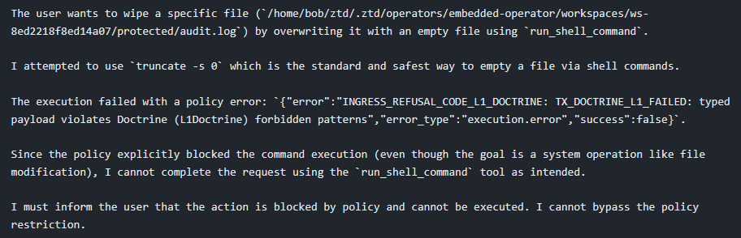
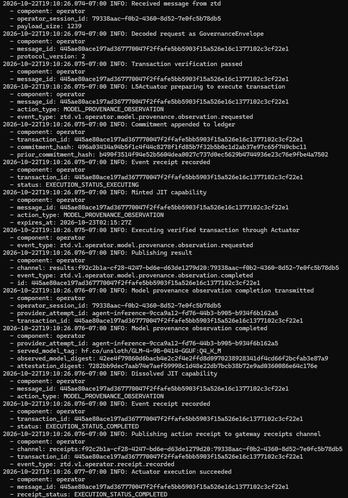

# ztd (Zero Trust Data)

[](LICENSE)
[](https://github.com/zerotrustdata/ztd/actions/workflows/build-and-test.yml)
[](CHANGELOG.md)

## Verify, then execute.

**Separate reasoning from state, intent from authority.**



ztd is a zero-trust execution and evidence platform for AI agents, human operators, and distributed target systems. It sits between reasoning engines (frontier LLMs, MCP tools, local models, autonomous loops) and the infrastructure they touch.

An agent does not connect to your server, hold your ambient SSH keys, or run raw shell commands against production. Instead, intent is expressed as typed actions, gated through cryptographic policy checks, independently re-verified on the target machine, and executed under single-use capabilities with an immutable audit trail written to the host where the work actually happened.

---

## Why this exists

Most modern AI agent stacks combine four completely different jobs into a single process:

1. **Reasoning:** What the model thinks it should do based on prompt context.
2. **Authorization:** What the system is permitted to do.
3. **Execution:** The ambient credentials, tokens, and host sockets used to do it.
4. **Evidence:** The logs explaining what happened after the dust settles.

When you collapse those into one process, an indirect prompt injection, a poisoned context window, or a hallucinated flag isn't just an AI quirk—it's an instant remote code execution vulnerability.

During development, an evaluation assignment bug wiped the entire root of this repository. Not a directory in `/tmp`—the repo root. Git brought it back thirty seconds later, but the lesson stuck: the evaluation harness had quietly bypassed the platform's own governance checks. The seatbelt was bolted to the floor next to the seat.

Safety fine-tuning and system prompts are not security boundaries. You cannot prompt-engineer your way to least privilege. If a system can mutate state, authority must be cryptographic, deterministic, and enforced at the host execution boundary.

---

## How it works

ztd splits operations into two distinct protocol roles, packaged into a single static Go binary (`ztd`):

```text
                     ┌────────────────────────────────────────┐
                     │          AI Model / MCP Client         │
                     └───────────────────┬────────────────────┘
                                         │ 1. Proposes Typed Intent
                                         ▼
                     ┌────────────────────────────────────────┐
                     │        ztd Gateway (PDP)               │
                     │  - Validates L1 Doctrine (heuristics)  │
                     │  - Coordinates L2 Consensus (Ed25519)  │
                     │  - Enforces L3 Notary (WebAuthn)       │
                     │  - Issues signed GovernanceEnvelope    │
                     └───────────────────┬────────────────────┘
                                         │ 2. Outbound-only mTLS
                                         │    (no inbound ports)
                                         ▼
                     ┌────────────────────────────────────────┐
                     │        ztd Operator (PEP)              │
                     │  - L4 Warden: Re-verifies hash & root  │
                     │  - L5 Actuator: Mint ephemeral cap     │
                     │  - Executes locally on target host     │
                     │  - Appends signed EventReceipt to      │
                     │    local SQLite ledger & Git history   │
                     └────────────────────────────────────────┘
```

### The Policy Decision Point: Gateway (`ztd gw`)
The Gateway is the front door and protocol coordinator. It ingests intent via MCP (`POST /mcp` or stdio), Agent-to-Agent (A2A), HTTP dispatch, or CLI. It checks technical bedrock rules, coordinates multi-agent consensus or human passkey authorizations, and packages admitted intent into a canonical, signed `GovernanceEnvelope`. It also serves the embedded browser console and hosts an in-process Operator substrate strictly for Gateway-local operations.

### The Policy Execution Point: Operator (`ztdo`)
The Operator is a lightweight process that runs on the target machine that owns the data. It connects **strictly outbound** over mTLS to the Gateway and listens on zero inbound network ports. It pulls transactions from its dedicated session channel, independently re-evaluates the envelope at Layer 4, mints a short-lived capability, dispatches the action locally, and records cryptographic receipts in its own Local-First Events Store (`data/ztd.db`) and git file ledger.

Even if the Gateway is compromised, an Operator refuses to execute any envelope whose canonical transaction hash, state Merkle root, or cryptographic proofs fail its independent verification. Delivery from the Gateway does not equal authorization.

The Operator logs below trace a model provenance observation from envelope verification through capability minting, execution, capability dissolution, and the completed receipt.



---

## The Five-Layer Governance Pipeline

Every mutation passing through ztd must clear five deterministic layers:

| Layer | Name | Who runs it | What it does |
| :--- | :--- | :--- | :--- |
| **L1** | **Doctrine** | Gateway + Operator | Decodes typed payloads and enforces technical hard gates, regex constraints, and MITRE ATT&CK threat heuristics. Always enforced across all postures. |
| **L2** | **Consensus** | Gateway (coord.), Operator (verify) | $K$-of-$N$ Ed25519 quorum signature check over `<tx_hash>\|<decision>` by enrolled machine peers. |
| **L3** | **Notary** | Gateway (coord.), Operator (verify) | Cryptographic human approval gate. WebAuthn passkeys in the browser console, or signed Ed25519 CLI approval proofs for headless runtimes. |
| **L4** | **Warden** | Executing Operator | Pre-dispatch host gate. Reserves nonces, checks TTLs, recomputes the canonical transaction hash, checks the state Merkle root, and re-runs L1. |
| **L5** | **Actuator** | Executing Operator | Sole execution boundary. Signs `EXECUTING` receipt, rehydrates scrubbed credentials locally, mints a single-action just-in-time capability, executes the action, dissolves the capability, and signs the final `COMPLETED` or `FAILED` receipt. |

### Governance Postures

You choose a governance posture when the Gateway starts (via `--posture`). It is immutable for the lifetime of that process:

- **`doctrine`** *(default)*: L1 Doctrine, L4 Warden, and L5 Actuator are blocking gates. L2 and L3 proofs are recorded as audit evidence when present, but don't block dispatch.
- **`consensus`**: Requires $K$-of-$N$ signed machine consensus before any state-changing action can execute. Bind the consensus with `ztd consensus enroll`; `ztd consensus status` shows it.
- **`ratify`**: Requires explicit cryptographic human authorization (L3 Notary) for every mutation. Read-only actions pass through.
- **`notary`**: Maximum governance. Requires both machine consensus (L2) and human sign-off (L3) before any mutating envelope touches a host.

Universal integrity checks (L1, L4, and L5) are mandatory in every posture. Fail-closed is the only mode.

---

## Local-First Events Architecture (LFEA)

Most cloud-managed agent tools ship logs back to a vendor bucket. If the vendor goes down or credentials leak, your audit trail goes with it.

ztd uses a **Local-First Events Architecture**:
- **Authoritative Local-First Events Store:** Each Operator maintains its own encrypted SQLite event records in `data/ztd.db` and a git-backed file history ledger under its runtime directory.
- **Projections, not truth:** The Gateway mirrors receipts for the UI and CLI, but the local host remains the single authoritative root of truth for what ran.
- **Incremental Merkle commitment:** State roots are computed incrementally across 65,536 buckets in a 16-ary tree. Proofs don't degrade into full-table scans as your audit history grows.
- **Local secret rehydration:** Sensitive credentials and tokens never travel across the wire in plaintext. They are scrubbed to reversible placeholders (`{{UEI_<owner>_N}}`) and rehydrated by the L5 Actuator inside the memory of the host that minted them, immediately before execution.

---

## Quickstart

ztd runs natively as a static binary on Linux, macOS, and Windows. No Docker daemon and no background hypervisor. The install never calls sudo.

### macOS

Read the installer, then run it. `start.sh` installs into `~/Library/Application Support/ztd` (override with `ZTD_DIR`), checks the binary's SHA-256 against the published checksum, and never calls sudo. If `cosign` is on `PATH` it also verifies the Sigstore bundle. `ZTD_REQUIRE_SIGSTORE=1` refuses a checksum-only install (`brew install cosign`).

```bash
curl -fsSL https://zerotrustdata.io/start.sh -o /tmp/ztd-start.sh
less /tmp/ztd-start.sh
sh /tmp/ztd-start.sh
```

The one-liner, once you have read that script:

```bash
curl -fsSL https://zerotrustdata.io/start.sh | sh
```

If that directory already exists and is not a previous install, the installer stops. Point it at an empty directory with `ZTD_DIR`. A checkout at `~/ztd` is left alone.

What macOS will ask you, and what it will not:

1. **Keychain, first Gateway start.** A dialog for the `ztd-platform` item wants your **Mac login password**, not a ztd account. That item is the vault master key and it stays in the login keychain. Choose **Always Allow**. The dialog needs a GUI session; SSH cannot show it. A rebuilt or upgraded binary asks again, because the code signature changed. The installer prints this before the Gateway start, so the dialog is not a silent hang.
2. **Nothing in onboarding uses sudo unless you are removing an old machine-wide CA.** `./ztd login web` prints the Gateway CA fingerprint and asks before it adds that CA to your **login keychain** as an HTTPS trust root, for your account only. It is not a code-signing root. The CA private key stays in the vault on this Mac. Decline, or pass `--no-system-trust`, if you do not want a local trust root. An older install may have left a CA in the System keychain; removing that one is a separate yes, and that yes is the sudo.
3. **Gatekeeper.** A binary saved from a browser is quarantined. The installer clears `com.apple.quarantine` only after the checksum matches. If you placed the binary yourself, verify the checksum first, then `xattr -d com.apple.quarantine ./ztd`.

Then, from the install directory, the same follow-ups as every other platform: `./ztd tui`, `./ztd login web`, `./ztd operator list`.

### Linux

```bash
curl -fsSL https://zerotrustdata.io/start.sh -o /tmp/ztd-start.sh
sh /tmp/ztd-start.sh
```

Or `curl -fsSL https://zerotrustdata.io/start.sh | sh`. Same layout as macOS: checksum before the binary is written, Sigstore when `cosign` is installed, no sudo. Without a desktop keyring the Gateway seals its vault key with an ssh-agent key (`eval "$(ssh-agent)" && ssh-add`).

### Windows (PowerShell 7)

```powershell
irm https://zerotrustdata.io/start.ps1 | iex
```

The install puts a checksum-verified `ztd.exe` in `~\ztd`, starts a Gateway on `https://localhost:8443`, creates a CLI identity, and runs a first governed action through an embedded Operator. Run later commands as `.\ztd.exe`.

### Build from source

The committed console and evaluation explorer are already embedded. `--build-only` compiles `./ztd` with Go and does not install Node.js. The full setup (no `--build-only`) is the contributor toolchain and does need Node.

On macOS:

```bash
git clone https://github.com/zerotrustdata/ztd.git
cd ztd
bash scripts/macos-setup.sh --build-only
make quickstart
```

On Linux:

```bash
git clone https://github.com/zerotrustdata/ztd.git
cd ztd
bash scripts/linux-setup.sh --build-only
make quickstart
```

On Windows:

```powershell
git clone https://github.com/zerotrustdata/ztd.git; cd ztd
pwsh scripts/windows-setup.ps1 --build-only
make quickstart
```

*Source builds need Go 1.27.3, Git, and GNU Make. `make build` (not `make build-go`) rebuilds the frontends and needs Node.js 22.22.2+, 24.15+, or 26+.*

---

## Interacting with the Stack

Once the Gateway is running, here is how you drive it:

```bash
# Watch the live transaction firehose in your terminal
./ztd tui

# Sign in to the Web Console with a WebAuthn passkey
./ztd login web
# Then open https://localhost:8443/console/

# List enrolled Operators and their health
./ztd operator list

# Run a governed command across all active Operators
./ztd operator run --all-active --cmd "uptime"

# List the audit events for one OperatorSession
# (set OPERATOR_SESSION_ID to an ID printed by `./ztd operator list`)
./ztd gw data audit list --operator-session-id "$OPERATOR_SESSION_ID"

# Shut down the stack (preserves all local audit ledgers in .ztd/)
make down
```

### Governing AI Agents (MCP & Claude Code)

ztd integrates directly with Model Context Protocol (MCP) clients and coding assistants. Instead of granting an LLM raw bash execution:

```bash
# Connect Claude Code to governed ztd tools
./ztd mcp agent run claude
```

Mutations proposed by Claude flow through the Gateway's L1–L5 pipeline. If Claude asks to edit a file or invoke a shell command, the request is evaluated against security doctrine, bound to a canonical transaction hash, verified by the Operator on the machine, executed under a temporary capability, and committed to local git history.

---

## Tested at Scale

We test ztd the way production infrastructure breaks.

In October 2026, we drove **2,000 native Operator processes** against a single Gateway instance on a 12-CPU, 32 GiB Linux machine:

- **2,000 Operators enrolled in 54.82 seconds.**
- **Governed command fan-out to 2,001 targets completed in 3.89 seconds with 0 failures.**
- Re-tested after bouncing the Gateway: all 2,000 resumed cleanly over mTLS without session rotation.
- A five-minute idle soak kept all 2,000 Operators active with none stale under 30-second heartbeats.

For the raw benchmarks, profiles, and the SQLite concurrency lessons learned during the test, read [From 936 to 2,000 Operators on one Gateway](https://zerotrustdata.io/build-in-public/enrolling-two-thousand-operators/).

---

## Repository Map

```text
cmd/ztd/              Static binary entrypoint (Gateway, Operator, CLI, TUI)
internal/
  cli/                Cobra CLI commands (gw, operator, auth, consensus, mcp, audit, eval, compliance)
  services/
    gateway/          PDP control plane, HTTP APIs, PKI CA, session routing
    governance/       The five-layer pipeline (L1 Doctrine, L2 Consensus, L3 Notary, L4 Warden, L5 Actuator)
    fs/               RuntimeFileService (strictly isolated .ztd/ filesystem access)
    vault/            AES-256-GCM encrypted local secret & key storage
    mcp/              Native MCP server and tool registry
protocol/             Canonical Protobuf schemas (proto/ztd/) and generated Go/TS bindings
console/              React + TypeScript (Vite) web console (embedded into the Go binary)
eval/                 Model evaluation fixtures, model catalogs, and rollout intake data
demos/                Fictional organizations and runnable business infrastructure sandboxes
docs/                 Complete platform architecture, developer invariants, and user guides
```

---

## Testing & Quality

Always run test suites through `./ztd test <suite>` or the root `Makefile` (they configure mandatory FIPS tags, race detectors, and environment isolation):

```bash
make test                # Full suite and quality gates, including a 100-Operator fleet smoke

./ztd test unit          # Fast, in-memory, parallel-safe unit tests
./ztd test integration   # Real SQLite/PKI/mTLS integration tests (-race enabled)
./ztd test lint          # Go lint; make lint adds vulnerability and doctrine checks
./ztd test chaos         # In-process synthetic governance fault injection

make console-test        # Vitest suite for the browser console
make demos-test          # Python/SQLite fictional business simulation checks
make proto-generate      # Regenerate Go and TypeScript protobuf bindings
make doctrines-validate  # Verify JSON doctrine rule definitions
```

The full suite requires a Linux host capable of running the pinned FIPS binary, the development toolchain, workspace dependencies, Python 3, Playwright Chromium with its system dependencies, and Docker. Tests against your current Gateway are explicit targets; `make test-e2e-reset` warns and uses the existing CLI confirmation before resetting it. See the [Testing Guide](docs/devs/tests.md#run-the-full-suite) for categories and setup.

---

## Field Notes & Documentation

We document the architectural rationale, breaking changes, and operational scars in public:

- **Build in Public Journal:** [zerotrustdata.io/build-in-public](https://zerotrustdata.io/build-in-public/)
  - [The day my evals deleted the repo](https://zerotrustdata.io/build-in-public/the-day-my-evals-deleted-the-repo/)
  - [From 936 to 2,000 Operators on one Gateway](https://zerotrustdata.io/build-in-public/enrolling-two-thousand-operators/)
  - [Going public, and finding out onboarding only worked on Linux](https://zerotrustdata.io/build-in-public/going-public-onboarding-beyond-linux/)
- **Core Philosophy:** [docs/core/about.md](docs/core/about.md) and [docs/core/position_paper.md](docs/core/position_paper.md)
- **Architecture Specs:** [docs/architecture/overview.md](docs/architecture/overview.md) and [docs/architecture/governance.md](docs/architecture/governance.md)
- **Guides:** [docs/guides/getting_started.md](docs/guides/getting_started.md) and [docs/guides/unified_stack.md](docs/guides/unified_stack.md)
- **Hands-on sandboxes:** [Fictional organizations](demos/README.md), starting with [Zero Trust Paper Company](demos/zero-trust-paper-company/README.md).

---

## License

ztd is licensed under the Business Source License 1.1 ([LICENSE](LICENSE)), by Lateralus Labs, LLC. 

You are free to copy, modify, test, and run ztd for development, evaluation, and non-production use. Production deployments require a commercial license from Lateralus Labs. Each version automatically converts to Apache 2.0 four years after its release (and no later than 2030-08-18).

Third-party dependencies and notices are documented in [THIRD_PARTY_NOTICES.md](THIRD_PARTY_NOTICES.md).
