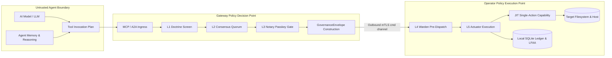

# AI Agents and the ztd Governance Boundary

## Purpose

Defines how AI agents and agentic applications interface with the ztd zero-trust governance boundary. ztd separates external coding agents (Claude Code, OpenAI Codex, Devin CLI, Gemini CLI, Goose) launched via `ztd mcp agent run` from agentic applications interacting over Model Context Protocol (MCP), Agent-to-Agent (A2A), or governed HTTP dispatch. This document establishes how agents interact with the five-layer governance pipeline (L1–L5), delineates ingress and egress boundaries, and explains why model reasoning and application memory remain strictly outside the platform trust boundary: *A model can ask, but it cannot directly act.*

## Quick index

- [Purpose](#purpose)
- [Quick index](#quick-index)
- [Invariants](#invariants)
  - [Agent Trust and Governance Boundary (`INV-AGT`)](#agent-trust-and-governance-boundary-inv-agt)
- [Owned surfaces](#owned-surfaces)
- [Procedures](#procedures)
  - [Selecting an Integration Path](#selecting-an-integration-path)
  - [Launching Agents with Governed MCP](#launching-agents-with-governed-mcp)
  - [Querying Agent Audit Trails](#querying-agent-audit-trails)
  - [Trust Boundaries and Model Memory Limits](#trust-boundaries-and-model-memory-limits)
  - [Agent Integration Matrix](#agent-integration-matrix)
  - [Agent Launcher Architecture and Tool Lockdown](#agent-launcher-architecture-and-tool-lockdown)
  - [MCP Stdio Bridge and Credential Hierarchy](#mcp-stdio-bridge-and-credential-hierarchy)
  - [Five-Layer Governance Enforcement for Agents](#five-layer-governance-enforcement-for-agents)
  - [Audit Evidence, Receipts, and Attestation](#audit-evidence-receipts-and-attestation)
  - [Production Tribunal (Intent Deliberation Pipeline)](#production-tribunal-intent-deliberation-pipeline)
- [Anti-patterns](#anti-patterns)
- [Links out](#links-out)

## Invariants

Ids are stable. Append the next free number within each group; do not renumber.

### Agent Trust and Governance Boundary (`INV-AGT`)

| ID | Rule |
| :--- | :--- |
| INV-AGT-01 | AI model outputs, prompts, and application memory are advisory only. They MUST NOT produce Ed25519 protocol signatures (L2), WebAuthn proofs, or enrolled CLI P-256 signatures (L3), and cannot satisfy governance gates. A human may approve a pending Gateway transaction with `ztd auth approve <transaction-hash> --cli` using the enrolled CLI key. All state mutations require the Gateway PDP and executing Operator PEP to enforce the active posture. |
| INV-AGT-02 | Every external agent (`claude`, `codex`, `devin`, `gemini`, `goose`) launched via `ztd mcp agent run <agent>` MUST authenticate with an owner-approved platform application enrollment (`ztd auth enroll app <agent>`) whose mTLS certificate carries both the agent's SPIFFE app identity and the approving owner's SPIFFE user identity in URI SANs. Identity MUST come from the verified certificate, never request headers. |
| INV-AGT-03 | Devin CLI does not expose native-tool disabling options. Only operations explicitly routed through ztd MCP cross the governance boundary; Devin's native file, shell, and network access remain ungoverned side channels. |
| INV-AGT-04 | `ztd mcp stdio` MUST fail closed immediately with `ErrIncompleteCredentialPair` when supplied a certificate without its corresponding private key or vice versa. Partial credential pairs MUST NOT degrade to unauthenticated access. |
| INV-AGT-05 | Agents retain native tools (shell, filesystem, network access) outside their configured MCP server unless the agent launcher or configuration actively disables them. Governance covers ONLY operations traversing ztd ingress; side channels remain agent-native. |
| INV-AGT-06 | Governed HTTP dispatch (`POST /api/v1/operators/commands`) cannot mint human L3 proofs. Under `ratify` or `notary`, when L3 proof is required, it suspends the envelope and keeps the original request open for human approval up to `mcp.ApprovalRequestTTL` (`DispatchApprovalCoordinator`), then delivers the approved envelope with the human's own proof; it never synthesizes proof and never executes standalone after the waiting request is gone. MCP/A2A submission paths suspend and return an approval response; direct envelope submission does not suspend. Direct envelopes MUST supply posture-required L2/L3 proofs and fail closed at L4 when they are missing. A doctrine violation on dispatch is refused as L1 (`ErrTxL1ValidationFailed`) in every posture, before any suspension. MCP and A2A suspend only on a missing L3 proof (`ErrTxL3ProofMissing`); an invalid proof is a rejection. Every other L4 rejection is a JSON-RPC error whose `error.data` is a `GovernanceRejection` carrying the signed rejection receipt (`INV-GOV-ACT-10`). |
| INV-AGT-07 | Third-party MCP servers (subprocess or HTTP) are governed exclusively through Gateway downstream egress with full L1–L5 governance, envelope construction, and signed receipts. `ztd mcp agent run` is a launcher only and MUST NOT serve as an external MCP reverse proxy. |
| INV-AGT-08 | The Go agent harness (`internal/tools/agent_harness/`) is a typed governed client used by evaluation and integration workflows. It contains no model, consensus, or reasoning loop and is not an agent. The production Tribunal service (`internal/services/tribunal/`) runs on the Gateway behind `POST /api/v1/operators/intents` (`INV-GW-GOV-07`) and turns a proposed `run_shell_command` call into audited typed arguments through multi-model deliberation, voting, risk analysis, and audit. Every member call is a receipted governed `INFERENCE`; it acts in front of envelope construction and is neither an L2 quorum proof nor an L3 approval. Its audited command crosses L1–L5 as an ordinary governed `MCP_CALL run_shell_command` action. The scored campaign system lane binds Primary turns and Assistant Tribunal calls to frozen formation slots; Lite remains frozen but unused, and Triage, Dash, and Codex are not scored. See `evals.md`, Model Campaign Architecture: System Lane and Model-Role Lane. |
| INV-AGT-09 | Every agent supported by the launcher MUST correspond to exactly one `agent.Integration` entry in `internal/cli/agent/registry.go`. An unrecognized agent name MUST fail closed with `ErrAgentNotFound` before Gateway startup, posture discovery, or enrollment. |

## Owned surfaces

| Surface | Path | Verify |
| :--- | :--- | :--- |
| Agent integration registry | `internal/cli/agent/registry.go`, `config.go`, `verify.go` | `ztd mcp agent list`, unit tests in `internal/cli/agent/` |
| Agent verification harness | `ztd mcp agent verify <agent>`, `internal/cli/agent/verify.go` | CI verification of lockdown without launching binaries |
| Agent launcher and stdio bridge | `internal/cli/cmd/mcp/mcp.go` | `ztd mcp agent run --help`, `internal/cli/cmd/mcp/mcp_agent_proxy_test.go` |
| MCP client configuration templates | `internal/services/mcp/config.go`, `ztd mcp agent show <agent>` | Stdio template inspection (no key paths) |
| Claude Code plugin | `claude-plugin/`, `.claude-plugin/marketplace.json` | `make claude-plugin-test` |
| MCP native tool registry | `internal/services/mcp/native_tool_registry.go` | Native tools registered explicitly in `RegisterNativeTools` |
| Tool lockdown configurations | `internal/cli/agent/config.go` (`Integration.WriteConfig`) | Per-agent tool disabling: Claude/Codex (flags), Goose (extensions), Gemini (settings), Devin (server list) |
| Go agent harness | `internal/tools/agent_harness/` | Typed Gateway client for integration and evaluation tests |
| Production Tribunal | `internal/services/tribunal/`, `internal/services/gateway/tribunal_intent.go` | `POST /api/v1/operators/intents` route registration, `internal/services/tribunal/` tests |

## Procedures

### Selecting an Integration Path

ztd provides the following integration paths for agents:

- **`ztd mcp agent run <agent>`**: Dedicated launcher providing full L1–L5 governance, automatic tool lockdown, posture-aware CLI login (under `doctrine` and `consensus` the same headless session as `ztd login`, with no browser, OS trust installation, or passkey ceremony; under `ratify` and `notary`, the launcher stays headless when the user already holds a passkey and otherwise installs OS trust and runs the passkey ceremony once, like `ztd login web`; application enrollment under those postures needs a passkey approval at the printed URL), and an enrolled application identity. For pending transactions, an authorized human may use the existing browser/passkey approval or `ztd auth approve <transaction-hash> --cli` with an enrolled CLI certificate. The Gateway constructs canonical `GovernanceEnvelope` transactions, coordinates L2/L3 when required, and produces signed receipts. Recommended for Claude Code, OpenAI Codex, Devin CLI, Gemini CLI, and Goose.
- **Claude Code Plugin (`claude-plugin/`)**: For Claude Code running inside IDEs or external shells. The plugin wires `ztd mcp stdio --app <name>` as the sole MCP server and uses a `PreToolUse` hook to deny all native tools except conversation-only utilities. Provides identical L1–L5 enforcement.
- **Gateway Downstream Egress (`--mcp-downstream-cmd` / `--mcp-downstream-url`)**: Connects third-party MCP servers as downstream targets of the Gateway. Every `tools/call` traverses the complete L1–L5 pipeline and produces signed receipts in the embedded Operator's local audit store under LFAA.
- **Direct MCP Client (`POST /mcp`)**: External MCP clients connect directly to the Gateway using enrolled mTLS credentials. The Gateway constructs envelopes, enforces L1 Doctrine, initiates L2 deliberation if required, and suspends mutations when L3 is missing. A human resolves a suspension through the existing browser/passkey flow or an enrolled CLI signature; the agent does not create either proof.
- **Agent-to-Agent (`POST /api/v1/a2a/call`)**: Inter-agent communication where skill calls are wrapped in `A2A_CALL` envelopes and governed according to the active posture.
- **Governed HTTP Dispatch (`POST /api/v1/operators/commands`)**: Enrolled applications dispatch commands directly. Does not synthesize L2 votes or L3 proofs. Under `ratify` and `notary`, a mutation that requires L3 holds the request open for a human decision up to `mcp.ApprovalRequestTTL` (INV-AGT-06).

### Launching Agents with Governed MCP

```bash
# Start the Gateway with the desired governance posture (once):
ztd gw start --posture doctrine

# Launch a supported coding agent with automatic tool lockdown and enrollment:
ztd mcp agent run claude      # Claude Code
ztd mcp agent run codex       # OpenAI Codex
ztd mcp agent run devin       # Devin CLI (partial lockdown: native tools remain active)
ztd mcp agent run gemini      # Gemini CLI
ztd mcp agent run goose       # Goose

# Pass additional execution arguments to the agent:
ztd mcp agent run claude -- -p "Fix unit test failures"

# Verify tool lockdown configuration without launching the binary (safe for CI):
ztd mcp agent verify claude

# Display the stdio MCP client configuration for manual integration:
ztd mcp agent show claude

# Govern external third-party MCP servers via Gateway downstream egress:
ztd gw start --mcp-downstream-cmd npx --mcp-downstream-args '-y,@modelcontextprotocol/server-filesystem,.ztd/tmp'
ztd gw start --mcp-downstream-url http://localhost:3000/mcp
```

### Querying Agent Audit Trails

Set `OPERATOR_SESSION_ID` to the operator session ID before running the operator-scoped commands below.

```bash
# Query audit events filtered by acting agent application SPIFFE identity:
ztd audit events --app spiffe://ztd.local/app/claude

# List signed transaction receipts filtered by agent identity:
ztd audit event-receipts --app spiffe://ztd.local/app/claude

# List audit events scoped by operator session:
ztd gw data audit list --operator-session-id "$OPERATOR_SESSION_ID"

# Display audit summary statistics for an operator session:
ztd gw data audit summary --operator-session-id "$OPERATOR_SESSION_ID"
```

### Trust Boundaries and Model Memory Limits

The platform governance model enforces strict cryptographic boundaries between agent intelligence and system execution:



- **Advisory Role**: Model reasoning, context windows, and tool plans are unverified user intent. They cannot satisfy governance gates or issue Ed25519 signatures (INV-AGT-01).
- **Gateway PDP Role**: Authenticates client mTLS identities (extracting `acting_app_id` and `requestor_user_id`), validates intent, screens L1 Doctrine, gathers L2 Consensus votes, and manages L3 human approvals.
- **Operator PEP Role**: Remote Operators pull envelopes over outbound mTLS channels (`cmd:<operator_id>:<operator_session_id>`), re-verify proofs at L4, mint single-action JIT capabilities at L5, execute the action, and record authoritative receipts locally under LFAA.
- **Boundary Limits**: Governance applies strictly to operations routed through a ztd ingress. It does not sandbox external AI processes or intercept ungoverned host processes.

### Agent Integration Matrix

| Integration Path | Ingress Format | Governance Pipeline | Target Execution |
| :--- | :--- | :--- | :--- |
| **`ztd mcp agent run`** | JSON-RPC over stdio bridge (`ztd mcp stdio`) | Full L1–L5 governance; coordinates L2 consensus and L3 notary suspensions | Embedded Operator or configured downstream MCP/A2A service |
| **Gateway Downstream Egress** | Upstream MCP `tools/call` | Full L1–L5 pipeline; posture enforcement; produces signed receipts | Downstream subprocess or HTTP MCP server |
| **Direct Gateway `/mcp`** | JSON-RPC over HTTP with mTLS | Gateway constructs `GovernanceEnvelope`; screens L1–L3; dispatches L4–L5 | Embedded Operator or downstream service |
| **A2A Ingress (`/api/v1/a2a/call`)** | JSON-RPC `a2a/call` with mTLS; mounted only when `--a2a-downstream-url` is set | Gateway constructs `A2A_CALL` envelope; screens L1–L3; dispatches L4–L5 | Registered downstream A2A service |
| **Governed HTTP Dispatch** | Serialized protobuf at `POST /api/v1/operators/commands` | Derives `action_type`; validates session; no L2/L3 synthesis; holds the request for a human L3 decision when required | Bound remote Operator PEP |
| **Direct Envelope** | Canonical `GovernanceEnvelope` at `/api/v1/governance/envelopes` | Validates envelope; verifies pre-existing L2/L3 proofs; no synthesis | Embedded Operator (or remote via dispatch) |

### Agent Launcher Architecture and Tool Lockdown

The launcher defines exact tool lockdown levels across registered agents (INV-AGT-09):
- **Claude Code (Strict)**: Launches with a temporary MCP configuration via `--mcp-config`; `--strict-mcp-config` ignores other servers; `--disallowed-tools` disables all built-in tools capable of file access, command execution, or network calls (`nativeToolsToDisable`). Only `ReportFindings`, `TaskStop`, and `ToolSearch` remain.
- **OpenAI Codex (Strict)**: Uses the same strict flags and temporary MCP configuration as Claude Code.
- **Goose (Strict)**: Injects ztd as an extension into `~/.config/goose/config.yaml` and starts with `session --no-profile --with-extension` to disable profile extensions.
- **Gemini CLI (Strict)**: Merges the ztd MCP server into `~/.gemini/settings.json` and sets `tools.core: []` (empty allowlist) to disable built-in tools.
- **Devin CLI (Partial)**: Configures `~/.config/devin/config.json` with ztd as the sole MCP server. Because Devin does not provide native tool disabling flags, the launcher emits a warning. Devin native tools remain ungoverned side channels (INV-AGT-03).

### MCP Stdio Bridge and Credential Hierarchy

`ztd mcp stdio` bridges standard input/output to the Gateway's authenticated HTTPS endpoint:
1. Resolves credentials in strict order (first complete pair wins):
   - `--app <name>`: Managed application certificates (`.ztd/apps/<name>.crt`, `.ztd/apps/<name>.key`; the key is sealed and unsealed in memory).
   - `--client-cert` and `--client-key`: Explicit CLI flags.
   - Default CLI credentials on disk (`.ztd/cli.crt`, `.ztd/cli.key`; the key is sealed and unsealed in memory).
2. Fails closed immediately if a certificate or private key is missing (`ErrIncompleteCredentialPair`, INV-AGT-04).
3. Proxies tool calls over TLS 1.3 mTLS. A suspended call returns a typed `suspension` (`GovernedSuspension`) in its `tools/call` result. The bridge reads `suspension.tx_hash` and `suspension.approval_url`, opens the approval URL, and waits for the `approval.completed` event over the Gateway SSE stream. The event carries the signed receipt of the resumed transaction, and the bridge returns it as the `tools/call` result. The bridge never re-sends the original request, because a re-send would open a new envelope and transaction.
4. Proxies every request, `initialize` included, to the Gateway's `/mcp` route: the Gateway negotiates the protocol version and advertises the served tools, so the bridge answers no MCP method locally. The default endpoint is the Gateway the CLI addresses (`-e/--endpoint` and `--port`, else the ports the local Gateway bound) with `/mcp` appended; `--gateway-url` overrides it and accepts only `https`.
5. Bounds one proxied request by `gatewayCallTimeout`, the Gateway's dispatch wait (`gateway.DispatchTimeout`) plus a margin, so a slow `tools/call` returns the Operator's signed answer rather than a bridge transport error. The L3 approval wait is separate and event-driven.

An MCP client runs the bridge as a subprocess: command `ztd`, args `["mcp", "stdio"]` (add `"--app", "<name>"` for an app identity), with the project root as working directory. `ztd mcp agent show <agent>` prints the configuration for a supported agent ([Connect apps to the Gateway](../guides/connect_apps_to_gateway.md)). The conformance suite's `MCP_STDIO` ingress drives this same bridge ([evaluation architecture](evals.md#governance-conformance-suite)).

### Five-Layer Governance Enforcement for Agents

Every agent tool call crossing the boundary is subject to the five-layer pipeline:
1. **L1 Doctrine**: Scans tool arguments and payloads against regex patterns and MITRE threat rules.
2. **L2 Consensus**: Evaluates K-of-N Ed25519 machine signatures from the bound consensus members under `consensus` and `notary` postures.
3. **L3 Notary**: Suspends mutation actions for human approval under `ratify` and `notary` postures. Gateway L3 accepts a passkey assertion or an enrolled CLI P-256 signature; neither proof can come from model output. An outbound Operator re-verifies the same human proof itself ([Governance Architecture](governance.md#layer-3-l3-notary-human-authorization)).
4. **L4 Warden**: Reserves the transaction nonce in SQLite, verifies expiration, recomputes the transaction hash, and validates state Merkle root.
5. **L5 Actuator**: Logs an initial `EXECUTING` receipt, mints a single-action capability, dispatches the tool call, dissolves the capability, captures the final state root, and signs the `COMPLETED` or `FAILED` receipt.

### Audit Evidence, Receipts, and Attestation

Every admitted tool execution produces a signed `ActionReceipt` containing:
- Canonical transaction identifier and SHA-256 hash.
- Initial and final state Merkle roots.
- L2 Consensus and L3 Notary verification outcomes.
- Execution status (`COMPLETED` or `FAILED`) and typed error codes.
- `ReceiptPersistenceAttestation` signed by the Actuator's private key, proving local database persistence.

Event receipts are persisted authoritatively on the executing Operator's local `events` chain. Mirrored event receipts at the Gateway provide query access via `ztd audit event-receipts --app <spiffe-id>`.

The `audit_receipt_list` and `audit_receipt_get` tools read the executing runtime's own audit store. Through the Gateway's MCP endpoint, `audit_receipt_list`'s optional `investigation_id` filter intersects the required `operator_session_id` scope, and remote Operator records there remain best-effort projections. Dispatched to an outbound Operator as `MCP_CALL`, both return that Operator's authoritative local receipts. Evaluation's built-in model-role executor has a separate governed route to the selected Operator's own `audit_receipt_list` handler. That route requires an investigation ID and `exclude_audit_reads`, which drops only the audit-read tools' own receipts so that `run_shell_command` and other native-tool receipts stay investigation context; it returns only the Operator's authoritative local receipts and does not fall back to Gateway projections. `audit_receipt_list` also accepts an `action_type` filter, a `not_before` RFC 3339 lower bound on execution time, and `limit` (default 50) and `offset` pagination, and returns only signed receipt records with their `count`; `audit_receipt_get` returns one signed receipt by `transaction_id`. See the [evaluation architecture](evals.md#model-campaign-architecture-system-lane-and-model-role-lane) for its campaign binding and trace evidence.

MCP `tools/call` and A2A `a2a/call` return that signed `ActionReceipt` as canonical protojson, not as a reference. The execution and investigation IDs are inside the receipt's envelope and payload. A suspended call returns one `GovernedSuspension` (`id`, `status`, `tx_hash`, `approval_url`, `message`) on both ingresses. Only a missing L3 proof suspends. An invalid L3 proof returns a signed `L3_PROOF_INVALID` rejection (`INV-GOV-ACT-13`).

Every JSON-RPC error from `POST /mcp` and `POST /api/v1/a2a/call` carries a typed `error.data`: exactly one of `GovernanceRejection` (a signed L4 rejection) or `IngressRefusal{code, error}` (every other refusal, `INV-GOV-ACT-11`). The JSON-RPC `error.message` is the sentinel text only, never a wrapped error chain, path, or `err.Error()`. The JSON-RPC `error.code` values are unchanged.

### Production Tribunal (Intent Deliberation Pipeline)

The production Tribunal service (`internal/services/tribunal/`) runs on the Gateway behind `POST /api/v1/operators/intents` (`INV-GW-GOV-07`). It authors typed `run_shell_command` arguments from the proposed call before envelope construction and governed dispatch. Clients, including evaluation campaigns, send the intent and a member inference template; they never run the Tribunal in-process:
1. **Sealed Candidate Generation**: Five sealed member personas (Axiom, Concord, Variance, Pragma, Nemesis) independently propose JSON objects containing one executable `command` and ordered `args` via governed `INFERENCE` dispatches on the assigned model variant, with each call recording its own signed receipt.
2. **Consensus Voting**: Strictly decodes candidates and clusters their canonical argument JSON without rewriting model output. Gateway-owned timeout and working directory are composed before voting and review. Invalid answers abstain. A cluster is selected if it achieves `MinConsensus` (at least 2 matching members). If no cluster achieves consensus, a second anonymized deliberation and revote round is conducted.
3. **Marshal Risk Assessment**: Evaluates the consensus command against operation risk criteria (`LOW`, `MEDIUM`, or `HIGH`). `HIGH` risk returns outcome `TRIBUNAL_OUTCOME_BLOCKED` with the risk rationale and feedback, and dispatches nothing. Evaluation campaign clients classify a second consecutive block as an agent conflict (`internal/services/evaluation/campaign_tribunal_authoring.go`).
4. **Technical Audit**: The Auditor persona reviews the consensus command (`APPROVE`, `REVISE`, or `SWAP`). When a `REVISE` or `SWAP` changes the command, Marshal assesses the changed command before it can be approved, and a `HIGH` assessment blocks it the same way.
5. **Governed Dispatch**: Only the approved, audited command is dispatched by the Gateway through `DispatchService.Dispatch` as an ordinary governed `MCP_CALL run_shell_command` under the caller's identity, so posture-required L2 quorum and L3 human approval apply unchanged. The Tribunal acts in front of envelope construction and does NOT substitute for or impersonate L2 consensus quorum proofs or L3 approvals. The `TribunalIntentResult` returns the persona steps, every member call with its receipt, the exact approved argument JSON, and the call's governed outcome.

Every member call carries a JSON response format whose schema is the shape its strict decoder accepts (`internal/services/tribunal/schema.go`). A candidate and a `REVISE` carry only the authored `{command, args}`; the Gateway owns timeout and working directory. Marshal answers `{risk, rationale}` with optional `feedback`. The Auditor schema has one branch per verdict, and offers the `SWAP` branch only when the panel split into alternative clusters. The schema guides the provider's output but does not replace the decoder: a provider that ignores it still fails closed. Marshal treats an invalid answer as `HIGH`, and the Auditor's answer counts as an invalid attempt.

## Anti-patterns

- **Treating Model Reasoning as Protocol Proof**: Assuming LLM approval or structured output satisfies L2 Consensus or L3 Notary gates (INV-AGT-01).
- **Supplying Incomplete Credential Pairs**: Passing `--client-cert` without `--client-key` to `ztd mcp stdio`, expecting fallback to unauthenticated access (INV-AGT-04).
- **Using `agent run` as an External Reverse Proxy**: Attempting to route arbitrary third-party MCP traffic through `ztd mcp agent run` instead of configuring Gateway downstream egress (INV-AGT-07).
- **Dispatching Mutations via HTTP Under Notary Posture**: Sending unapproved mutations to `POST /api/v1/operators/commands` under `ratify` or `notary` postures. The HTTP dispatch path blocks until a human approves, denies, or the approval expires (INV-AGT-06); an agent that does not expect a request held for up to `mcp.ApprovalRequestTTL` plus the dispatch deadline will time out.
- **Relying on Devin for Complete Governance**: Assuming Devin CLI is fully contained when it retains native shell and network access outside MCP (INV-AGT-03, INV-AGT-05).
- **Treating SSE Streams as Durable Governance State**: Relying on SSE event delivery as authoritative execution proof. SSE is delivery telemetry; local SQLite audit records under LFAA are authoritative.

## Links out

- [Gateway Architecture](gateway.md): Policy Decision Point, operational modes, MCP endpoint, and HTTP routing.
- [Operator Architecture](operator.md): Policy Execution Point, outbound mTLS transport, native tools, and L4/L5 execution.
- [Governance Architecture](governance.md): Five-layer verification pipeline, posture enforcement rules, and receipt attestation.
- [Consensus Architecture](consensus.md): Protocol L2 machine consensus, bound-member Ed25519 deliberation, and verification mechanics.
- [Authentication Architecture](auth.md): mTLS identities, platform application enrollments, CLISession records, and WebAuthn ceremonies.
- [Network Architecture](network.md): PKI hierarchy, TLS 1.3/mTLS configurations, and pub/sub transport channels.
- [Storage Architecture](storage.md): SQLite persistence, audit vaults, evidence chains, and commitment ledgers.
- [SSE Streaming](sse.md): Server-Sent Events architecture for approval notifications and live telemetry.
- [Events Architecture](events.md): Canonical event taxonomy, routing keys, and action-type derivation.
