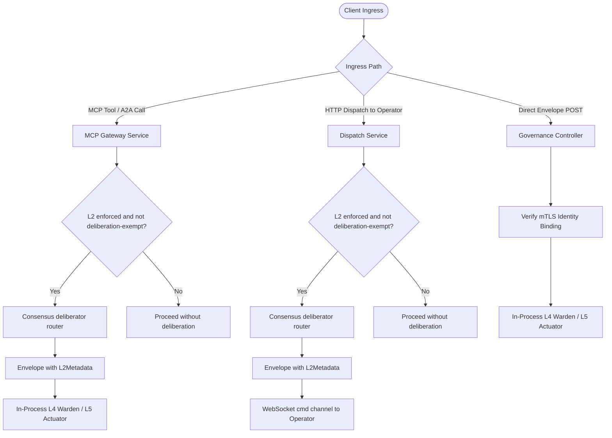

# Consensus Architecture

## Purpose

Defines ztd's Layer 2 (L2) machine consensus architecture: the bound consensus provider that produces K-of-N Ed25519 votes over an envelope's transaction hash, the two providers (`application` and `tribunal`), enrollment and binding of consensus members through `PLATFORM_ENROLLMENT_BIND_CONSENSUS`, the Tribunal vote contract and deliberation attestation exemption, HTTPS protobuf deliberation for the `application` provider, L4 Warden and outbound Operator (`OperatorL2Trust`) signature verification, and L5 Actuator receipt evidence. Every member is an enrolled application with an enabled Ed25519 signer. The `tribunal` provider's members are the Gateway-hosted Tribunal panel, which votes with its sealed app signing keys. The `application` provider's members are third-party applications reached over HTTPS. Binding records the provider, member IDs, quorum, and (for `tribunal`) the pinned model through the governed L5 handler.

## Quick index

- [Purpose](#purpose)
- [Quick index](#quick-index)
- [Invariants](#invariants)
  - [Application Enrollment and Binding (`INV-CON-POL`)](#application-enrollment-and-binding-inv-con-pol)
  - [Deliberation and Proof Production (`INV-CON-VOTE`)](#deliberation-and-proof-production-inv-con-vote)
  - [L4 Verification and Authorization (`INV-CON-WARD`)](#l4-verification-and-authorization-inv-con-ward)
  - [Receipt and Audit Evidence (`INV-CON-RCPT`)](#receipt-and-audit-evidence-inv-con-rcpt)
- [Owned surfaces](#owned-surfaces)
- [Procedures](#procedures)
  - [Place in the Five-Layer Interlock](#place-in-the-five-layer-interlock)
  - [Consensus Providers and Binding](#consensus-providers-and-binding)
  - [Tribunal Consensus Enrollment](#tribunal-consensus-enrollment)
  - [Consensus Application Enrollment and Binding](#consensus-application-enrollment-and-binding)
  - [Application Provider Deliberation Mechanics](#application-provider-deliberation-mechanics)
  - [Tribunal Provider Vote Mechanics](#tribunal-provider-vote-mechanics)
  - [Gateway Ingress Deliberation Routing](#gateway-ingress-deliberation-routing)
  - [L4 Warden and Outbound Operator Verification](#l4-warden-and-outbound-operator-verification)
  - [Receipt Evidence and Deterministic Stages](#receipt-evidence-and-deterministic-stages)
- [Anti-patterns](#anti-patterns)
- [Links out](#links-out)

## Invariants

Ids are stable. Append the next free number within each group; do not renumber.

### Application Enrollment and Binding (`INV-CON-POL`)

| ID | Rule |
| :--- | :--- |
| INV-CON-POL-01 | Consensus members are ordinary enrolled applications (`PLATFORM_COMPONENT_KIND_APPLICATION`). Every member MUST enroll through the standard platform workflow, receiving its mTLS client certificate and registering its Ed25519 public key in `trusted_signers`. The binding's `provider` decides where votes come from. The `application` provider's members are third-party applications reached over HTTPS. A Gateway-hosted `tribunal` provider is allowed as a second provider, selected by the same binding; its members vote with sealed app signing keys held by the Gateway host. |
| INV-CON-POL-02 | The Gateway MUST record at most one bound consensus policy (`constants.DocIDConsensusBinding` in `constants.CollectionConsensus`), with unique actor-owned enrolled signing applications and a quorum from one through the member count (`application`) or as INV-CON-POL-07 states (`tribunal`). The bound policy's primary application ID (`app_id` / `PrimaryAppID()`) designates the target application for HTTPS deliberation dispatch under the `application` provider, and is `tribunal-axiom` under the `tribunal` provider. |
| INV-CON-POL-03 | Binding a consensus member set MUST traverse the governance pipeline as the bootstrap action `PLATFORM_ENROLLMENT_BIND_CONSENSUS` (`POST /api/v1/auth/platform-enrollments/consensus`), validating every member's ownership, existing enrollment policy, and enabled `TrustedSigner` in the Gateway's signer store. |
| INV-CON-POL-04 | `PLATFORM_ENROLLMENT_BIND_CONSENSUS` is a mutation that is NOT exempt from L3 via `_authorized_by_decision`: it MUST require L3 human authorization under `ratify` and `notary` postures (`posture.RequiresL3() == true`). |
| INV-CON-POL-05 | Outbound Operators MUST receive each bound consensus member's identity and Ed25519 public key in their signed enrollment bundle and in-band certificate renewal bundle (`OperatorL2Trust`). |
| INV-CON-POL-06 | The binding's `provider` MUST be `application` or `tribunal` (`constants.ParseConsensusProvider`). An empty stored or requested value decodes as `application`, so bindings written before providers existed remain valid without migration. `models.ResolveConsensusBinding` is the single validator for both providers and MUST run at Gateway admission and in the L5 handler. An `application` binding MUST carry an absolute HTTPS `endpoint_url` (INV-CON-VOTE-04 TLS rules apply) and MUST NOT pin a model. A `tribunal` binding MUST NOT carry an endpoint and MUST pin both `model_tag` and `model_digest`. |
| INV-CON-POL-07 | A `tribunal` binding MUST bind exactly the five canonical Tribunal member application IDs in canonical order (`constants.TribunalConsensusMemberAppIDs`): `tribunal-axiom` (primary), `tribunal-concord`, `tribunal-variance`, `tribunal-pragma`, `tribunal-nemesis`. Its quorum MUST be from 3 through 5 and defaults to 3 when omitted. Each member MUST pass the per-member owner and enabled `TrustedSigner` checks of INV-CON-POL-03. Each member's private key MUST be sealed on the Gateway host. A `tribunal-*` application enrolled on another host cannot vote here and fails closed. |
| INV-CON-POL-08 | Rebinding MUST re-run the bind. `PLATFORM_ENROLLMENT_BIND_CONSENSUS` replaces the single bound record at `constants.DocIDConsensusBinding`, and every rebind remains L3-gated under `ratify` and `notary` (INV-CON-POL-04). No governed unbind exists. Disabling a member application through the existing application revoke disables its trusted signer, and consensus MUST then fail closed while enabled members are fewer than the quorum. |

### Deliberation and Proof Production (`INV-CON-VOTE`)

| ID | Rule |
| :--- | :--- |
| INV-CON-VOTE-01 | Each consensus member application MUST recompute the canonical transaction hash from envelope fields (`governance.GenerateMessageID`) and verify `envelope.Id` and `envelope.TransactionHash` before signing a decision. |
| INV-CON-VOTE-02 | Every `L2Vote.consensus_signature` in the envelope's `L2Metadata` MUST be an Ed25519 signature by the bound member application named in that vote's `L2Vote.signer_key_id`, over the canonical UTF-8 payload `<transaction_hash>\|<decision>`, where `<decision>` is the vote's `L2Vote.decision` (`true` or `false`), encoded as a hex string; L2 accepts only K distinct affirmative member signatures. |
| INV-CON-VOTE-03 | When the bound provider is `application`, the Gateway MUST transmit the full `GovernanceEnvelope` serialized as `application/x-protobuf` to the bound HTTPS deliberation endpoint (`endpoint_url`, hosted by the primary member) and receive back the envelope populated with member votes in its `L2Metadata` block. |
| INV-CON-VOTE-04 | When the bound provider is `application`, deliberation TLS verification MUST validate the server certificate chain against Gateway-owned CA trust and verify the exact bound application SPIFFE URI (`spiffe://ztd.local/app/<app_id>`) in the SAN. Deliberation MUST NOT rely on system Web PKI roots or DNS SANs. |
| INV-CON-VOTE-05 | The `tribunal` provider MUST produce each member's vote through exactly one governed `INFERENCE` dispatched by `DispatchService.DispatchInference` on the binding's pinned `model_tag` and `model_digest`, under the member's own app identity (`ActingAppID`) and the owner of the member application's policy (`RequestorUserID`). Members MUST be asked in canonical order, in concurrent batches sized to the affirmative votes still needed, so a batch never exceeds K. Votes MUST be signed and recorded in canonical order within each batch. |
| INV-CON-VOTE-06 | A member's answer MUST decode strictly as `{"decision":"approve"\|"deny","reason":"..."}` (`tribunal.ParseConsensusVote`). Only a strict `approve` produces an affirmative vote. Invalid JSON or any other decision value MUST produce a signed deny vote. |
| INV-CON-VOTE-07 | A member whose vote inference fails, whose application policy or owner cannot be read, or whose sealed signing key is unavailable (`ErrConsensusMemberKeyUnavailable`) MUST cast no vote. No vote is signed for it, and no plaintext key fallback exists. |
| INV-CON-VOTE-08 | Each `tribunal` member vote MUST sign `L2VotePayload(<transaction_hash>, decision)` with the member's sealed Ed25519 key over the transaction hash recomputed by `governance.GenerateMessageID`. A hash mismatch or an undecodable envelope MUST return an error and sign nothing. |
| INV-CON-VOTE-09 | The `tribunal` deliberator MUST stop collecting votes when K affirmative votes are reached, or when K can no longer be reached. It MUST return the envelope with only the `governance.L2` metadata changed, with `consensus_set_id` set to the binding ID. A short quorum is rejected at L4 (`ErrTxL2QuorumNotMet`) and MUST NOT be synthesized. |
| INV-CON-VOTE-10 | The Tribunal shell-authoring deliberation MUST NOT supply L2 votes or pre-vote. Each L2-gated envelope, including a Tribunal-approved shell command, is voted independently over its own final transaction hash. |
| INV-CON-VOTE-11 | The `tribunal` deliberator MUST record every member it asks, before that vote counts, as one hash-chained Gateway audit event `ztd.v1.consensus.vote.recorded` keyed by the envelope's transaction ID. The event content is a `models.ConsensusVoteRecord`: member, outcome (`approve`, `deny`, or `no_vote`), the member's own reason, and the failure behind an invalid-answer deny or a missing vote. A vote whose record cannot be written MUST NOT count. `GET /api/v1/audit/consensus-votes?tx_id=` and `ztd audit votes --tx` read the records, with reason and failure text scrubbed. |

### L4 Verification and Authorization (`INV-CON-WARD`)

| ID | Rule |
| :--- | :--- |
| INV-CON-WARD-01 | The L4 Warden (`L4Warden.verifyL2Posture`) MUST verify each `L2Vote.consensus_signature` in `L2Metadata` against the recomputed transaction hash rather than trusting the envelope's declared identifier. The single exception is a witness-bound observation (INV-CON-WARD-09), whose votes are verified against the parent hash its own hashed payload names. |
| INV-CON-WARD-02 | Both Gateway in-process L4 verification and outbound Operator L4 verification (`OperatorL2Trust`) MUST verify each `L2Vote.consensus_signature` against the Ed25519 public key of the bound member named by `L2Vote.signer_key_id`, from `trusted_signers` / the Operator enrollment bundle. |
| INV-CON-WARD-03 | Evaluation MUST accept only affirmative (`decision=true`) signatures verified against enabled member `TrustedSigner` public keys, meeting the stored quorum. A negative decision authenticates dissent and does not count toward quorum. |
| INV-CON-WARD-04 | Bootstrap action types (`actionType.IsBootstrapAction()`) MUST be exempt from L2 gating across all postures, permitting initial enrollment and `PLATFORM_ENROLLMENT_BIND_CONSENSUS` transactions to succeed before a consensus application is bound. |
| INV-CON-WARD-05 | Under `consensus` and `notary` postures (`posture.RequiresL2() == true`), a missing `L2Metadata` proof, an unbound consensus policy, insufficient affirmative member signatures, or a negative decision MUST reject the transaction fail closed. Only a deliberation-exempt envelope (INV-CON-WARD-07) is exempt from the missing-proof rejection. Under `doctrine` and `ratify` postures, L2 proofs are evaluated for deterministic audit evidence without gating transaction admission. |
| INV-CON-WARD-06 | Under `consensus` and `notary` postures, an `L2Vote.consensus_signature` from a bound member that fails verification MUST reject the transaction with `ErrTxL2SignatureInvalid` (`L2_SIGNATURE_INVALID`). Votes from signers outside the bound member set are ignored and count toward neither quorum nor rejection. |
| INV-CON-WARD-07 | The deliberation attestation (`L2Metadata.deliberation`, `L2DeliberationAttestation`) is the only exemption from L2 gating. It MUST NOT be granted by caller identity, ingress path, or action type alone. `governance.L2DeliberationExempt` holds only when the action type is `INFERENCE`, `PROVIDER_BOUNDARY_OBSERVATION`, or `MODEL_PROVENANCE_OBSERVATION`, `L2Metadata.votes` is empty, and `L2Metadata.parent_transaction_hash` is empty. L4 verifies the attestation in every posture. The signer MUST be a member of a bound `tribunal` consensus, MUST be an enabled trusted signer (on an outbound Operator, an entry in `OperatorL2Trust` also qualifies), and its Ed25519 signature MUST verify over `<tx_hash>\|consensus-deliberation` (`governance.L2DeliberationPayload`) against the recomputed transaction hash. Any failure, and any attestation on an envelope that is not exempt, MUST reject with `ErrTxL2SignatureInvalid`. A vote signature is never valid as an attestation, and an attestation is never valid as a vote. |
| INV-CON-WARD-08 | Only the in-process `TribunalConsensusDeliberator` MUST request an attestation. `Dispatch` and `DispatchObservation` attach it only to envelopes built under the unexported context mark `withConsensusDeliberation`, which no ingress path can set. Every Gateway deliberation site MUST skip deliberation for a deliberation-exempt envelope, which stops recursion. |
| INV-CON-WARD-09 | A witness binding (`L2Metadata.parent_transaction_hash`) lets a `PROVIDER_BOUNDARY_OBSERVATION` or `MODEL_PROVENANCE_OBSERVATION` command carry its parent `INFERENCE`'s L2 votes instead of being voted on itself. It is not an exemption: the observation records `L2_STATUS_REQUIRED_VALID` only when the parent quorum verifies. `governance.L2WitnessBound` holds only for those two action types with a parent hash and no deliberation attestation. `governance.VerifyL2WitnessBinding` MUST prove that the command payload's `inference_transaction_id` equals the parent hash. The payload is covered by the observation's own transaction hash and nonce. L4 then verifies the votes against the parent hash exactly as INV-CON-WARD-02 through INV-CON-WARD-06 require. L4 runs this check in every posture, and any failure MUST reject with `ErrTxL2SignatureInvalid`. A parent hash on any other action, alongside a deliberation attestation, or naming another inference, is never audit-only. A witness binding and a deliberation attestation are mutually exclusive. |
| INV-CON-WARD-10 | Only `DispatchService.Dispatch` MUST attach a witness binding. It does so after the parent `INFERENCE` holds its admission proofs and before it is published, by running `DispatchRequest.OnAdmitted` under the unexported context mark `withWitnessParent`. No ingress path can set that mark. `DispatchObservation` attaches the parent's votes only under that mark (`attachWitnessBinding`), and it skips deliberation for a witness-bound envelope. A Tribunal member's vote inference carries a deliberation attestation and is never marked as a witness parent. |

An absent L2 proof (or empty L2 metadata with no set ID) yields `L2_PROOF_MISSING`. A proof naming an enabled, known set with fewer than K affirmative member votes yields `L2_QUORUM_NOT_MET`. A proof naming an unknown or disabled set yields `L2_CONSENSUS_SET_UNKNOWN`. All of these reject execution when L2 is enforced.

### Receipt and Audit Evidence (`INV-CON-RCPT`)

| ID | Rule |
| :--- | :--- |
| INV-CON-RCPT-01 | The L4 Warden decides the L2 status once and the L5 ActionReceipt `L2Status` field MUST copy it: `L2_STATUS_REQUIRED_VALID` when an L2 proof is present and verified (also where L2 is not enforced, as audit evidence), `L2_STATUS_REQUIRED_FAILED` when L2 is enforced and fails, or `L2_STATUS_NOT_REQUIRED` when L2 is not enforced for the action (the posture does not require it, or the action is bootstrap-exempt), when the envelope is deliberation-exempt under INV-CON-WARD-07, and when no valid proof is present. L5 never recomputes it from posture. |
| INV-CON-RCPT-02 | L4 verification MUST produce `DeterministicStageEvidence` for protocol L2 recording stage outcome (`VERIFIED`, `FAILED`, or `NOT_REQUIRED`) and the SHA-256 `L2SignatureDigest` over the sorted, canonically encoded set of `L2Vote.consensus_signature` values and the `L2DeliberationAttestation` signature when present. |
| INV-CON-RCPT-03 | A deliberation-exempt envelope MUST record `L2_STATUS_NOT_REQUIRED` and protocol L2 stage outcome `NOT_REQUIRED`, even under `consensus` or `notary` and even though its attestation verified. Its L2 stage evidence MUST carry the attestation signer key ID (`SignerKeyId`). |

## Owned surfaces

| Claim | Path | Verify |
| :--- | :--- | :--- |
| Consensus binding model | `protocol/models/consensus.json`, `internal/models/auth.go` (`ConsensusPolicy`) | Schema validation and `consensus_store_service_test.go` |
| Consensus binding document store | `internal/services/gateway/consensus_store_service.go` (`constants.DocIDConsensusBinding` in `constants.CollectionConsensus`) | Unit tests in `consensus_store_service_test.go` |
| Consensus provider and Tribunal member IDs | `internal/constants/consensus.go` (`ConsensusProvider`, `TribunalConsensusMemberAppIDs`) | `internal/constants/consensus_test.go` |
| Consensus application enrollment & binding | `internal/services/gateway/platform_enrollment_service.go`, `platform_enrollment_controller.go`, `internal/services/pubsub/platform_enrollment_handlers.go` | `POST /api/v1/auth/platform-enrollments/consensus` (`PLATFORM_ENROLLMENT_BIND_CONSENSUS`) |
| Consensus binding resolution (Gateway admission and L5 write) | `internal/models/consensus_binding.go` (`ResolveConsensusBinding`, `ResolveConsensusMembership`) | Unit tests in `consensus_binding_test.go` |
| Tribunal vote producer and provider router | `internal/services/gateway/tribunal_consensus_deliberator.go` (`TribunalConsensusDeliberator`, `consensusDeliberatorRouter`) | `tribunal_consensus_deliberator_test.go`, `consensus_deliberation_integration_test.go` |
| Tribunal vote prompt and strict decoder | `internal/services/tribunal/consensus_vote.go` (`ConsensusVotePrompt`, `ParseConsensusVote`), `internal/services/tribunal/types.go` (`ConsensusMemberAppID`) | `consensus_vote_test.go`, `consensus_member_test.go` |
| Member vote records and reads | `internal/models/consensus_vote.go` (`ConsensusVoteRecord`), `internal/services/gateway/audit_controller.go` (`handleAuditConsensusVotes`), `internal/cli/operator/consensus_votes.go` (`ztd audit votes`, votes on an `operator run` `L2_QUORUM_NOT_MET` rejection) | `TestTribunalConsensusRecordsEveryMemberVote`, `TestAuditController_EventsAndReportNeverReturnRawContent`, `consensus_votes_test.go` |
| Tribunal member signer | `internal/cli/auth/tribunal_consensus_signer.go` (`TribunalConsensusSigner`) | `tribunal_consensus_signer_integration_test.go` |
| Deliberation attestation payload, exemption, and verification | `internal/services/governance/l2_consensus.go` (`L2DeliberationPayload`, `L2DeliberationExempt`, `verifyL2Deliberation`) | `l4_warden_consensus_test.go` |
| Deliberation attestation attach | `internal/services/gateway/dispatch_service.go` (`withConsensusDeliberation`, `ConsensusMemberSigner`) | `dispatch_service_test.go` |
| Witness binding claim and verification | `internal/services/governance/l2_consensus.go` (`L2WitnessBound`, `VerifyL2WitnessBinding`) | `l4_warden_witness_test.go` |
| Witness binding attach | `internal/services/gateway/dispatch_service.go` (`DispatchRequest.OnAdmitted`, `withWitnessParent`, `attachWitnessBinding`) | `witness_binding_test.go` |
| L2 wire fields | `protocol/proto/ztd/common/v1/common.proto` (`L2DeliberationAttestation`, `L2Metadata.deliberation`, payload `consensus_provider`, `consensus_model_tag`, `consensus_model_digest`) | `make proto-generate` |
| L4 Warden L2 verification & `OperatorL2Trust` | `internal/services/governance/l2_consensus.go`, `internal/services/governance/l4_warden.go` | Integration tests in `l4_warden_consensus_test.go` |
| L5 Actuator receipt evidence | `internal/services/governance/l5_actuator.go` | Receipt tests in `l4_warden_test.go` |
| Ingress deliberation integration | `internal/services/mcp/gateway.go`, `internal/services/gateway/dispatch_service.go` | End-to-end tests in `test/l2_consensus_integration_test.go` |

## Procedures

### Place in the Five-Layer Interlock

L2 Consensus occupies the second layer of the platform governance interlock:
1. **L1 Doctrine**: Decodes payload and executes static regex screening and MITRE threat detection.
2. **L2 Consensus**: Verifies K distinct bound-member Ed25519 signatures over `<transaction_hash>|<decision>`, or a verified deliberation attestation for a deliberation-exempt envelope.
3. **L3 Notary**: Verifies human authorization proofs (a WebAuthn passkey assertion or an enrolled CLI certificate's ECDSA P-256 signature) for mutating actions.
4. **L4 Warden**: Executes pre-dispatch verification (replay check, hash match, state root, L1-L3 proofs).
5. **L5 Actuator**: Mints single-action JIT capabilities, executes actions, and writes local signed receipts.

`constants.Posture.RequiresL2()` (`internal/constants/posture.go`) governs whether L2 verification gates execution:

| Posture | `posture.RequiresL2()` | L2 Gate Status | Receipt `L2Status` Value | Deterministic Stage Outcome |
| :--- | :--- | :--- | :--- | :--- |
| **`doctrine`** | `false` | Non-gating (audited only) | `L2_STATUS_REQUIRED_VALID` (if valid) or `L2_STATUS_NOT_REQUIRED` | `DETERMINISTIC_STAGE_OUTCOME_VERIFIED` (if valid) or `NOT_REQUIRED` |
| **`consensus`** | `true` | Strictly required for non-bootstrap | `L2_STATUS_REQUIRED_VALID` (`L2_STATUS_REQUIRED_FAILED` on rejection) | `DETERMINISTIC_STAGE_OUTCOME_VERIFIED` (`FAILED` on rejection) |
| **`ratify`** | `false` | Non-gating (audited only) | `L2_STATUS_REQUIRED_VALID` (if valid) or `L2_STATUS_NOT_REQUIRED` | `DETERMINISTIC_STAGE_OUTCOME_VERIFIED` (if valid) or `NOT_REQUIRED` |
| **`notary`** | `true` | Strictly required for non-bootstrap | `L2_STATUS_REQUIRED_VALID` (`L2_STATUS_REQUIRED_FAILED` on rejection) | `DETERMINISTIC_STAGE_OUTCOME_VERIFIED` (`FAILED` on rejection) |

### Consensus Providers and Binding

The single bound consensus record at `constants.DocIDConsensusBinding` names a `provider`, which selects the vote producer:

| Provider | Vote producer | Members | Binding command |
| :--- | :--- | :--- | :--- |
| `application` | Member applications behind an HTTPS deliberation endpoint (`ConsensusAppDeliberator`) | Enrolled applications named by repeatable `--member-app`, with `--quorum K` | `ztd consensus enroll app <primary> <https-endpoint>` |
| `tribunal` | Gateway-hosted Tribunal panel (`TribunalConsensusDeliberator`) | `tribunal-axiom` through `tribunal-nemesis`, canonical (INV-CON-POL-07) | `ztd consensus enroll tribunal --model <tag> [--quorum 3]` |

Consensus management commands:
- `ztd consensus status` shows the bound provider, members, quorum, model, posture, and whether L2 is enforced.
- Rebinding re-runs the enroll command for the chosen provider. The new bind replaces the bound record and is L3-gated under `ratify` and `notary` (INV-CON-POL-08).
- No revoke command exists. Revoking a member application disables its trusted signer, and consensus fails closed below quorum.
- `ztd auth enroll consensus` is removed. No alias exists.

### Tribunal Consensus Enrollment

`ztd consensus enroll tribunal --model <tag> [--quorum 3]` runs these steps:
1. Resolves the model digest the same way the Tribunal intent path resolves `tribunal.Config.ModelDigest`, and fails if it cannot.
2. For each `tribunal-*` member not yet enrolled, runs application enrollment with a generated Ed25519 signing key and waits for the owner decision. Members already enrolled are skipped, so a re-run resumes.
3. Submits the `PLATFORM_ENROLLMENT_BIND_CONSENSUS` bind with `provider=tribunal`, the pinned model tag and digest, and the quorum, then waits for the decision.

Under `ratify` or `notary`, each approval is an L3 passkey step whose URL the command prints. A full enrollment takes up to six approvals: five members and the bind. Each member's private key is sealed on the Gateway host (INV-CON-POL-07).

Outbound Operators load the binding's `OperatorL2Trust` only from their enrollment and certificate-renewal bundles (INV-CON-POL-05). An Operator already running when the bind completes keeps its earlier trust. Until it restarts or renews its certificate, its L4 Warden rejects Tribunal votes and deliberation attestations with `ErrTxL2SignatureInvalid`. Restart running outbound Operators after the bind.

### Consensus Application Enrollment and Binding

Ordinary application enrollment accepts a separate Ed25519 signing public key alongside its P-256 transport CSR. Owner approval and completion bind both keys as described in [Platform Workload Enrollment](auth.md#platform-workload-enrollment). `TestPlatformEnrollment_OrdinaryApplicationEnrollsSigningKeyAndBindsConsensus` exercises enrollment, binding, HTTPS protobuf deliberation, Operator trust export, and revocation without seeding a trusted signer.

For the CLI enrollment, sealed signing identity, and posture-dependent approval behavior, see [Platform Workload Enrollment](auth.md#platform-workload-enrollment). Consensus enrollment and binding depend on local account authority, independently of the account's sign-in provider.

Each third-party application that serves as a consensus member enrolls and binds through two standard governed steps:

1. **Application Enrollment (`PLATFORM_COMPONENT_KIND_APPLICATION`)**:
   - The application generates its P-256 transport key and CSR plus a separate Ed25519 signing key, submits both public identities to `POST /api/v1/auth/platform-enrollments/request`, and awaits posture-dependent owner approval.
   - Upon completion (`POST /api/v1/auth/platform-enrollments/complete`), the application receives its mTLS client certificate (`spiffe://ztd.local/app/<app_id>`) and its Ed25519 public key is registered in `trusted_signers` (`SignerStoreService`).
2. **Consensus Binding (`PLATFORM_ENROLLMENT_BIND_CONSENSUS`)**:
   - An authenticated owner binds the enrolled application(s) as the Gateway's consensus provider via `POST /api/v1/auth/platform-enrollments/consensus` (`ztd consensus enroll app`), executing the governed bootstrap action `PLATFORM_ENROLLMENT_BIND_CONSENSUS`.
   - The command supports repeatable `--member-app` flags and `--quorum`. Each member ID is trimmed and an empty member is rejected locally (`ErrMissingRequiredField`). A single application with `--quorum` omitted binds as 1-of-1. A multi-member set must state `--quorum` explicitly; the Gateway rejects an omitted quorum for more than one member with `ErrConsensusQuorumInvalid` before any governed envelope is submitted, so a K-of-N policy is never written by default. `models.ResolveConsensusBinding` validates the set, the L5 handler validates that the primary application is among the members (`ErrConsensusAppNotEnrolled` otherwise), all member IDs are unique and owned by the binding actor with an existing enrollment policy, and each member has an enabled Ed25519 signer in `trusted_signers`.
   - Because `PLATFORM_ENROLLMENT_BIND_CONSENSUS` is a bootstrap action (`IsBootstrapAction() == true`), it is exempt from L2 gating so it can execute under `consensus` and `notary` postures before a consensus provider exists. It is not marked `_authorized_by_decision`, so it remains L3-gated under `ratify` and `notary`.
   - The handler persists the single bound consensus record at `constants.DocIDConsensusBinding` in `constants.CollectionConsensus` (`ConsensusStoreService`), recording the provider, primary application ID (`app_id`), member application IDs (`member_app_ids`), quorum, and for the `application` provider its HTTPS deliberation endpoint URL. The primary app ID is returned by `policy.PrimaryAppID()` (prioritizing `app_id` over `member_app_ids[0]`).
   - `models.ValidateConsensusEndpoint` requires absolute HTTPS URLs without credentials or fragments at admission, authoritative persistence, and egress.
   - For HTTPS deliberation dispatch, the Gateway constructs a dedicated TLS client via `PKIAuthority.NewConsensusAppHTTPClient(primaryAppID)` (`internal/services/gateway/gateway_certs.go`). Its TLS config comes from `httpclient.SPIFFEServerTLSConfig` (`internal/httpclient/httpclient.go`), which disables Go's hostname check and instead verifies the server certificate chain against the Gateway's trust bundle (`GatewayTrustBundle()`) and the certificate's URI SAN against the exact bound primary application SPIFFE ID (`spiffe://ztd.local/app/<app_id>`). The agent harness's `Client.Deliberate` (`internal/tools/agent_harness/client/deliberate.go`) authenticates the application the same way, against its Operator identity's trust anchors, and presents no client certificate. Application certificates carry URI SANs and no DNS SANs, so deliberation never relies on system Web PKI roots or DNS matching. `ConsensusAppDeliberator.Deliberate` rejects all redirects (`ErrConsensusEndpointInvalid`) for every client it uses, including the factory-built client, by applying the redirect policy to a copy of whichever client it is handed (`httpclient.WithoutRedirects`). The PKI client itself installs no redirect policy.
   - `ConsensusAppDeliberator` takes and returns the Gateway's canonical protojson envelope wire, and transcodes to and from binary protobuf for the application (`TestConsensusDeliberation_SpeaksProtobufToApplicationAndReturnsCallerWire`). `TestDispatchNotary_OutboundHumanDecisionWithDeliberatedL2ReturnsOriginalVerifiedResult` exercises this path with a real 2-of-3 Ed25519 consensus set and an Operator that enforces L2 and L3.

### Application Provider Deliberation Mechanics

During L2 deliberation under the `application` provider:
1. **Protobuf Request**: The Gateway serializes the `GovernanceEnvelope` as `application/x-protobuf` and sends an HTTPS `POST` request to the bound deliberation endpoint (`endpoint_url`).
2. **Hash Verification**: Each member application recomputes the canonical transaction hash (`governance.GenerateMessageID`) and verifies `envelope.Id` and `envelope.TransactionHash`.
3. **Policy Evaluation & Signing**: Member applications evaluate the envelope intent and each signs `<transaction_hash>|<decision>` (`true` or `false`) using its Ed25519 private key.
4. **Proof Attachment**: The deliberation endpoint populates `envelope.Governance.L2` (`L2Metadata`, with `consensus_set_id` and one `L2Vote` per member vote) and returns the protobuf `GovernanceEnvelope` in the HTTPS response body. The Gateway rejects a response with no votes (`ErrTxL2SignatureMissing`); quorum is evaluated at L4, not during deliberation.

### Tribunal Provider Vote Mechanics

During L2 deliberation under the `tribunal` provider, `TribunalConsensusDeliberator` (`internal/services/gateway/tribunal_consensus_deliberator.go`) runs these steps:
1. **Hash Verification**: The deliberator decodes the envelope and recomputes the transaction hash (`governance.GenerateMessageID`). A mismatch returns an error and signs nothing (INV-CON-VOTE-08).
2. **Member Inference**: The deliberator takes the next members in canonical order, as many as affirmative votes are still needed, and dispatches their votes concurrently. Each member gets one governed `INFERENCE` on the pinned model under the member's app identity and policy owner (INV-CON-VOTE-05). The inference carries the member's deliberation attestation, so it is exempt from L2 (INV-CON-WARD-07). The system prompt is the shared Tribunal vote prompt with the member's stance. The user prompt carries the action type, target resource, event type, signed operator identity and session, and signed case, investigation, and task IDs, followed by the typed action payload decoded by `governance.DecodePayloadForAction` and rendered as protojson. A payload that does not decode for its action type fails deliberation before any member is asked or any vote is signed. `intent_data` is rendered separately and is optional; its absence alone does not make an action unclear, though the Tribunal denies when the action or target remains unclear. For `OLLAMA_MODEL_RESIDENCY`, the prompt states that the action reads current resident models and that its handler does not load or unload models. The request carries `constants.InferenceRequestSchemaVersion` and a JSON response format constrained by `tribunal.ConsensusVoteJSONSchema`.
3. **Strict Decode**: The answer decodes as `{"decision":"approve"|"deny","reason":"..."}`. Invalid JSON or any other value is a signed deny. A failed inference, an unreadable owner policy, or an unavailable sealed key casts no vote (INV-CON-VOTE-06, INV-CON-VOTE-07).
4. **Signing**: Each cast vote signs `<transaction_hash>|true` or `<transaction_hash>|false` with the member's sealed Ed25519 key.
5. **Vote Record**: Each member's outcome, reason, and failure is appended to the Gateway audit chain as `ztd.v1.consensus.vote.recorded` before the vote counts; an unrecorded vote does not count (INV-CON-VOTE-11). Read them with `ztd audit votes --tx <transaction-id>`. `ztd operator run` prints them under an `L2_QUORUM_NOT_MET` rejection.
6. **Short-Circuit**: Collection stops at K affirmative votes, once K is unreachable, or once the context ends (INV-CON-VOTE-09). The check runs between batches. A deny or failure inside a batch can leave the rest of that batch moot, but those votes are still recorded. The returned envelope has its `consensus_set_id` set to the binding ID. L4 evaluates quorum.

Each L2-gated envelope costs three to five extra model calls on the single Ollama host. When all members approve, those calls run as one concurrent batch of K calls. Each deny or failure adds one more batch.

An `INFERENCE` dispatched through `DispatchService` costs exactly one vote round. Its provider-boundary and model-provenance observation commands are witness-bound to it (INV-CON-WARD-09, INV-CON-WARD-10) and do not deliberate. The inference dispatcher opens each attempt's observation window (BEGIN) from `DispatchRequest.OnAdmitted`, after the vote and immediately before publish. The window therefore starts when the attempt starts and does not include vote latency, which the observer's clock-skew tolerance would otherwise reject.

### Gateway Ingress Deliberation Routing

- **Deliberator Router**: `consensusDeliberatorRouter` (`internal/services/gateway/tribunal_consensus_deliberator.go`) reads the bound provider per request. `application` routes to `ConsensusAppDeliberator`, and `tribunal` routes to `TribunalConsensusDeliberator`. A `tribunal` binding with no late-bound Tribunal producer fails with `ErrTxL2ConsensusNotConfigured`.
- **MCP Tools and A2A Calls**: For L2-enforced actions under `consensus` and `notary` that are not deliberation-exempt, `processGatewayTransaction` (`internal/services/mcp/gateway.go`) deliberates the `GovernanceEnvelope` through the router prior to dispatch.
- **Governed HTTP Command Dispatch**: When dispatching commands to an outbound Operator, `DispatchService` deliberates the envelope for L2-enforced, non-exempt actions before publishing it to `cmd:<operator_id>:<operator_session_id>`.
- **Direct Envelope Ingress**: Direct submissions to `POST /api/v1/governance/envelopes` do not trigger Gateway-initiated deliberation; callers must submit envelopes already carrying a valid `L2Metadata` block (`consensus_set_id` and `L2Vote` entries), or a deliberation attestation that L4 verifies (INV-CON-WARD-08 restricts attestation requests to the in-process deliberator).

### L4 Warden and Outbound Operator Verification

1. **Bootstrap Exemption**: If `actionType.IsBootstrapAction()` is true, transactions bypass L2 gating across all postures.
2. **Deliberation Attestation**: If `L2Metadata.deliberation` is set, `verifyL2Deliberation` runs first and in every posture. It checks the signer, bound `tribunal` provider, enabled trusted signer, and attestation signature (INV-CON-WARD-07). A proven attestation on a deliberation-exempt envelope marks it `NOT_REQUIRED`. Any other envelope carrying an attestation fails with `ErrTxL2SignatureInvalid`.
3. **Witness Binding**: If `L2Metadata.parent_transaction_hash` is set, `VerifyL2WitnessBinding` runs in every posture. It proves the envelope is an observation command whose hashed payload names that parent (INV-CON-WARD-09). Every later step then verifies the votes against the parent hash rather than the recomputed observation hash. Any failure is `ErrTxL2SignatureInvalid`.
4. **Presence Checks**: Under `consensus` and `notary` (`posture.RequiresL2()`), a missing `L2Metadata` proof (`ErrTxL2SignatureMissing`), an unconfigured store (`ErrTxL2SignerStoreNotConfigured` or `ErrTxL2ConsensusNotConfigured`), or an unbound, unknown, or disabled consensus set (`ErrTxL2ConsensusSetUnknown`) fails closed immediately. A deliberation-exempt envelope passes this step once its attestation verifies.
4. **Signature Verification**: `L4Warden.verifyL2Posture` recomputes the transaction hash and verifies each Ed25519 signature over `<transaction_hash>|<decision>` against a bound member public key in `trusted_signers`. Under `consensus` and `notary`, a member signature that fails verification, or a member with no enabled signer key, fails closed with `ErrTxL2SignatureInvalid` (INV-CON-WARD-06). Signers outside the bound member set are ignored. A repeated member vote fails with `ErrTxL2DuplicateSigner` when `require_distinct` is set.
5. **Decision Check**: Requires at least K distinct affirmative (`decision=true`) member votes; otherwise rejects with `ErrTxL2QuorumNotMet`.
6. **Outbound Operator Verification (`OperatorL2Trust`)**: Remote Operators receive each bound consensus member's identity and Ed25519 public key in their signed enrollment bundle (and upon in-band certificate renewal), served in memory via `governance.L2TrustStore` (`OperatorL2Trust`), and independently verify the envelope's `L2Metadata` votes and deliberation attestations in their local L4 Warden.

### Receipt Evidence and Deterministic Stages

When L4 verification concludes, the Warden emits deterministic stage evidence, and the L5 Actuator embeds the final L2 outcome into the signed `ActionReceipt`:
- **Deterministic Stage Evidence**: A stage record with `DETERMINISTIC_STAGE_KIND_PROTOCOL_L2` records the outcome (`VERIFIED`, `FAILED`, or `NOT_REQUIRED`). For a deliberation-exempt envelope, the stage's `SignerKeyId` is the attestation signer.
- **Rejection Attribution**: A rejected L2 proof produces a signed `FAILED` receipt whose signed `rejection_code` names the L2 check. The enum is defined in `protocol/proto/ztd/operator/v1/operator.proto`.
- **Signature Digest**: `L2SignatureDigest` computes a SHA-256 digest over the sorted set of `L2Vote.consensus_signature` values and the attestation signature when present, binding the cryptographic proof into the audit trail.
- **Receipt Status**: The signed receipt records `L2Status`: `L2_STATUS_REQUIRED_VALID`, `L2_STATUS_REQUIRED_FAILED`, or `L2_STATUS_NOT_REQUIRED`. A deliberation-exempt envelope records `L2_STATUS_NOT_REQUIRED` (INV-CON-RCPT-03).

## Anti-patterns

- **Treating Consensus as a Gateway-Internal Service or Keystore Construct**: Expecting a Gateway-internal consensus deliberator other than the bound `tribunal` provider, storing member signing keys outside the sealed app signing key store, or accepting removed flags (`--consensus-id`, `--consensus-url`, `--consensus-bootstrap`) or removed routes (`POST /consensus/v1/deliberate`, `/api/v1/admin/consensus`). Consensus members are enrolled applications bound via `PLATFORM_ENROLLMENT_BIND_CONSENSUS`.
- **Pre-Voting from the Shell-Authoring Deliberation**: Using the Tribunal shell-authoring deliberation's approval, or any earlier deliberation, as L2 votes for an envelope. Each L2-gated envelope is voted over its own final hash (INV-CON-VOTE-10).
- **Exempting L2 by Caller Identity**: Treating an envelope as deliberation-exempt because the caller is a Tribunal member app, a Gateway-internal caller, or an `INFERENCE` action without a verified attestation. An ingress path that sets `L2Metadata.deliberation` is equally invalid (INV-CON-WARD-07, INV-CON-WARD-08).
- **Treating Consensus as Distributed State Machine Replication**: Equating L2 Consensus with a Raft or Paxos leader-election engine. L2 is strictly a cryptographic signature gate over an immutable transaction hash.
- **Submitting Unproved Envelopes via Direct Ingress**: Expecting the Gateway to call the bound deliberation endpoint on direct submissions to `POST /api/v1/governance/envelopes`. Direct submissions require pre-populated `L2Metadata` votes carrying `L2Vote.consensus_signature` values, or a verified deliberation attestation.
- **Treating Negative or Malformed Member Answers as Abstention**: Recording an invalid or non-approve member answer as no vote. It is a signed deny (INV-CON-VOTE-06). Only a member that cannot run or sign casts no vote (INV-CON-VOTE-07).
- **Treating Negative Votes as Authorization**: Treating a negative decision (`decision=false`) as authorizing execution. Dissent is recorded for audit purposes only (INV-CON-WARD-03).
- **Trusting Declared Transaction Identifiers**: Signing or verifying envelopes without recomputing the SHA-256 transaction hash via `governance.GenerateMessageID` (INV-CON-VOTE-01, INV-CON-WARD-01).

## Links out

- [Platform Architecture Overview](overview.md): High-level system architecture and node topologies.
- [Governance Architecture](governance.md): Five-layer governance interlock, posture definitions, and receipt validation.
- [Gateway Architecture](gateway.md): Gateway initialization, service wiring, and in-process execution.
- [Operator Architecture](operator.md): Outbound pub/sub execution, L4 Warden verification, and L5 Actuator receipts.
- [Authentication Architecture](auth.md): SPIFFE workload identities, trusted signers, and L3 human proofs.
- [Evaluation Architecture](evals.md): Native evaluation campaigns executed under the frozen governance posture.
- [Storage Architecture](storage.md): Canonical SQLite document store and encrypted persistence boundaries.
- [Network Architecture](network.md): TLS 1.3, mTLS enforcement, and WebSocket pub/sub routing.
