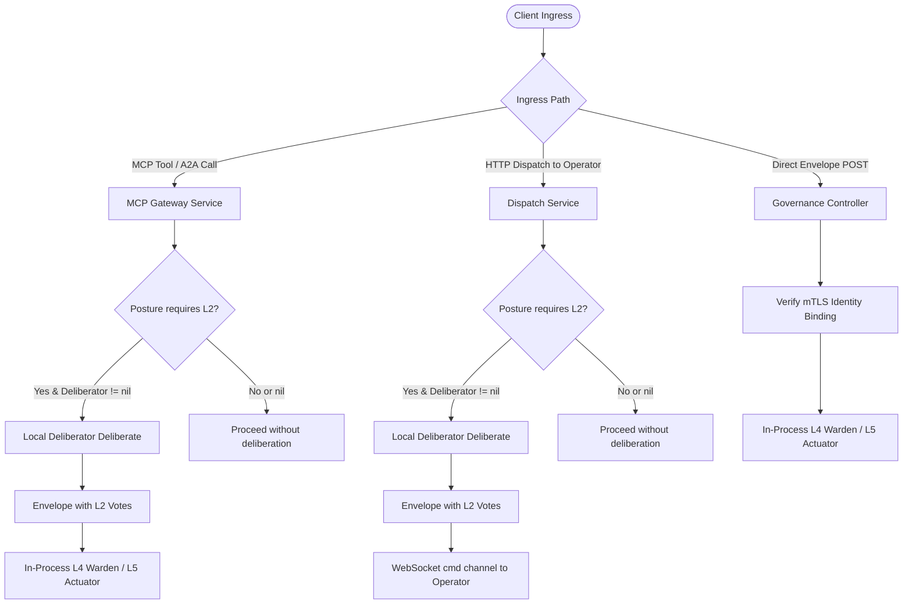

# Consensus Architecture

## Purpose

Defines ztd's Layer 2 (L2) machine consensus architecture: multi-member Ed25519 signature policies, deterministic deliberation mechanics, key custody models, declarative startup bootstrap, L4 Warden verification, and L5 Actuator receipt evidence. L2 Consensus functions as a deterministic $K$-of-$N$ threshold authorization gate within the five-layer governance interlock, ensuring that machine transactions are verified against an enrolled body of trusted member signers before execution.

## Quick index

- [Purpose](#purpose)
- [Quick index](#quick-index)
- [Invariants](#invariants)
  - [Policy and Membership (`INV-CON-POL`)](#policy-and-membership-inv-con-pol)
  - [Vote Production and Deliberation (`INV-CON-VOTE`)](#vote-production-and-deliberation-inv-con-vote)
  - [L4 Verification and Authorization (`INV-CON-WARD`)](#l4-verification-and-authorization-inv-con-ward)
  - [Receipt and Audit Evidence (`INV-CON-RCPT`)](#receipt-and-audit-evidence-inv-con-rcpt)
- [Owned surfaces](#owned-surfaces)
- [Procedures](#procedures)
  - [Place in the Five-Layer Interlock](#place-in-the-five-layer-interlock)
  - [Policy Schema and Validation Rules](#policy-schema-and-validation-rules)
  - [Vote Production and Deliberation Mechanics](#vote-production-and-deliberation-mechanics)
  - [Gateway Ingress Deliberation Routing](#gateway-ingress-deliberation-routing)
  - [Key Custody and Declarative Bootstrap](#key-custody-and-declarative-bootstrap)
  - [Administrative Enrollment and Lifecycle](#administrative-enrollment-and-lifecycle)
  - [L4 Warden Verification and Quorum Evaluation](#l4-warden-verification-and-quorum-evaluation)
  - [Receipt Evidence and Deterministic Stages](#receipt-evidence-and-deterministic-stages)
- [Anti-patterns](#anti-patterns)
- [Links out](#links-out)

## Invariants

Ids are stable. Append the next free number within each group; do not renumber.

### Policy and Membership (`INV-CON-POL`)

| ID | Rule |
| :--- | :--- |
| INV-CON-POL-01 | Consensus policy identifiers MUST be non-empty and contain only ASCII alphanumeric characters, hyphens, and underscores (`isValidConsensusID`). |
| INV-CON-POL-02 | Quorum MUST satisfy `1 <= Quorum <= len(member_app_ids)`. Any policy creation request with quorum less than 1 or exceeding the member count MUST fail closed with `ErrConstraintViolation`. |
| INV-CON-POL-03 | Every listed `member_app_id` MUST resolve to an enabled `TrustedSigner` in the Gateway's signer store at policy write time. Writes referencing unresolvable or disabled signers MUST be rejected. |
| INV-CON-POL-04 | New consensus policies MUST be created with `enabled=true`. Overwriting an existing policy while `enabled=true` MUST be rejected with `ErrAlreadyExists`. Disabling a policy requires submitting the same policy ID with `enabled=false`. |
| INV-CON-POL-05 | `member_app_ids` MUST contain only unique, non-empty identifiers. Duplicate member application IDs within a single policy MUST be rejected with `ErrConstraintViolation`. |

### Vote Production and Deliberation (`INV-CON-VOTE`)

| ID | Rule |
| :--- | :--- |
| INV-CON-VOTE-01 | The Deliberator MUST recompute the canonical transaction hash from envelope fields (`governance.GenerateMessageID`). If `envelope.Id` does not match the recomputed hash, deliberation MUST reject the envelope with `ErrConsensusHashMismatch`. |
| INV-CON-VOTE-02 | Every member vote signature MUST be an Ed25519 signature over the canonical UTF-8 payload `<transaction_hash>\|<decision>`, where `<decision>` is `true` or `false`, encoded as a lowercase hex string. |
| INV-CON-VOTE-03 | Consensus members MUST evaluate payload safety deterministically using `L1Doctrine.AnalyzeCommand`. Any signal with `BlockRecommended=true` MUST result in a `decision=false` vote. If `L1Doctrine` is nil, members MUST fail closed with `decision=false`. |
| INV-CON-VOTE-04 | Deliberation MUST produce at least one signed vote from available member private keys. If no member keys are resolvable, deliberation MUST return `ErrConsensusNoSigningMembers`. |
| INV-CON-VOTE-05 | The mTLS deliberation endpoint (`POST /consensus/v1/deliberate`) MUST be registered on the Gateway HTTP router only when the active governance posture requires L2 consensus (`consensus` or `notary`). |

### L4 Verification and Authorization (`INV-CON-WARD`)

| ID | Rule |
| :--- | :--- |
| INV-CON-WARD-01 | The L4 Warden MUST verify member signatures against the recomputed transaction hash rather than trusting the envelope's declared identifier. |
| INV-CON-WARD-02 | When `require_distinct` is true in the policy, duplicate member key IDs within the vote set MUST reject the transaction fail closed under an L2-enforcing posture with `ErrTxL2DuplicateSigner`. |
| INV-CON-WARD-03 | Quorum evaluation MUST count only affirmative (`decision=true`) votes signed by enabled `TrustedSigner` keys belonging to enrolled policy members. Negative votes (`decision=false`) authenticate dissent but do not count toward quorum. |
| INV-CON-WARD-04 | Bootstrap action types (`actionType.IsBootstrapAction()`) MUST be exempt from L2 gating across all postures, permitting initial enrollment transactions to succeed before consensus signers exist. |
| INV-CON-WARD-05 | Under `consensus` and `notary` postures, missing L2 votes, disabled policies, or unmet quorums MUST reject the transaction with a fatal error. Under `doctrine` and `ratify` postures, L2 votes are evaluated for deterministic audit evidence without gating transaction admission. |

### Receipt and Audit Evidence (`INV-CON-RCPT`)

| ID | Rule |
| :--- | :--- |
| INV-CON-RCPT-01 | The L5 ActionReceipt `L2Status` field MUST record `L2_STATUS_REQUIRED_VALID` when L2 is required and verified, `L2_STATUS_REQUIRED_FAILED` when required and failed, or `L2_STATUS_NOT_REQUIRED` when the posture does not require L2. |
| INV-CON-RCPT-02 | L4 verification MUST produce `DeterministicStageEvidence` for protocol L2 recording stage outcome (`VERIFIED`, `FAILED`, or `NOT_REQUIRED`) and the SHA-256 `L2SignatureDigest` over the vote set. |

## Owned surfaces

| Claim | Path | Verify |
| :--- | :--- | :--- |
| Consensus policy model | `protocol/models/consensus.json`, `internal/models/auth.go` | Schema validation and `consensus_store_service_test.go` |
| Consensus policy document store | `internal/services/gateway/consensus_store_service.go` | Unit tests in `consensus_store_service_test.go` |
| Consensus service and deliberator | `internal/services/consensus/service.go`, `internal/services/consensus/member.go` | Unit tests in `internal/services/consensus/service_test.go` |
| Consensus factory and key providers | `internal/services/consensus/factory.go` | Unit tests in `internal/services/consensus/factory_test.go` |
| L4 Warden L2 verification | `internal/services/governance/l2_consensus.go`, `internal/services/governance/l4_warden.go` | Integration tests in `l4_warden_consensus_test.go` |
| L5 Actuator receipt evidence | `internal/services/governance/l5_actuator.go` | Receipt tests in `l4_warden_test.go` |
| Deliberation HTTP endpoint | `internal/services/gateway/governance_controller.go`, `gateway_http_router.go` | Router tests in `gateway_http_test.go` |
| Administrative consensus API | `internal/services/gateway/admin_controller.go` | Admin tests in `admin_controller_test.go` |
| Declarative startup bootstrap | `internal/cli/serve/gateway.go` | Bootstrap tests in `consensus_bootstrap_test.go` |
| Ingress deliberation integration | `internal/services/mcp/gateway.go`, `dispatch_service.go` | End-to-end tests in `test/l2_consensus_integration_test.go` |

## Procedures

### Place in the Five-Layer Interlock

L2 Consensus occupies the second layer of the platform governance interlock:
1. **L1 Doctrine**: Decodes payload and executes static regex screening and MITRE threat detection.
2. **L2 Consensus**: Verifies $K$-of-$N$ threshold Ed25519 signatures over the exact transaction hash.
3. **L3 Notary**: Verifies human authorization proofs (WebAuthn passkeys) for mutating actions.
4. **L4 Warden**: Executes pre-dispatch verification (replay check, hash match, state root, L1-L3 proofs).
5. **L5 Actuator**: Mints single-action JIT capabilities, executes actions, and writes local signed receipts.

The active posture governs whether L2 verification gates execution:

| Posture | L2 Gate Status | Receipt `L2Status` Value | Deterministic Stage Outcome |
| :--- | :--- | :--- | :--- |
| **`doctrine`** | Non-gating (audited only) | `L2_STATUS_NOT_REQUIRED` | `DETERMINISTIC_STAGE_OUTCOME_VERIFIED` (if valid) or `NOT_REQUIRED` |
| **`consensus`** | Strictly required for non-bootstrap | `L2_STATUS_REQUIRED_VALID` | `DETERMINISTIC_STAGE_OUTCOME_VERIFIED` |
| **`ratify`** | Non-gating (audited only) | `L2_STATUS_NOT_REQUIRED` | `DETERMINISTIC_STAGE_OUTCOME_VERIFIED` (if valid) or `NOT_REQUIRED` |
| **`notary`** | Strictly required for non-bootstrap | `L2_STATUS_REQUIRED_VALID` | `DETERMINISTIC_STAGE_OUTCOME_VERIFIED` |

### Policy Schema and Validation Rules

Consensus policies are stored in the Gateway's canonical SQLite document store under the `"consensus"` collection (`constants.CollectionConsensus`). The schema is defined in `protocol/models/consensus.json` and mirrored in `models.ConsensusPolicy`:

```json
{
  "id": "fedramp-consensus",
  "member_app_ids": ["fedramp-csp-auditor", "fedramp-3pao", "fedramp-jab"],
  "quorum": 2,
  "require_distinct": true,
  "enabled": true,
  "created_at": "2026-09-28T00:00:00Z",
  "updated_at": "2026-09-28T00:00:00Z"
}
```

Storage validation (`ConsensusStoreService`) fails closed on policy writes:
- **Identifier Format**: Validated via `isValidConsensusID`; must contain only alphanumeric characters, hyphens, and underscores.
- **Quorum Constraints**: `1 <= Quorum <= len(member_app_ids)`.
- **Member Uniqueness**: No duplicate member application IDs.
- **Signer Verification**: Every `member_app_id` must resolve to an enabled `TrustedSigner` in `SignerStoreService`.
- **Overwrite Protection**: Policies with `enabled=true` cannot overwrite existing enabled policies (`ErrAlreadyExists`). Disabling requires updating the policy with `enabled=false`.

### Vote Production and Deliberation Mechanics

The reference vote producer is `ConsensusService` (`internal/services/consensus/service.go`). It manages member identities (`ConsensusMember`), each bound to an application ID and an Ed25519 private key.

During deliberation (`Deliberate`):
1. **Hash Verification**: Recomputes the transaction hash using `governance.GenerateMessageID(env)`. Mismatches return `ErrConsensusHashMismatch`.
2. **Payload Extraction**: Extracts intent commands from `env.IntentData` or `env.Payload`.
3. **Safety Evaluation**: Members evaluate safety via `L1Doctrine.AnalyzeCommand(cmdData)`. If any threat signal flags `BlockRecommended=true`, the member votes `decision=false`.
4. **Cryptographic Signing**: Signs the string `<transaction_hash>|<decision>` with the member's private key (`signDecision`), returning a lowercase hex signature.
5. **Vote Assembly**: Assembles `commonv1.L2Vote` records (`signer_key_id`, `consensus_signature`, `decision`). If zero member keys were available, returns `ErrConsensusNoSigningMembers`.
6. **Envelope Decoration**: Binds `env.Governance.L2.ConsensusSetId` and attaches the vote slice to `env.Governance.L2.Votes`.

### Gateway Ingress Deliberation Routing



- **MCP Tools and A2A Calls**: Under `consensus` and `notary`, `prepareEnvelope` passes constructed envelope bytes to `g.l2ConsensusDeliberator.Deliberate` prior to dispatch.
- **Governed HTTP Command Dispatch**: When dispatching commands to an outbound Operator, `DispatchService` deliberates under L2 postures before publishing the envelope to `cmd:<operator_id>:<operator_session_id>`.
- **Direct Envelope Ingress**: Direct submissions to `POST /api/v1/governance/envelopes` do not trigger automatic deliberation; callers must submit envelopes already populated with valid L2 vote sets.
- **HTTP Deliberation Endpoint**: Handled by `POST /consensus/v1/deliberate` on port 8443. Mounted only when the active posture requires L2 consensus.

### Key Custody and Declarative Bootstrap

In single-binary deployments, the Gateway manages member key seeds via `consensus.FileKeyProvider` (`internal/services/consensus/factory.go`). Member key seeds are stored in `.ztd/secrets/consensus_member_<consensus_id>_<member_app_id>.key` with `0600` permissions.

#### Declarative Bootstrap Configuration
The `--consensus-bootstrap` CLI flag seeds policies and keys at Gateway startup:

```json
{
  "consensus_id": "fedramp-consensus",
  "member_app_ids": ["fedramp-csp-auditor", "fedramp-3pao", "fedramp-jab"],
  "quorum": 2,
  "member_seeds": {
    "fedramp-csp-auditor": "a1b2c3...",
    "fedramp-3pao": "d4e5f6...",
    "fedramp-jab": "7890ab..."
  },
  "seed_hex": "optional_shared_fallback_seed..."
}
```

Resolution precedence:
1. **Per-Member Seeds (`member_seeds`)**: Generates and registers individual Ed25519 key pairs for every member ID. Required for production high-assurance deployments.
2. **Shared Seed (`seed_hex`)**: Derives a single key pair registered across all members.
3. **Generated Fallback**: Generates a temporary key pair across members if neither seed is provided.

### Administrative Enrollment and Lifecycle

Authorized administrators manage consensus policies dynamically:
- `POST /api/v1/admin/consensus`: Registers a new policy. Member signers must exist in the trusted signer store.
- `GET /api/v1/admin/consensus`: Lists configured policies and quorums.
- `DELETE /api/v1/admin/consensus/{id}`: Deletes a policy by ID.
- Policy updates take immediate effect at L4 verification because the Warden queries `L2ConsensusPolicyStore` per transaction.

### L4 Warden Verification and Quorum Evaluation

```mermaid
flowchart TD
    Start([L4 Warden: verifyL2Posture]) --> CheckBootstrap{Is Bootstrap Action?}
    CheckBootstrap -->|Yes| Exempt[Bypass L2 gate; evaluate audit evidence only]
    CheckBootstrap -->|No| CheckVotes{Votes present in envelope?}
    
    CheckVotes -->|No| CheckReqA{Posture requires L2?}
    CheckReqA -->|Yes| FailNoVotes[Fail: ErrTxL2SignatureMissing]
    CheckReqA -->|No| PassNonGating[Return l2Valid=false, err=nil]
    
    CheckVotes -->|Yes| CheckStores{Stores configured?}
    CheckStores -->|No| CheckReqB{Posture requires L2?}
    CheckReqB -->|Yes| FailNoStores[Fail: ErrTxL2SignerStoreNotConfigured or ErrTxL2ConsensusNotConfigured]
    CheckReqB -->|No| PassNonGating
    
    CheckStores -->|Yes| LoadPolicy[Load policy by l2.ConsensusSetId]
    LoadPolicy --> CheckPolicy{Policy found and enabled?}
    CheckPolicy -->|No| CheckReqC{Posture requires L2?}
    CheckReqC -->|Yes| FailPolicy[Fail: ErrTxL2ConsensusSetUnknown]
    CheckReqC -->|No| PassNonGating
    
    CheckPolicy -->|Yes| LoopVotes[Iterate through votes]
    LoopVotes --> MemberCheck{Is vote.SignerKeyId in policy.MemberKeyIDs?}
    MemberCheck -->|No| NextVote[Skip vote]
    MemberCheck -->|Yes| SeenCheck{SignerKeyId already seen?}
    
    SeenCheck -->|Yes & RequireDistinct=true| DupFail[Fail: ErrTxL2DuplicateSigner]
    SeenCheck -->|Yes & RequireDistinct=false| NextVote
    
    SeenCheck -->|No| VerifySig{Verify Ed25519 signature over hash|decision}
    VerifySig -->|Invalid| NextVote
    VerifySig -->|Valid| RecordSeen[Mark seen=true]
    RecordSeen --> DecisionCheck{vote.Decision == true?}
    DecisionCheck -->|Yes| IncQuorum[affirmative++]
    DecisionCheck -->|No| RecordDissent[Dissent authenticated; do not increment]
    
    IncQuorum --> NextVote
    RecordDissent --> NextVote
    NextVote --> QuorumCheck{affirmative >= policy.Quorum?}
    
    QuorumCheck -->|Yes| Success[Return l2Valid=true, err=nil]
    QuorumCheck -->|No| CheckReqD{Posture requires L2?}
    CheckReqD -->|Yes| FailQuorum[Fail: ErrTxL2QuorumNotMet]
    CheckReqD -->|No| PassNonGating
```

1. **Bootstrap Exemption**: If `actionType.IsBootstrapAction()` is true, transactions bypass L2 gating across all postures.
2. **Presence Checks**: Under `consensus` and `notary`, missing votes or unconfigured stores immediately fail closed. A consensus set that is unknown or disabled fails closed with `ErrTxL2ConsensusSetUnknown`; `ErrTxL2ConsensusNotConfigured` applies only when the consensus policy store is absent.
3. **Distinctness Enforcement**: If a member key ID was already evaluated and `policy.RequireDistinct` is true, duplicate signatures fail closed with `ErrTxL2DuplicateSigner`.
4. **Signature Verification**: Verifies Ed25519 signatures against the recomputed transaction hash and decision value.
5. **Threshold Check**: Increments affirmative counts only when `vote.Decision == true`. If `affirmative < policy.Quorum`, returns `ErrTxL2QuorumNotMet`.

On the Gateway, policies reside in SQLite. Remote Operators receive the Gateway's configured consensus policy and member public keys in their in-memory enrollment bundle, served via `governance.L2TrustStore`.

### Receipt Evidence and Deterministic Stages

When L4 verification concludes, the Warden emits deterministic stage evidence, and the L5 Actuator embeds the final L2 outcome into the signed `ActionReceipt`:
- **Deterministic Stage Evidence**: A stage record with `DETERMINISTIC_STAGE_KIND_PROTOCOL_L2` records the outcome (`VERIFIED`, `FAILED`, or `NOT_REQUIRED`).
- **Rejection Attribution**: A rejected L2 proof produces a signed `FAILED` receipt whose signed `rejection_code` names the L2 check. The enum is defined in `protocol/proto/ztd/operator/v1/operator.proto`.
- **Signature Digest**: `L2SignatureDigest` computes a SHA-256 digest over the concatenated member signatures in the vote set, binding the cryptographic proof into the audit trail.
- **Receipt Status**: The signed receipt records `L2Status`: `L2_STATUS_REQUIRED_VALID`, `L2_STATUS_REQUIRED_FAILED`, or `L2_STATUS_NOT_REQUIRED`.

## Anti-patterns

- **Equating L2 Consensus with Distributed State Machine Replication**: Treating L2 Consensus as a Raft or Paxos leader-election engine. L2 is strictly a threshold cryptographic signature policy over an immutable transaction hash.
- **Sharing Private Keys Across Members in Production**: Using `seed_hex` or generated fallback modes in production deployments. Production configurations must supply independent `member_seeds`.
- **Assuming Dynamic Admin Policy Changes Hot-Reload Running Deliberators**: Updating a consensus policy via the admin API and expecting the in-process deliberator to switch private keys without a restart. Deliberator assembly occurs at Gateway startup.
- **Submitting Unproved Envelopes via Direct Ingress**: Expecting the Gateway to synthesize missing L2 votes on direct submissions to `POST /api/v1/governance/envelopes`. Direct submissions require pre-deliberated envelopes.
- **Counting Negative Votes Toward Quorum**: Treating negative member decisions (`decision=false`) as quorum contributors. Dissent is recorded for audit purposes only (INV-CON-WARD-03).
- **Trusting Declared Transaction Identifiers**: Signing or verifying envelopes without recomputing the SHA-256 transaction hash via `governance.GenerateMessageID` (INV-CON-VOTE-01, INV-CON-WARD-01).

## Links out

- [Platform Architecture Overview](overview.md): High-level system architecture and node topologies.
- [Governance Architecture](governance.md): Five-layer governance interlock, posture definitions, and receipt validation.
- [Gateway Architecture](gateway.md): Gateway initialization, service wiring, and in-process execution.
- [Operator Architecture](operator.md): Outbound pub/sub execution, L4 Warden verification, and L5 Actuator receipts.
- [Authentication Architecture](auth.md): SPIFFE workload identities, trusted signers, and L3 human proofs.
- [Storage Architecture](storage.md): Canonical SQLite document store and encrypted persistence boundaries.
- [Network Architecture](network.md): TLS 1.3, mTLS enforcement, and WebSocket pub/sub routing.
