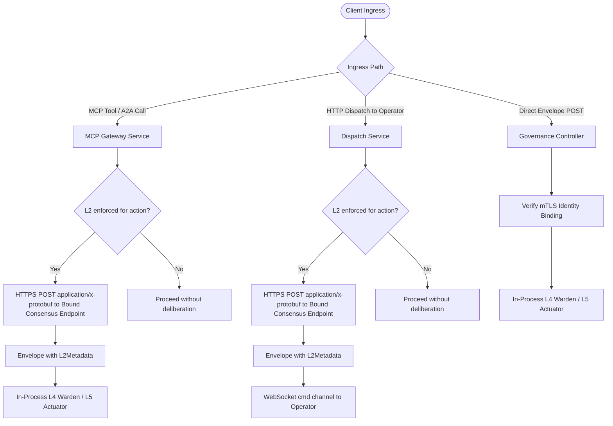

# Consensus Architecture

## Purpose

Defines ztd's Layer 2 (L2) machine consensus architecture: enrolling third-party applications as ordinary `PLATFORM_COMPONENT_KIND_APPLICATION` identities, binding an actor-owned K-of-N member set through `PLATFORM_ENROLLMENT_BIND_CONSENSUS`, HTTPS protobuf deliberation mechanics, L4 Warden and outbound Operator (`OperatorL2Trust`) signature verification, and L5 Actuator receipt evidence. Every member is an enrolled application with an enabled Ed25519 signer; binding records the member IDs and quorum through the governed L5 handler.

## Quick index

- [Purpose](#purpose)
- [Quick index](#quick-index)
- [Invariants](#invariants)
  - [Application Enrollment and Binding (`INV-CON-POL`)](#application-enrollment-and-binding-inv-con-pol)
  - [Deliberation and Proof Production (`INV-CON-VOTE`)](#deliberation-and-proof-production-inv-con-vote)
  - [L4 Verification and Authorization (`INV-CON-WARD`)](#l4-verification-and-authorization-inv-con-ward)
  - [Receipt and Audit Evidence (`INV-CON-RCPT`)](#receipt-and-audit-evidence-inv-con-rcpt)
- [Owned surfaces](#owned-surfaces)
- [Procedures](#procedures)
  - [Place in the Five-Layer Interlock](#place-in-the-five-layer-interlock)
  - [Consensus Application Enrollment and Binding](#consensus-application-enrollment-and-binding)
  - [Vote Production and Deliberation Mechanics](#vote-production-and-deliberation-mechanics)
  - [Gateway Ingress Deliberation Routing](#gateway-ingress-deliberation-routing)
  - [L4 Warden and Outbound Operator Verification](#l4-warden-and-outbound-operator-verification)
  - [Receipt Evidence and Deterministic Stages](#receipt-evidence-and-deterministic-stages)
- [Anti-patterns](#anti-patterns)
- [Links out](#links-out)

## Invariants

Ids are stable. Append the next free number within each group; do not renumber.

### Application Enrollment and Binding (`INV-CON-POL`)

| ID | Rule |
| :--- | :--- |
| INV-CON-POL-01 | Consensus members are ordinary enrolled applications (`PLATFORM_COMPONENT_KIND_APPLICATION`), not a Gateway-internal service. Every member MUST enroll through the standard platform workflow, receiving its mTLS client certificate and registering its Ed25519 public key in `trusted_signers`. |
| INV-CON-POL-02 | The Gateway MUST record at most one bound consensus policy (`constants.DocIDConsensusBinding` in `constants.CollectionConsensus`), with unique actor-owned enrolled signing applications and a quorum from one through the member count. The bound policy's primary application ID (`app_id` / `PrimaryAppID()`) designates the target application for HTTPS deliberation dispatch. |
| INV-CON-POL-03 | Binding a consensus member set MUST traverse the governance pipeline as the bootstrap action `PLATFORM_ENROLLMENT_BIND_CONSENSUS` (`POST /api/v1/auth/platform-enrollments/consensus`), validating every member's ownership, existing enrollment policy, and enabled `TrustedSigner` in the Gateway's signer store. |
| INV-CON-POL-04 | `PLATFORM_ENROLLMENT_BIND_CONSENSUS` is a mutation that is NOT exempt from L3 via `_authorized_by_decision`: it MUST require L3 human authorization under `ratify` and `notary` postures (`posture.RequiresL3() == true`). |
| INV-CON-POL-05 | Outbound Operators MUST receive each bound consensus member's identity and Ed25519 public key in their signed enrollment bundle and in-band certificate renewal bundle (`OperatorL2Trust`). |

### Deliberation and Proof Production (`INV-CON-VOTE`)

| ID | Rule |
| :--- | :--- |
| INV-CON-VOTE-01 | Each consensus member application MUST recompute the canonical transaction hash from envelope fields (`governance.GenerateMessageID`) and verify `envelope.Id` and `envelope.TransactionHash` before signing a decision. |
| INV-CON-VOTE-02 | Every `L2Vote.consensus_signature` in the envelope's `L2Metadata` MUST be an Ed25519 signature by the bound member application named in that vote's `L2Vote.signer_key_id`, over the canonical UTF-8 payload `<transaction_hash>\|<decision>`, where `<decision>` is the vote's `L2Vote.decision` (`true` or `false`), encoded as a hex string; L2 accepts only K distinct affirmative member signatures. |
| INV-CON-VOTE-03 | During L2 deliberation, the Gateway MUST transmit the full `GovernanceEnvelope` serialized as `application/x-protobuf` to the bound HTTPS deliberation endpoint (`endpoint_url`, hosted by the primary member) and receive back the envelope populated with member votes in its `L2Metadata` block. |
| INV-CON-VOTE-04 | Deliberation TLS verification MUST validate the server certificate chain against Gateway-owned CA trust and verify the exact bound application SPIFFE URI (`spiffe://ztd.local/app/<app_id>`) in the SAN. Deliberation MUST NOT rely on system Web PKI roots or DNS SANs. |

### L4 Verification and Authorization (`INV-CON-WARD`)

| ID | Rule |
| :--- | :--- |
| INV-CON-WARD-01 | The L4 Warden (`L4Warden.verifyL2Posture`) MUST verify each `L2Vote.consensus_signature` in `L2Metadata` against the recomputed transaction hash rather than trusting the envelope's declared identifier. |
| INV-CON-WARD-02 | Both Gateway in-process L4 verification and outbound Operator L4 verification (`OperatorL2Trust`) MUST verify each `L2Vote.consensus_signature` against the Ed25519 public key of the bound member named by `L2Vote.signer_key_id`, from `trusted_signers` / the Operator enrollment bundle. |
| INV-CON-WARD-03 | Evaluation MUST accept only affirmative (`decision=true`) signatures verified against enabled member `TrustedSigner` public keys, meeting the stored quorum. A negative decision authenticates dissent and does not count toward quorum. |
| INV-CON-WARD-04 | Bootstrap action types (`actionType.IsBootstrapAction()`) MUST be exempt from L2 gating across all postures, permitting initial enrollment and `PLATFORM_ENROLLMENT_BIND_CONSENSUS` transactions to succeed before a consensus application is bound. |
| INV-CON-WARD-05 | Under `consensus` and `notary` postures (`posture.RequiresL2() == true`), a missing `L2Metadata` proof, an unbound consensus policy, insufficient affirmative member signatures, or a negative decision MUST reject the transaction fail closed. Under `doctrine` and `ratify` postures, L2 proofs are evaluated for deterministic audit evidence without gating transaction admission. |
| INV-CON-WARD-06 | Under `consensus` and `notary` postures, an `L2Vote.consensus_signature` from a bound member that fails verification MUST reject the transaction with `ErrTxL2SignatureInvalid` (`L2_SIGNATURE_INVALID`). Votes from signers outside the bound member set are ignored and count toward neither quorum nor rejection. |

An absent L2 proof (or empty L2 metadata with no set ID) yields `L2_PROOF_MISSING`. A proof naming an enabled, known set with fewer than K affirmative member votes yields `L2_QUORUM_NOT_MET`. A proof naming an unknown or disabled set yields `L2_CONSENSUS_SET_UNKNOWN`. All of these reject execution when L2 is enforced.

### Receipt and Audit Evidence (`INV-CON-RCPT`)

| ID | Rule |
| :--- | :--- |
| INV-CON-RCPT-01 | The L4 Warden decides the L2 status once and the L5 ActionReceipt `L2Status` field MUST copy it: `L2_STATUS_REQUIRED_VALID` when an L2 proof is present and verified (also where L2 is not enforced, as audit evidence), `L2_STATUS_REQUIRED_FAILED` when L2 is enforced and fails, or `L2_STATUS_NOT_REQUIRED` when L2 is not enforced for the action (the posture does not require it, or the action is bootstrap-exempt) and no valid proof is present. L5 never recomputes it from posture. |
| INV-CON-RCPT-02 | L4 verification MUST produce `DeterministicStageEvidence` for protocol L2 recording stage outcome (`VERIFIED`, `FAILED`, or `NOT_REQUIRED`) and the SHA-256 `L2SignatureDigest` over the sorted, canonically encoded set of `L2Vote.consensus_signature` values. |

## Owned surfaces

| Claim | Path | Verify |
| :--- | :--- | :--- |
| Consensus binding model | `protocol/models/consensus.json`, `internal/models/auth.go` | Schema validation and `consensus_store_service_test.go` |
| Consensus binding document store | `internal/services/gateway/consensus_store_service.go` (`constants.DocIDConsensusBinding` in `constants.CollectionConsensus`) | Unit tests in `consensus_store_service_test.go` |
| Consensus application enrollment & binding | `internal/services/gateway/platform_enrollment_service.go`, `platform_enrollment_controller.go`, `internal/services/pubsub/platform_enrollment_handlers.go` | `POST /api/v1/auth/platform-enrollments/consensus` (`PLATFORM_ENROLLMENT_BIND_CONSENSUS`) |
| L4 Warden L2 verification & `OperatorL2Trust` | `internal/services/governance/l2_consensus.go`, `internal/services/governance/l4_warden.go` | Integration tests in `l4_warden_consensus_test.go` |
| L5 Actuator receipt evidence | `internal/services/governance/l5_actuator.go` | Receipt tests in `l4_warden_test.go` |
| Ingress HTTPS deliberation integration | `internal/services/mcp/gateway.go`, `internal/services/gateway/dispatch_service.go` | End-to-end tests in `test/l2_consensus_integration_test.go` |

## Procedures

### Place in the Five-Layer Interlock

L2 Consensus occupies the second layer of the platform governance interlock:
1. **L1 Doctrine**: Decodes payload and executes static regex screening and MITRE threat detection.
2. **L2 Consensus**: Verifies K distinct bound-member Ed25519 signatures over `<transaction_hash>|<decision>`.
3. **L3 Notary**: Verifies human authorization proofs (a WebAuthn passkey assertion or an enrolled CLI certificate's ECDSA P-256 signature) for mutating actions.
4. **L4 Warden**: Executes pre-dispatch verification (replay check, hash match, state root, L1-L3 proofs).
5. **L5 Actuator**: Mints single-action JIT capabilities, executes actions, and writes local signed receipts.

`constants.Posture.RequiresL2()` (`internal/constants/posture.go`) governs whether L2 verification gates execution:

| Posture | `posture.RequiresL2()` | L2 Gate Status | Receipt `L2Status` Value | Deterministic Stage Outcome |
| :--- | :--- | :--- | :--- | :--- |
| **`doctrine`** | `false` | Non-gating (audited only) | `L2_STATUS_REQUIRED_VALID` (if valid) or `L2_STATUS_NOT_REQUIRED` | `DETERMINISTIC_STAGE_OUTCOME_VERIFIED` (if valid) or `NOT_REQUIRED` |
| **`consensus`** | `true` | Strictly required for non-bootstrap | `L2_STATUS_REQUIRED_VALID` (`L2_STATUS_REQUIRED_FAILED` on rejection) | `DETERMINISTIC_STAGE_OUTCOME_VERIFIED` (`FAILED` on rejection) |
| **`ratify`** | `false` | Non-gating (audited only) | `L2_STATUS_REQUIRED_VALID` (if valid) or `L2_STATUS_NOT_REQUIRED` | `DETERMINISTIC_STAGE_OUTCOME_VERIFIED` (if valid) or `NOT_REQUIRED` |
| **`notary`** | `true` | Strictly required for non-bootstrap | `L2_STATUS_REQUIRED_VALID` (`L2_STATUS_REQUIRED_FAILED` on rejection) | `DETERMINISTIC_STAGE_OUTCOME_VERIFIED` (`FAILED` on rejection) |

### Consensus Application Enrollment and Binding

Ordinary application enrollment accepts a separate Ed25519 signing public key alongside its P-256 transport CSR. Owner approval and completion bind both keys as described in [Platform Workload Enrollment](auth.md#platform-workload-enrollment). `TestPlatformEnrollment_OrdinaryApplicationEnrollsSigningKeyAndBindsConsensus` exercises enrollment, binding, HTTPS protobuf deliberation, Operator trust export, and revocation without seeding a trusted signer.

For the CLI enrollment, sealed signing identity, binding/query commands, and posture-dependent approval behavior, see [Platform Workload Enrollment](auth.md#platform-workload-enrollment). Consensus enrollment and binding depend on local account authority, independently of the account's sign-in provider.

Each third-party application that serves as a consensus member enrolls and binds through two standard governed steps:

1. **Application Enrollment (`PLATFORM_COMPONENT_KIND_APPLICATION`)**:
   - The application generates its P-256 transport key and CSR plus a separate Ed25519 signing key, submits both public identities to `POST /api/v1/auth/platform-enrollments/request`, and awaits posture-dependent owner approval.
   - Upon completion (`POST /api/v1/auth/platform-enrollments/complete`), the application receives its mTLS client certificate (`spiffe://ztd.local/app/<app_id>`) and its Ed25519 public key is registered in `trusted_signers` (`SignerStoreService`).
2. **Consensus Binding (`PLATFORM_ENROLLMENT_BIND_CONSENSUS`)**:
   - An authenticated owner binds the enrolled application(s) as the Gateway's consensus provider via `POST /api/v1/auth/platform-enrollments/consensus` (`ztd auth enroll consensus bind`), executing the governed bootstrap action `PLATFORM_ENROLLMENT_BIND_CONSENSUS`.
   - The CLI supports repeatable `--member-app` flags and `--quorum`. Each member ID is trimmed and an empty member is rejected locally (`ErrMissingRequiredField`). A single application with `--quorum` omitted binds as 1-of-1. A multi-member set must state `--quorum` explicitly; the Gateway rejects an omitted quorum for more than one member with `ErrConsensusQuorumInvalid` before any governed envelope is submitted, so a K-of-N policy is never written by default. The L5 handler validates that the quorum is between 1 and the member count, the primary application is among the members (`ErrConsensusAppNotEnrolled` otherwise), all member IDs are unique and owned by the binding actor with an existing enrollment policy, and each member has an enabled Ed25519 signer in `trusted_signers`.
   - Because `PLATFORM_ENROLLMENT_BIND_CONSENSUS` is a bootstrap action (`IsBootstrapAction() == true`), it is exempt from L2 gating so it can execute under `consensus` and `notary` postures before a consensus provider exists. It is not marked `_authorized_by_decision`, so it remains L3-gated under `ratify` and `notary`.
   - The handler persists the single bound consensus record at `constants.DocIDConsensusBinding` in `constants.CollectionConsensus` (`ConsensusStoreService`), recording the primary application ID (`app_id`), member application IDs (`member_app_ids`), quorum, and its HTTPS deliberation endpoint URL. The primary app ID is returned by `policy.PrimaryAppID()` (prioritizing `app_id` over `member_app_ids[0]`).
   - `models.ValidateConsensusEndpoint` requires absolute HTTPS URLs without credentials or fragments at admission, authoritative persistence, and egress.
   - For HTTPS deliberation dispatch, the Gateway constructs a dedicated TLS client via `PKIAuthority.NewConsensusAppHTTPClient(primaryAppID)` (`internal/services/gateway/gateway_certs.go`). This client disables Go's hostname check and instead verifies the server certificate chain against the Gateway's trust bundle (`GatewayTrustBundle()`) and the certificate's URI SAN against the exact bound primary application SPIFFE ID (`spiffe://ztd.local/app/<app_id>`). Application certificates carry URI SANs and no DNS SANs, so deliberation never relies on system Web PKI roots or DNS matching. `ConsensusAppDeliberator.Deliberate` rejects all redirects (`ErrConsensusEndpointInvalid`) for every client it uses, including the factory-built client, by applying the redirect policy to a copy of whichever client it is handed (`rejectConsensusAppRedirects`). The PKI client itself installs no redirect policy.
   - `ConsensusAppDeliberator` takes and returns the Gateway's canonical protojson envelope wire, and transcodes to and from binary protobuf for the application (`TestConsensusDeliberation_SpeaksProtobufToApplicationAndReturnsCallerWire`). `TestDispatchNotary_OutboundHumanDecisionWithDeliberatedL2ReturnsOriginalVerifiedResult` exercises this path with a real 2-of-3 Ed25519 consensus set and an Operator that enforces L2 and L3.

### Vote Production and Deliberation Mechanics

During L2 deliberation:
1. **Protobuf Request**: The Gateway serializes the `GovernanceEnvelope` as `application/x-protobuf` and sends an HTTPS `POST` request to the bound deliberation endpoint (`endpoint_url`).
2. **Hash Verification**: Each member application recomputes the canonical transaction hash (`governance.GenerateMessageID`) and verifies `envelope.Id` and `envelope.TransactionHash`.
3. **Policy Evaluation & Signing**: Member applications evaluate the envelope intent and each signs `<transaction_hash>|<decision>` (`true` or `false`) using its Ed25519 private key.
4. **Proof Attachment**: The deliberation endpoint populates `envelope.Governance.L2` (`L2Metadata`, with `consensus_set_id` and one `L2Vote` per member vote) and returns the protobuf `GovernanceEnvelope` in the HTTPS response body. The Gateway rejects a response with no votes (`ErrTxL2SignatureMissing`); quorum is evaluated at L4, not during deliberation.

### Gateway Ingress Deliberation Routing

- **MCP Tools and A2A Calls**: For L2-enforced actions under `consensus` and `notary`, `processGatewayTransaction` (`internal/services/mcp/gateway.go`) deliberates the `GovernanceEnvelope` (`application/x-protobuf` to the bound endpoint) prior to dispatch.
- **Governed HTTP Command Dispatch**: When dispatching commands to an outbound Operator, `DispatchService` deliberates the envelope for L2-enforced actions before publishing it to `cmd:<operator_id>:<operator_session_id>`.
- **Direct Envelope Ingress**: Direct submissions to `POST /api/v1/governance/envelopes` do not trigger Gateway-initiated deliberation; callers must submit envelopes already carrying a valid `L2Metadata` block (`consensus_set_id` and `L2Vote` entries).

### L4 Warden and Outbound Operator Verification

1. **Bootstrap Exemption**: If `actionType.IsBootstrapAction()` is true, transactions bypass L2 gating across all postures.
2. **Presence Checks**: Under `consensus` and `notary` (`posture.RequiresL2()`), a missing `L2Metadata` proof (`ErrTxL2SignatureMissing`), an unconfigured store (`ErrTxL2SignerStoreNotConfigured` or `ErrTxL2ConsensusNotConfigured`), or an unbound, unknown, or disabled consensus set (`ErrTxL2ConsensusSetUnknown`) fails closed immediately.
3. **Signature Verification**: `L4Warden.verifyL2Posture` recomputes the transaction hash and verifies each Ed25519 signature over `<transaction_hash>|<decision>` against a bound member public key in `trusted_signers`. Under `consensus` and `notary`, a member signature that fails verification, or a member with no enabled signer key, fails closed with `ErrTxL2SignatureInvalid` (INV-CON-WARD-06). Signers outside the bound member set are ignored. A repeated member vote fails with `ErrTxL2DuplicateSigner` when `require_distinct` is set.
4. **Decision Check**: Requires at least K distinct affirmative (`decision=true`) member votes; otherwise rejects with `ErrTxL2QuorumNotMet`.
5. **Outbound Operator Verification (`OperatorL2Trust`)**: Remote Operators receive each bound consensus member's identity and Ed25519 public key in their signed enrollment bundle (and upon in-band certificate renewal), served in memory via `governance.L2TrustStore` (`OperatorL2Trust`), and independently verify the envelope's `L2Metadata` votes in their local L4 Warden.

### Receipt Evidence and Deterministic Stages

When L4 verification concludes, the Warden emits deterministic stage evidence, and the L5 Actuator embeds the final L2 outcome into the signed `ActionReceipt`:
- **Deterministic Stage Evidence**: A stage record with `DETERMINISTIC_STAGE_KIND_PROTOCOL_L2` records the outcome (`VERIFIED`, `FAILED`, or `NOT_REQUIRED`).
- **Rejection Attribution**: A rejected L2 proof produces a signed `FAILED` receipt whose signed `rejection_code` names the L2 check. The enum is defined in `protocol/proto/ztd/operator/v1/operator.proto`.
- **Signature Digest**: `L2SignatureDigest` computes a SHA-256 digest over the sorted set of `L2Vote.consensus_signature` values, binding the cryptographic proof into the audit trail.
- **Receipt Status**: The signed receipt records `L2Status`: `L2_STATUS_REQUIRED_VALID`, `L2_STATUS_REQUIRED_FAILED`, or `L2_STATUS_NOT_REQUIRED`.

## Anti-patterns

- **Treating Consensus as a Gateway-Internal Service or Keystore Construct**: Expecting the Gateway to host an internal consensus deliberator (`internal/services/consensus/`), store member keys in `.ztd/secrets/`, or accept removed flags (`--consensus-id`, `--consensus-url`, `--consensus-bootstrap`) or removed routes (`POST /consensus/v1/deliberate`, `/api/v1/admin/consensus`). Consensus is an external application enrolled via `PLATFORM_COMPONENT_KIND_APPLICATION` and bound via `PLATFORM_ENROLLMENT_BIND_CONSENSUS`.
- **Equating L2 Consensus with Distributed State Machine Replication**: Treating L2 Consensus as a Raft or Paxos leader-election engine. L2 is strictly a cryptographic signature gate over an immutable transaction hash.
- **Submitting Unproved Envelopes via Direct Ingress**: Expecting the Gateway to call the bound deliberation endpoint on direct submissions to `POST /api/v1/governance/envelopes`. Direct submissions require pre-populated `L2Metadata` votes carrying `L2Vote.consensus_signature` values.
- **Treating Negative Votes as Authorization**: Treating a negative decision (`decision=false`) as authorizing execution. Dissent is recorded for audit purposes only (INV-CON-WARD-03).
- **Trusting Declared Transaction Identifiers**: Signing or verifying envelopes without recomputing the SHA-256 transaction hash via `governance.GenerateMessageID` (INV-CON-VOTE-01, INV-CON-WARD-01).

## Links out

- [Platform Architecture Overview](overview.md): High-level system architecture and node topologies.
- [Governance Architecture](governance.md): Five-layer governance interlock, posture definitions, and receipt validation.
- [Gateway Architecture](gateway.md): Gateway initialization, service wiring, and in-process execution.
- [Operator Architecture](operator.md): Outbound pub/sub execution, L4 Warden verification, and L5 Actuator receipts.
- [Authentication Architecture](auth.md): SPIFFE workload identities, trusted signers, and L3 human proofs.
- [Storage Architecture](storage.md): Canonical SQLite document store and encrypted persistence boundaries.
- [Network Architecture](network.md): TLS 1.3, mTLS enforcement, and WebSocket pub/sub routing.
