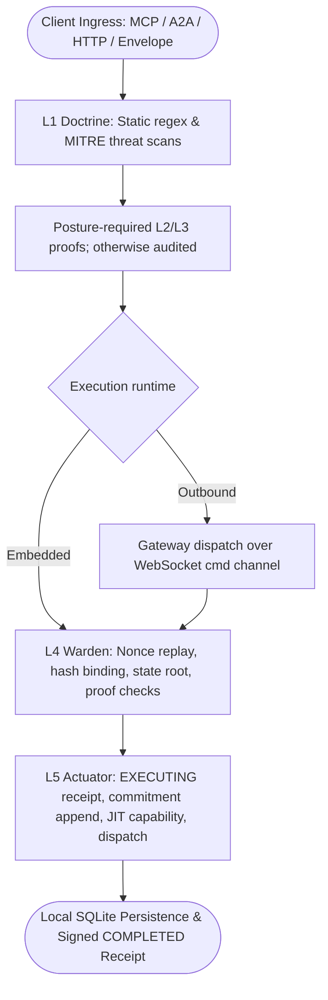
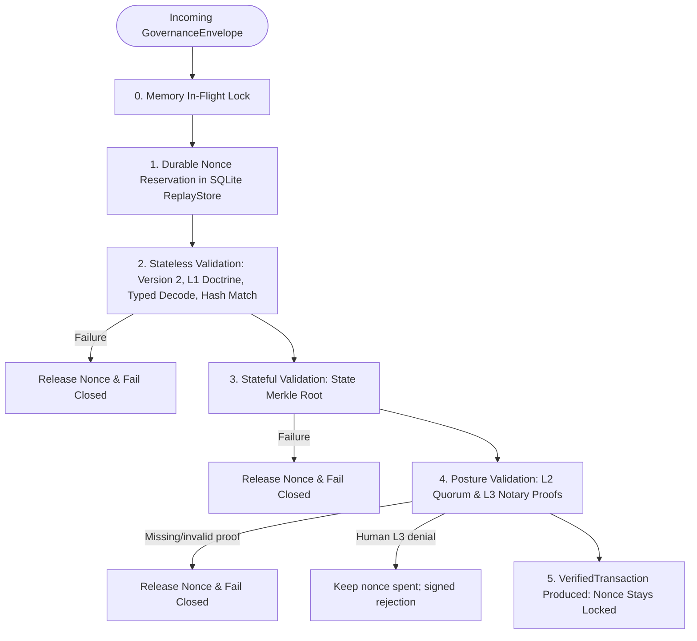

# Governance Architecture

## Purpose

Defines the governance architecture of the ztd platform: the five-layer verification pipeline (L1 through L5), immutable governance postures (`doctrine`, `consensus`, `ratify`, `notary`), canonical transaction container (`GovernanceEnvelope`) hashing and canonicalization, pre-dispatch verification in the L4 Warden, fail-closed execution in the L5 Actuator, just-in-time capability lifecycle, and deterministic protocol stage evidence attestation. The architecture enforces zero-trust execution across distributed runtimes: *A model can ask, but it cannot directly act.*

## Quick index

- [Purpose](#purpose)
- [Quick index](#quick-index)
- [Invariants](#invariants)
  - [Posture and Enforcement (`INV-GOV-POST`)](#posture-and-enforcement-inv-gov-post)
  - [Canonical Envelope and Hashing (`INV-GOV-ENV`)](#canonical-envelope-and-hashing-inv-gov-env)
  - [Bedrock Layers and Posture Rules (`INV-GOV-LAY`)](#bedrock-layers-and-posture-rules-inv-gov-lay)
  - [L4 Warden Pre-Dispatch (`INV-GOV-WARD`)](#l4-warden-pre-dispatch-inv-gov-ward)
  - [L5 Actuator and Execution (`INV-GOV-ACT`)](#l5-actuator-and-execution-inv-gov-act)
  - [Audit Trail and Evidence Chain (`INV-GOV-EVID`)](#audit-trail-and-evidence-chain-inv-gov-evid)
- [Owned surfaces](#owned-surfaces)
- [Procedures](#procedures)
  - [The Five-Layer Interlock Sequence](#the-five-layer-interlock-sequence)
  - [Governance Postures and Enforcement Matrix](#governance-postures-and-enforcement-matrix)
  - [Canonical Transaction Envelope and Deterministic Hashing](#canonical-transaction-envelope-and-deterministic-hashing)
  - [Layer 1 (L1) Doctrine: Technical Bedrock](#layer-1-l1-doctrine-technical-bedrock)
  - [FILE_EDIT Runtime State Protection](#fileedit-runtime-state-protection)
  - [Layer 2 (L2) Consensus: Bound Application Deliberation](#layer-2-l2-consensus-bound-application-deliberation)
  - [Layer 3 (L3) Notary: Human Authorization](#layer-3-l3-notary-human-authorization)
  - [Layer 4 (L4) Warden: Pre-Dispatch Verification Pipeline](#layer-4-l4-warden-pre-dispatch-verification-pipeline)
  - [Layer 5 (L5) Actuator: Fail-Closed Execution Boundary](#layer-5-l5-actuator-fail-closed-execution-boundary)
  - [Deterministic Protocol Chain and Evidence Graph](#deterministic-protocol-chain-and-evidence-graph)
  - [End-to-End Transaction Lifecycles](#end-to-end-transaction-lifecycles)
- [Anti-patterns](#anti-patterns)
- [Links out](#links-out)

## Invariants

Ids are stable. Append the next free number within each group; do not renumber.

### Posture and Enforcement (`INV-GOV-POST`)

| ID | Rule |
| :--- | :--- |
| INV-GOV-POST-01 | `constants.Posture` (`internal/constants/posture.go`) is the single posture owner across the platform, defining the four canonical governance postures (`doctrine`, `consensus`, `ratify`, `notary`) and their methods (`Valid()`, `RequiresL2()`, `RequiresL3()`, `Description()`, `HumanApprovalReason()`). Unknown or empty postures MUST fail closed (requiring both L2 and L3) and MUST be rejected at startup with an error wrapping `ErrInvalidPosture`. Duplicate posture parsers or types (`governance.GatewayPosture`, `GetGovernancePostureRequirements`, `ParseGovernancePosture`, `LoadOptions.Posture`) are prohibited. |
| INV-GOV-POST-02 | The Gateway is the sole posture authority. It MUST set `GovernanceEnvelope.Posture` to its configured posture (`constants.Posture`) exactly once, at construction time. No other component (client, Operator, relay) writes it, and Operator-built envelopes such as receipt envelopes carry none. Callers never send posture: direct envelope submission MUST refuse an envelope that carries one with `ErrEnvelopePostureCallerSupplied` (HTTP 400) before L4. The L4 Warden MUST read posture per-envelope from `envelope.Posture` and fail closed with `ErrEnvelopePostureMissing` if absent. |
| INV-GOV-POST-03 | Posture configuration is immutable for the lifetime of the process. In gateway mode, `--posture` defaults to `doctrine`. Outbound Operators learn the Gateway posture exclusively from their signed enrollment bundle and evaluate `envelope.Posture` per transaction. |
| INV-GOV-POST-04 | L2 consensus is enforced under `consensus` and `notary` postures (`posture.RequiresL2() == true`). L3 notary proof is enforced under `ratify` and `notary` postures (`posture.RequiresL3() == true`) whenever `governance.L3Required(actionType, posture)` is true (`actionType.IsMutation() && !actionType.AuthorizedByDecision() && posture.RequiresL3()`). |

### Canonical Envelope and Hashing (`INV-GOV-ENV`)

| ID | Rule |
| :--- | :--- |
| INV-GOV-ENV-01 | All new ingress transactions MUST declare protocol version `"2"` (`GovernanceProtocolVersionV2`). Envelopes with version `"1.0"` or other values MUST fail closed at L4 with `ErrTxProtocolVersionUnsupported`. |
| INV-GOV-ENV-02 | The canonical transaction hash (`GenerateMessageID`) for protocol version 2 MUST hash the prefix `ztd-tx-v2\|` followed by `action_type\|event_type\|` and the canonical v1 string representation with SHA-256 encoded as lowercase hex. |
| INV-GOV-ENV-03 | The v1 canonical string MUST serialize fields in strict documented order: `action_type`, `target_resource`, base64-encoded `payload`, `state_merkle_root`, `nonce`, `expires_at` as fixed six-digit microsecond UTC RFC3339 (`timesvc.FormatTimestamp`), canonicalized `intent_data`, `requestor_user_id`, `acting_app_id`, `operator_id`, `operator_session_id`, `case_id`, `investigation_id`, `task_id`, `web_session_id`, and `cli_session_id`. Each non-empty field is followed by `\|`; empty or absent fields are omitted together with their delimiter. A non-nil `intent_data` writes its delimiter even when it has no fields. |
| INV-GOV-ENV-04 | `envelope.Id` and `envelope.TransactionHash` MUST both equal the recomputed transaction hash. Any mismatch MUST be rejected at L4 with `ErrTxTransactionIDMismatch` or `ErrTxTransactionHashMismatch`. |
| INV-GOV-ENV-05 | Posture and L2/L3 governance proofs MUST NOT be included in the transaction hash canonicalization, allowing L2 consensus signers to sign before human notary approval and allowing the gateway to set envelope posture without invalidating hashes. |

### Bedrock Layers and Posture Rules (`INV-GOV-LAY`)

| ID | Rule |
| :--- | :--- |
| INV-GOV-LAY-01 | L1 Doctrine MUST validate protobuf field options `(ztd.common.v1).forbidden_patterns` on string fields and run MITRE ATT&CK threat detectors across command, MCP argument, A2A payload, and critical system file edit requests. Any violation MUST reject the transaction fail closed with `ErrTxL1ValidationFailed` across all postures. |
| INV-GOV-LAY-02 | L2 Consensus proofs (`ConsensusProof`) MUST be Ed25519 signatures over `<transaction_hash>\|<decision>` signed by the Gateway's bound consensus application (`constants.DocIDConsensusBinding` in `constants.CollectionConsensus`). Under `consensus` and `notary` postures, `L4Warden.verifyL2Posture` and outbound Operators (`OperatorL2Trust`) MUST verify an affirmative decision (`decision=true`) against that enrolled application's Ed25519 public key in `trusted_signers`, or reject with `ErrTxL2SignatureInvalid` / `ErrTxL2QuorumNotMet` (`INV-CON-WARD-06`). |
| INV-GOV-LAY-03 | Platform bootstrap action types (`actionType.IsBootstrapAction()`) MUST be exempt from L2 consensus gating across all postures, allowing platform enrollment and `PLATFORM_ENROLLMENT_BIND_CONSENSUS` before a consensus application is bound. |
| INV-GOV-LAY-04 | L3 Notary verification MUST gate mutations according to `governance.L3Required`: `actionType.IsMutation() && !actionType.AuthorizedByDecision() && posture.RequiresL3()` (`ErrTxL3ProofMissing`). Read-only actions MUST NOT require an L3 proof under any posture. Follow-on enrollment completion actions marked `_authorized_by_decision` (`PLATFORM_ENROLLMENT_ISSUE`, `PLATFORM_ENROLLMENT_PERSIST_POLICY`, `PLATFORM_ENROLLMENT_CREATE_SESSION`) inherit authority from the committed `PLATFORM_ENROLLMENT_DECIDE` decision and are exempt from L3, whereas `HandlePersistPolicy` and `HandleCreateSession` MUST require and field-by-field match the committed issuance (`ErrPlatformEnrollmentIssuanceNotCommitted`, `ErrPlatformEnrollmentIssuanceMismatch`). `PLATFORM_ENROLLMENT_DECIDE`, `PLATFORM_ENROLLMENT_REVOKE`, and `PLATFORM_ENROLLMENT_BIND_CONSENSUS` remain L3-gated under `ratify` and `notary`. |
| INV-GOV-LAY-05 | In Gateway mode, the L3 Notary accepts either a WebAuthn passkey assertion or a CLI approval signature made with the enrolled CLI certificate's ECDSA P-256 key. `ztd auth approve <transaction-hash> --cli` signs the pending transaction hash; the default browser flow remains WebAuthn. The protobuf `L3Proof` carries the CLI leaf certificate DER, SHA-256 certificate fingerprint, and domain-separated signature. The Gateway MUST verify the certificate's canonical CLI SPIFFE user/session identity and verify that the fingerprint belongs to that active, non-revoked registered CLI session. The CLI approver session from the certificate SAN MAY differ from the submitter session in the unchanged envelope. A malformed or mixed CLI/WebAuthn proof MUST fail closed without fallback. Under `doctrine` and `consensus`, posture does not require L3. The outbound Operator's suspended-row and Ed25519 verifier remains a separate dormant path; Gateway CLI approval does not establish outbound L3 transfer or verification. `L4Warden` passes `requestor_user_id` as the approving user; `operator_id` identifies the execution target. Attaching approval proof MUST preserve every hashed envelope field. Evaluation dispatch still cannot mint L3 proofs and retains its fail-closed preflight under `ratify` and `notary`. |

### L4 Warden Pre-Dispatch (`INV-GOV-WARD`)

| ID | Rule |
| :--- | :--- |
| INV-GOV-WARD-01 | L4 Warden MUST track nonces in memory (`inFlight`) before stateful operations to prevent race conditions, and MUST durably reserve the nonce in `ReplayStore` before payload validation. |
| INV-GOV-WARD-02 | Expiry (`envelope.ExpiresAt`) MUST be strictly checked against the clock before nonce reservation. Expired transactions MUST fail closed with `ErrTxTransactionExpired`. |
| INV-GOV-WARD-03 | Stateless checks MUST run before stateful checks: protocol version, L1 doctrine presence, non-empty ID, event and action agreement (a governed request event MUST map to the envelope `action_type`, otherwise L4 rejects with `ErrTxEventActionMismatch` and a signed receipt whose `rejection_code` is `GOVERNANCE_REJECTION_CODE_EVENT_ACTION_MISMATCH`; an event that fails `ValidateGovernedRequest` is refused before L4 with `ErrTxUnknownEventType`, `ErrTxEventNotRequest`, or `ErrTxEventNotGoverned` and carries no receipt), known action type, non-empty payload (except heartbeat and shutdown, whose typed messages have no required fields and marshal to zero bytes when all-default; `PayloadMayBeEmpty` is the single owner of that exemption), typed payload decoding, document collection scope, execution target ownership, L1 doctrine scanning, and dual hash matching. |
| INV-GOV-WARD-04 | The state Merkle root (`envelope.StateMerkleRoot`) MUST be nonempty and match the admission snapshot in context for Gateway-built transactions, including delivery over the authenticated outbound command channel and resumption of a suspended transaction after L3 approval. That snapshot MUST remain bound by canonical hash and required proof verification; Operators MUST NOT re-fetch it from the Gateway or substitute a local root. Direct submissions without that context MUST match the current local root from `StateRootProvider`; mismatches MUST fail closed with `ErrTxStateRootMismatch`. |
| INV-GOV-WARD-05 | Any validation failure occurring after nonce reservation MUST release the nonce reservation via `replayStore.ReleaseNonce`, except an explicit human L3 denial (`ErrTxL3Denied`), whose nonce stays spent so that denied transaction cannot later execute. |
| INV-GOV-WARD-06 | A `DOCUMENT_UPDATE` or `DOCUMENT_DELETE` payload MUST target a collection marked `_governed` in `protocol/constants/collections.json` (`CollectionName.IsGovernedDocument`); any other collection MUST fail closed with `ErrTxDocumentCollectionNotGoverned` before execution. |
| INV-GOV-WARD-07 | After document collection scope and before doctrine scanning, L4 MUST require `ExecutionTarget.ExecutesFor(envelope.OperatorId)`: an outbound runtime executes only for its own enrolled Operator ID, and the Gateway executes only for the embedded Operator owned by `embedded.Service`. A missing target dependency, empty target on a host action, or foreign target fails closed with `ErrTxTargetOperatorMismatch`. The one exception is an unbound `DOCUMENT_UPDATE` or `DOCUMENT_DELETE` with an empty `operator_id`, which INV-AUTH-ID-05 admits and which skips the `ExecutesFor` check; the target dependency must still be present. |
| INV-GOV-WARD-08 | Immediately after the `ExecutesFor` check, L4 MUST verify a non-empty `envelope.OperatorSessionId` equals the session `ExecutionTarget.RuntimeIdentity` reports for the runtime, and MUST reject a session claimed without an `operator_id`; a mismatch fails closed with `ErrTxTargetSessionMismatch`. The claim is hashed but proves only what the sender wrote. An empty claim (app record writes, platform enrollment) is admitted and recorded under the runtime's own session. |

### L5 Actuator and Execution (`INV-GOV-ACT`)

| ID | Rule |
| :--- | :--- |
| INV-GOV-ACT-01 | The L5 Actuator MUST enforce fail-closed execution: execution handler, receipt signing key, SQL audit store, auditor signing key, auditor key ID, and commitment ledger MUST be present, and the envelope's event type MUST be non-empty. Each check runs before any receipt is signed or the handler runs. |
| INV-GOV-ACT-02 | The Actuator MUST sign and persist an `EXECUTING` status `ActionReceipt` to the audit stores before invoking the execution handler. Failure to sign or persist MUST abort execution without invoking the handler (`ErrL5ActuatorSignReceipt`, `ErrL5ActuatorCommitmentPersist`). |
| INV-GOV-ACT-03 | The Actuator MUST append a signed `CommitmentAttestation` to the SQLite hash-chained commitment ledger against the current chain head before execution, in the same immediate write transaction that persists the initial receipt. |
| INV-GOV-ACT-04 | The Actuator MUST mint a transaction-scoped, single-action `Capability` bound to the transaction hash, action type, target resource, operator ID, session, and expiry before execution, and MUST dissolve the capability immediately after execution completes or fails. |
| INV-GOV-ACT-05 | The Actuator MUST finalize the `ActionReceipt` with status (`COMPLETED` or `FAILED`), state root after, execution timestamp, and typed `ReceiptFailureCode`. Every governed action handler MUST return its execution, required audit, and result-publication failures to L5; a typed failed result MUST NOT produce a `COMPLETED` receipt. Handlers MUST preserve underlying Go error causes and join independent failures. L5 MUST sign the final receipt, log it, and attach a signed `ReceiptPersistenceAttestation`. |
| INV-GOV-ACT-06 | Remote receipt publication to the Gateway (`PublishActionReceipt`) is best effort and MUST NOT alter or gate local execution outcome. The executing runtime's local SQLite audit record remains authoritative under LFAA. |
| INV-GOV-ACT-07 | A governed `FILE_EDIT` or `RESTORE_FILE` MUST NOT write runtime control or evidence state under `.ztd/` except the executing runtime's controlled evaluation target directory. The executing runtime MUST open the target through `RuntimeFileService.OpenFileEditTarget` before any I/O, and all I/O MUST go through the returned `FileEditTarget`. |
| INV-GOV-ACT-08 | Receipts MUST be filed under a session the executing runtime owns, taken from the L5 `Identity` (the runtime's `ExecutionTarget`), never from an unverified envelope claim. A rejection (`RecordRejectedTransaction`) is always filed under the runtime's own operator and session; the claimed ids stay in the signed receipt's stage evidence, and the rejection receipt is published under the runtime's own identity. A verified envelope that names no session executes under the runtime's own session. Without a resolvable identity the Actuator fails closed (`ErrL5ActuatorRuntimeIdentityMissing`) before anything executes. A rejection receipt that cannot be persisted returns `ErrL5ActuatorRejectionReceiptPersist`, because nothing executed. The embedded Operator's own session is its claimed operator session, or the Gateway's `EmbeddedOperatorBootstrapSessionID` audit session before the claim. |
| INV-GOV-ACT-09 | A rejection receipt (`RecordRejectedTransaction`) MUST set `ActionReceipt.rejection_code` from `ClassifyGovernanceRejection` (`internal/services/governance/rejection_code.go`), which maps verification sentinels via `errors.Is`. An unmapped error MUST be `GOVERNANCE_REJECTION_CODE_UNCLASSIFIED`, never a guessed layer. `CanonicalizeActionReceipt` MUST bind `rejection_code` into the receipt signature. `rejection_code` MUST be `GOVERNANCE_REJECTION_CODE_UNSPECIFIED` on any receipt that is not a governance rejection. Verifiers MUST attribute a rejection to a layer from the signed `rejection_code`, never from `result_summary`. Enum values are defined in `protocol/proto/ztd/operator/v1/operator.proto`. |
| INV-GOV-ACT-10 | Every governed ingress MUST return the executing Operator's signed rejection receipt to the caller as `GovernanceRejection` (`protocol/proto/ztd/operator/v1/operator.proto`): the HTTP body for direct envelope submission and governed dispatch, and the JSON-RPC `error.data` for MCP and A2A. The receipt travels as `*governance.ReceiptError` (`internal/services/governance/rejection_code.go`) from `ProcessEnvelope` or the dispatch receipt wait to the response writer. `GovernanceRejection.error` renders only the governance sentinel, never the wrapped chain. An L4 that cannot run (`RUNTIME_VAULT_LOCKED`, `VERIFIER_MISCONFIGURED`) is HTTP 503; every other rejection is HTTP 403. A refusal before L4 carries no receipt and returns a typed `IngressRefusal` (INV-GOV-ACT-11). |
| INV-GOV-ACT-11 | Every pre-envelope refusal on every ingress MUST be a typed `IngressRefusal{code, error}` (`operator.proto`): the HTTP body for direct envelope submission and governed dispatch, and the JSON-RPC `error.data` for MCP and A2A. `governance.NewIngressRefusal` (`internal/services/governance/ingress_refusal.go`) names the check. An unmapped refusal is `INGRESS_REFUSAL_CODE_UNCLASSIFIED`, and `error` renders only the governance sentinel, never the wrapped chain. |
| INV-GOV-ACT-12 | Direct envelope submission (`POST /api/v1/governance/envelopes`, `verifyEnvelopeIdentityBinding` in `internal/services/gateway/governance_controller.go`) MUST bind every envelope to the mTLS peer certificate and the auth middleware before L4. mTLS is always required: a request with no peer certificate is refused `MTLS_REQUIRED`, and no path skips the check. `requestor_user_id` MUST equal the user the middleware authenticated (`ContextKeyUserID`), so a certificate kind that carries no user admits no requestor. A non-empty `acting_app_id` MUST match an app SPIFFE URI SAN on the certificate, on Operator-bound envelopes as well as on app-only envelopes. L3 resolves the human from the bound `requestor_user_id`. An envelope that cannot be decoded is refused as a malformed request (`TX_INVALID_ENVELOPE`, HTTP 400) and never passed downstream. |
| INV-GOV-ACT-13 | MCP `tools/call` and A2A `a2a/call` success MUST return the executing Operator's full signed `ActionReceipt` as canonical protojson (`response.MarshalProtoJSONCanonical`), in `CallToolResult.receipt` and `A2ASuccessResponse.result`. A missing L3 proof MUST suspend the call with one typed `GovernedSuspension` (`suspension` on MCP, the body on A2A) that carries `tx_hash`. An invalid L3 proof MUST be a signed `L3_PROOF_INVALID` rejection on both ingresses, never a suspension. The `approval.completed` SSE event MUST carry the canonical signed receipt of the resumed transaction in `receipt`. A human deny (`POST /api/v1/approvals/respond`, `approved: false`) MUST resubmit the suspended envelope with `L3Metadata.denied`, which L4 rejects in every posture as a signed `L3_DENIED` rejection; the handler returns that receipt and `approval.completed` carries it. L4 keeps a denied nonce spent (a missing or invalid proof releases it), so the denied transaction can never execute later on that runtime. |

### Audit Trail and Evidence Chain (`INV-GOV-EVID`)

| ID | Rule |
| :--- | :--- |
| INV-GOV-EVID-01 | Deterministic stage evidence MUST maintain strict monotonic ordering: `L1_DOCTRINE`, `PROTOCOL_L2`, `L3_NOTARY`, `L4_VERIFICATION`, `RECEIPT_PERSISTENCE`, `COMMITMENT_APPEND`, and `L5_EXECUTION`. |
| INV-GOV-EVID-02 | Stage parentage MUST bind strictly: L1, L2, and L3 stages declare parent ID equal to the L4 stage ID; L4, receipt persistence, and commitment append declare parent ID equal to the L5 stage ID. On a rejected transaction no L5 stage exists: the L1, L2, and L3 stages that ran declare the L4 stage ID as parent, and the L4 stage has an empty parent ID. |
| INV-GOV-EVID-03 | Non-empty identity fields (`OperatorID`, `OperatorSessionID`, `RequestorUserID`, `ActingAppID`, `CaseID`, `InvestigationID`, `TaskID`) MUST be identical across all deterministic stages in a transaction; an empty value is not compared. |
| INV-GOV-EVID-04 | The final `ReceiptPersistenceAttestation` MUST bind the transaction ID, audit record ID, signer key ID, timestamp, and SHA-256 digest of the final receipt signature, signed by the Actuator's private key. |
| INV-GOV-EVID-05 | Relayed receipts at the Gateway MUST be verified against both the Actuator public key signature and the persistence attestation before acceptance; invalid attestations MUST cause rejection. |
| INV-GOV-EVID-06 | On a rejected transaction, the `L1_DOCTRINE` stage MUST be `FAILED` only when doctrine found a violation. It MUST be `VERIFIED` when doctrine passed and a later check failed (transaction hash or ID, state root, or posture). It MUST be absent when rejection happened before doctrine ran. |

## Owned surfaces

| Claim | Path | Verify |
| :--- | :--- | :--- |
| Single posture owner and methods | `internal/constants/posture.go` (`constants.Posture`) | Unit tests in `internal/constants/` and `internal/services/governance/l4_warden_test.go` |
| Envelope proto definition and schema | `protocol/proto/ztd/common/v1/common.proto`, `protocol/models/governance.json` | `make proto-generate` and schema validation tests |
| Envelope hashing and canonicalization | `internal/governance/envelope.go` | Parity tests in `internal/governance/envelope_hash_parity_test.go` |
| L1 Doctrine validation and threat detectors | `internal/services/governance/l1_doctrine.go` | Unit tests in `internal/services/governance/l1_doctrine_test.go` |
| L2 Consensus verification | `internal/services/governance/l2_consensus.go` | Unit tests in `internal/services/governance/l4_warden_consensus_test.go` |
| L3 Notary authorization | `internal/services/governance/l3_notary.go` | Unit tests in `internal/services/governance/l3_notary_test.go` |
| L4 Warden pre-dispatch pipeline | `internal/services/governance/l4_warden.go` | Unit tests in `internal/services/governance/l4_warden_test.go` |
| L5 Actuator execution boundary | `internal/services/governance/l5_actuator.go` | Unit tests in `internal/services/governance/l5_actuator_test.go` |
| Governance rejection classification | `internal/services/governance/rejection_code.go` | Canonicalization tests in `protocol/action_receipt_canonicalization_test.go` |
| Just-in-time capability lifecycle | `internal/services/governance/capability.go` | Unit tests in `internal/services/governance/capability_test.go` |
| Deterministic protocol chain verification | `internal/services/governance/protocol_chain.go` | Chain tests in `internal/services/governance/protocol_chain_test.go` |
| Gateway dispatch envelope construction | `internal/services/gateway/dispatch_service.go` | Unit tests in `internal/services/gateway/dispatch_service_test.go` |
| Operator execution receipts proto | `protocol/proto/ztd/operator/v1/operator.proto` | `make proto-generate` |

## Procedures

### The Five-Layer Interlock Sequence

Every governed mutation passes the five-layer interlock before execution. The path depends on ingress and runtime: the Gateway evaluates L1 and coordinates posture-required proofs, then either its embedded Operator or an outbound Operator performs L4 and L5. Under non-enforcing postures, L2/L3 are audited rather than required; a human deny is always sent through L4 as an explicit L3 denial.



1. **L1 Doctrine**: Technical bedrock. Hard static regex analysis over string fields (`forbidden_patterns`) and MITRE ATT&CK threat heuristics across commands, MCP arguments, A2A payloads, and file edits. Enforced fail-closed across all postures.
2. **L2 Consensus**: Machine deliberation via the bound consensus application (`PLATFORM_COMPONENT_KIND_APPLICATION`). Evaluates Ed25519 signatures over `<transaction_hash>|<decision>`. Enforced under `consensus` and `notary` (`posture.RequiresL2()`); audited under `doctrine` and `ratify`.
3. **L3 Notary**: Human authorization. Verifies cryptographic proof of human intent for mutating actions where `governance.L3Required(actionType, posture)` is true. Enforced under `ratify` and `notary` (`posture.RequiresL3()`); audited under `doctrine` and `consensus`. Read-only actions and follow-on enrollment actions marked `_authorized_by_decision` bypass L3.
4. **L4 Warden**: Pre-dispatch verification gate. Reserves transaction nonces in durable SQLite storage, checks expiration, decodes typed payload, validates target ownership, recomputes the canonical transaction hash, verifies state Merkle root, and evaluates posture-required L2/L3 proofs.
5. **L5 Actuator**: Execution boundary. Establishes zero standing privileges. Logs an `EXECUTING` receipt to local SQLite audit storage, appends a signed `CommitmentAttestation` to the commitment ledger, rehydrates scrubbed tokens via local vault keys, mints a single-action JIT capability, invokes the handler, dissolves the capability immediately, captures final state root, signs a `COMPLETED` or `FAILED` receipt, and attaches a signed `ReceiptPersistenceAttestation`.

### Governance Postures and Enforcement Matrix

`constants.Posture` (`internal/constants/posture.go`) defines the four canonical postures and provides `Valid()`, `RequiresL2()`, `RequiresL3()`, `Description()`, and `HumanApprovalReason()`:

| Posture | L1 Doctrine | L2 Consensus (`RequiresL2()`) | L3 Notary (`governance.L3Required`) | L3 Notary (Read-Only or `AuthorizedByDecision`) | Operational Use Case |
| :--- | :--- | :--- | :--- | :--- | :--- |
| **`doctrine`** | Enforced | Audited | Audited | Not Required | Local development, automated testing, and CI pipelines |
| **`consensus`** | Enforced | Enforced (Bound App) | Audited | Not Required | Autonomous workflows with machine consensus review |
| **`ratify`** | Enforced | Audited | Enforced (Human) | Not Required | Interactive workflows requiring human sign-off on mutations |
| **`notary`** | Enforced | Enforced (Bound App) | Enforced (Human) | Not Required | High-assurance production environments with full interlock |

The posture is declared at Gateway startup via `--posture` (default `doctrine`) and stamped into `GovernanceEnvelope.Posture`. Unknown or empty postures fail closed (requiring both L2 and L3) and are rejected at startup with `ErrInvalidPosture`. Outbound Operators learn the Gateway posture exclusively from their signed enrollment bundle, and their L4 Warden evaluates `envelope.Posture` as authoritative. L2 consensus and L3 notary gate execution only where the matrix marks them `Enforced`. The governance conformance suite runs once per posture, on a stack started in that posture ([Governance Conformance Suite](evals.md#governance-conformance-suite)).

### Canonical Transaction Envelope and Deterministic Hashing

The `GovernanceEnvelope` (`protocol/proto/ztd/common/v1/common.proto`) is the canonical wire container binding identity, state, payload, and governance proofs.

#### Deterministic Hash Calculation (`GenerateMessageID`)
All transactions enforce protocol version `"2"` (`GovernanceProtocolVersionV2`):

```text
canonical_v2 = "ztd-tx-v2|" + action_type + "|" + event_type + "|" + canonical_v1
transaction_hash = sha256_hex(canonical_v2)
```

The embedded `canonical_v1` string serializes fields in strict deterministic sequence with `|` delimiters:
1. `action_type`
2. `target_resource`
3. `payload` (Base64 standard encoding)
4. `state_merkle_root`
5. `nonce`
6. `expires_at` (fixed six-digit microsecond UTC RFC3339)
7. `intent_data` (recursively sorted keys: `key=val,key2=val2`)
8. `requestor_user_id`
9. `acting_app_id`
10. `operator_id`
11. `operator_session_id`
12. `case_id`
13. `investigation_id`
14. `task_id`
15. `web_session_id`
16. `cli_session_id`

Non-empty fields are terminated with `|`. Empty optional fields and their delimiters are omitted, except that a non-nil `intent_data` writes its delimiter even when it has no fields. `expires_at` is formatted as fixed six-digit microsecond UTC RFC3339. Posture (`posture`), envelope ID (`id`), transaction hash (`transaction_hash`), timestamp (`timestamp`), governance metadata (`governance`), source component (`source_component`), system fingerprint (`system_fingerprint`), tenant (`tenant_id`), and binding persona (`binding_persona`) are excluded from hashing. Protocol version (`protocol_version`) is not a v1 field: it selects the hash form, and only version 2 is admitted at L4. This guarantees that:
- The bound L2 consensus application can sign the transaction hash before human L3 notary approval is obtained.
- The Gateway can stamp the posture into `envelope.Posture` without altering cryptographic signatures.
- `envelope.Id` and `envelope.TransactionHash` MUST both equal the recomputed hash (`INV-GOV-ENV-04`).

### Layer 1 (L1) Doctrine: Technical Bedrock

L1 Doctrine performs static verification on raw intent without network dependencies:
1. **Protobuf Field Option Screening**: Scans fields of decoded messages for the `(ztd.common.v1).forbidden_patterns` custom extension, evaluating regular expressions against string values.
2. **Payload Threat Detection**: Analyzes command lines, MCP arguments, A2A skill payloads, and file edits against built-in MITRE ATT&CK detectors and directory-loaded doctrine rules (`internal/services/governance/l1_doctrine.go`).
3. **Directory Doctrine Files**: `NewL1DoctrineFromDir` loads external JSON catalogs (e.g. `blacklist_doctrine.json`, `gitleaks_doctrine.json`, `owasp_crs_doctrine.json`).
4. **Doctrine Bundle Identity**: Records a deterministic `doctrine_bundle_hash` and `doctrine_bundle_version` (`ztd-l1-doctrine-v1+<source@version>`) in stage evidence.

### FILE_EDIT Runtime State Protection

Governed `FILE_EDIT` and `RESTORE_FILE` actions cannot write runtime control or evidence state under `.ztd/`. The writable runtime subtrees are the controlled evaluation target directory `.ztd/eval/targets/` and the working trees of throwaway Operators hosted at `.ztd/operators/<name>/`. `.ztd/operators/` and each `<name>` directory stay protected, and so does the hosted Operator's own nested `.ztd/`.
1. **L1 Lexical Screen**: Gateway and Operator L1 reject file paths for which `security.IsProtectedRuntimePath` is true. The check is lexical, case-insensitive, and treats `/` and `\` as path separators.
2. **Execution Confinement**: The executing runtime opens the target via `RuntimeFileService.OpenFileEditTarget`. It resolves symlinks, confirms the path lies outside protected state, and roots all I/O inside an `os.Root` boundary.

### Layer 2 (L2) Consensus: Bound Application Deliberation

L2 Consensus authenticates machine review through an ordinary enrolled application (`PLATFORM_COMPONENT_KIND_APPLICATION`) bound on the Gateway via `PLATFORM_ENROLLMENT_BIND_CONSENSUS` (`constants.DocIDConsensusBinding` in `constants.CollectionConsensus`):
1. **HTTPS Protobuf Deliberation**: Under `consensus` and `notary` postures (`posture.RequiresL2()`), the Gateway sends the full `GovernanceEnvelope` (`application/x-protobuf`) to the bound consensus application's HTTPS deliberation endpoint and receives back the envelope with its `ConsensusProof` signed by the application's Ed25519 key.
2. **Signature Format**: Ed25519 signature over the UTF-8 payload `<transaction_hash>|<decision>` (`true` or `false`).
3. **Warden and Operator Verification**: `L4Warden.verifyL2Posture` and outbound Operators (`OperatorL2Trust`) verify the signature against the bound consensus application's Ed25519 public key in `trusted_signers`. An unbound or unknown consensus application rejects with `ErrTxL2ConsensusSetUnknown`; `ErrTxL2ConsensusNotConfigured` means only that the consensus store is absent.
4. **Decision Evaluation**: Only an affirmative (`decision=true`) signature verified against the bound consensus application satisfies L2. A negative decision records authenticated dissent and rejects with `ErrTxL2QuorumNotMet`.
5. **Bootstrap Exemption**: Platform bootstrap actions (`actionType.IsBootstrapAction() == true`, including `PLATFORM_ENROLLMENT_BIND_CONSENSUS`) are exempt from L2 enforcement across all postures.

### Layer 3 (L3) Notary: Human Authorization

L3 Notary provides non-repudiable human-in-the-loop authorization when `governance.L3Required(actionType, posture)` is true (`actionType.IsMutation() && !actionType.AuthorizedByDecision() && posture.RequiresL3()`):
1. **Mutation and Decision-Authorized Classification**: Action types carry intrinsic `_mutation` and `_authorized_by_decision` booleans (`ActionType.IsMutation()`, `ActionType.AuthorizedByDecision()`). Read-only actions (`FS_READ`, `FS_LIST`, etc.) bypass L3 enforcement. Follow-on enrollment completion actions (`PLATFORM_ENROLLMENT_ISSUE`, `PLATFORM_ENROLLMENT_PERSIST_POLICY`, `PLATFORM_ENROLLMENT_CREATE_SESSION`) have `_authorized_by_decision` set because they inherit authority from the committed `PLATFORM_ENROLLMENT_DECIDE` decision; `HandlePersistPolicy` and `HandleCreateSession` strictly require and field-by-field match the committed issuance (`ErrPlatformEnrollmentIssuanceNotCommitted`, `ErrPlatformEnrollmentIssuanceMismatch`). `PLATFORM_ENROLLMENT_DECIDE`, `PLATFORM_ENROLLMENT_REVOKE`, and `PLATFORM_ENROLLMENT_BIND_CONSENSUS` remain L3-gated under `ratify` and `notary`.
2. **Gateway Mode**: Requires a WebAuthn passkey assertion with challenge matching `transaction_hash`. When CLI callers present `mtls_cert_fingerprint`, the CLI session is verified, and the certificate is checked against the Gateway's local revoked-certificate records.
3. **Outbound Operator Mode**: Verifies an approved record in `SuspendedTransactionStore` matching `transaction_hash` and `requestor_user_id` within the 30-minute approval window (`L3ApprovalWindow`), signed with an authorized Ed25519 CLI signature.
4. **Suspension Mechanics**: On Gateway MCP/A2A ingress and on `PLATFORM_ENROLLMENT_DECIDE` / `PLATFORM_ENROLLMENT_REVOKE`, the executing runtime's L4 rejects a missing proof with `ErrTxL3ProofMissing`. The Gateway then suspends the `GovernanceEnvelope` via `mcp.GatewayService.SuspendGovernanceEnvelope` (`StoreSuspendedTransaction` in `SuspendedTransactionStore`) and returns an approval response (`GovernedSuspension` on MCP/A2A, or HTTP `202 Accepted` with `status: "l3_required"`, `posture`, `tx_hash`, `approval_url` at `/console/approve/<tx_hash>`, `expires_at`, and `message` on enrollment decision/revoke routes) instead of a rejection. Once approved, execution resumes via `ResumeWithL3Proof`. A deny resumes via `DenySuspendedTransaction` with `L3Metadata.denied` set; L4 checks the marker before any proof, in every posture, and rejects with `ErrTxL3Denied` (`L3_DENIED`), so the executing runtime's L5 signs the rejection and the nonce is spent. Direct envelope submissions do not suspend: L4 fails them closed with `ErrTxL3ProofMissing`. Governed HTTP dispatch does not suspend either: under `ratify` and `notary` it refuses a mutation that passed L1 screening with `ErrTxL3ProofUnmintable` before the envelope exists.
5. **Resume Routing**: Approval and denial route by the suspended envelope's `operator_id`. Embedded targets use the in-process envelope processor; outbound targets use the injected `governance.EnvelopeProcessor` implemented by `gateway.DispatchService`. The outbound processor resolves the original Operator session, checks its Operator identity, posture, event/action agreement and canonical hash, and uses the same delivery and verified-result loop as a new dispatch. Resume preserves the admission state root, nonce, expiry and existing L2 metadata. It never rebuilds an envelope or synthesizes proof. A missing outbound processor fails closed. Non-inference rejection returns the verified signed receipt without requiring a success result; inference returns only after verification of its signed completion. This routing does not implement outbound CLI/passkey trust transfer or enable ratify/notary evaluation campaigns.

### Layer 4 (L4) Warden: Pre-Dispatch Verification Pipeline



1. **In-Flight Lock**: `trackInFlight(envelope.Nonce)` acquires an in-memory lock to eliminate concurrency races.
2. **Durable Nonce Reservation**: Validates `envelope.ExpiresAt` against the clock and reserves `envelope.Nonce` in SQLite (`replayStore.ReserveNonce`).
3. **Stateless Validation**: Enforces protocol version 2, validates action type, decodes protobuf payload, confirms target ownership (`ExecutesFor`), evaluates L1 Doctrine, and verifies dual hash equality (`transaction_hash == envelope.Id == recomputed_hash`).
4. **Stateful Validation**: Validates `envelope.StateMerkleRoot` against the admission snapshot in context.
5. **Posture Validation**: Evaluates posture-required L2 Consensus votes and L3 Notary proofs from `envelope.Posture`.
6. **Fail-Closed Nonce Handling**: Validation failures after Step 1 invoke `releaseNonceReservation`, except `ErrTxL3Denied`: its nonce remains spent to prevent later execution. Rejections are recorded by the L5 Actuator as signed `FAILED` receipts with `failure_code` `RECEIPT_FAILURE_CODE_GOVERNANCE_REJECTED` and a `rejection_code` (`INV-GOV-ACT-09`). L1 stage evidence on rejection follows `INV-GOV-EVID-06`.

### Layer 5 (L5) Actuator: Fail-Closed Execution Boundary

The L5 Actuator owns the execution boundary and enforces zero standing privileges:
1. **Pre-Execution Invariants**: Verifies `ExecutionHandler`, `SigningKey`, the SQL audit store, `AuditorSigningKey`, `AuditorKeyID`, and `CommitmentLedger`, then the envelope's event type.
2. **Initial Receipt Logging**: Constructs and signs an initial `ActionReceipt` with status `EXECUTION_STATUS_EXECUTING`, persists to local SQLite audit storage, and sets stage `DETERMINISTIC_STAGE_KIND_RECEIPT_PERSISTENCE`.
3. **Commitment Append**: Appends a signed `CommitmentAttestation` to the SQLite hash-chained commitment ledger in the same immediate write transaction that persists the initial receipt.
4. **Payload Rehydration**: Rehydrates scrubbed tokens via local vault keys (`ScrubbingService`).
5. **JIT Capability Lifecycle**:
   - Mints a single-action capability (`MintCapability`) binding transaction hash, action type, target resource, operator ID, session ID, and expiry.
   - Dispatches execution to `ExecutionHandler.ExecuteVerifiedTransaction`.
   - Dissolves the capability immediately after the handler returns (`Capability.Dissolve`, called directly rather than deferred).
6. **Receipt Finalization**: Marks receipt `COMPLETED` or `FAILED`, captures final state root, maps errors to typed `ReceiptFailureCode` (and `rejection_code` for governance rejections), signs final receipt, and attaches a signed `ReceiptPersistenceAttestation`.
7. **Gateway Relay**: Publishes the final receipt to `receipts:<operator_id>:<operator_session_id>` on a best-effort basis. The local SQLite record remains authoritative under LFAA.

### Deterministic Protocol Chain and Evidence Graph

Every completed or failed transaction that reaches the Actuator generates a deterministic protocol evidence chain (`DeterministicProtocolChain`):
- **Ordered Stages**: Enforces strict monotonic ordering: `L1_DOCTRINE` -> `PROTOCOL_L2` -> `L3_NOTARY` -> `L4_VERIFICATION` -> `RECEIPT_PERSISTENCE` -> `COMMITMENT_APPEND` -> `L5_EXECUTION`.
- **Parentage Relationships**: L1, L2, and L3 stages set `ParentStageId` to the L4 stage ID. L4, receipt persistence, and commitment append set `ParentStageId` to the L5 stage ID. On a rejected transaction the chain ends at L4, and the L4 stage has an empty `ParentStageId`.
- **Identity Invariance**: Non-empty identity attributes (`OperatorID`, `OperatorSessionID`, `RequestorUserID`, `ActingAppID`, `CaseID`, `InvestigationID`, `TaskID`) remain identical across all stages.
- **Content Addressing**: Canonical stages serialize into a content reference: `deterministic-stages:sha256:<hex>`.

### End-to-End Transaction Lifecycles

#### Synchronous Gateway Execution (Embedded Operator)
1. Client submits intent via HTTP or MCP.
2. Gateway constructs `GovernanceEnvelope`, evaluates L1 Doctrine, binds state root, injects posture, and hashes transaction.
3. L4 Warden reserves nonce in SQLite, verifies stateless properties, state root, and posture proofs.
4. L5 Actuator logs `EXECUTING` receipt, appends commitment, rehydrates secrets, mints capability, executes handler, dissolves capability, signs persistence attestation, and persists `COMPLETED` receipt.
5. Signed `ActionReceipt` returns directly in the client response.

#### Outbound Operator WebSocket Dispatch
1. Client submits intent to the Gateway.
2. Gateway constructs envelope, validates L1 Doctrine, and publishes to `cmd:<operator_id>:<operator_session_id>`. The Gateway does not check L3 proofs itself: governed HTTP dispatch screens L1 first in every posture, then refuses mutations under `ratify` and `notary` before the envelope exists (`ErrTxL3ProofUnmintable`), and the executing Operator's L4 verifies the proofs for the rest.
3. Operator receives envelope, runs L4 Warden, and reserves nonce in its local SQLite replay store.
4. Operator L5 Actuator executes the command, logs receipts to local SQLite audit store, and appends commitment to local ledger.
5. Operator relays signed receipt to `receipts:<operator_id>:<operator_session_id>`.
6. Gateway verifies signatures and persistence attestation before updating its mirrored audit projection.

## Anti-patterns

- **Trusting Client-Supplied Posture**: Allowing clients to set or override governance posture per request. Posture is immutable and set at Gateway startup.
- **Executing Before Initial Receipt Persistence**: Invoking execution handlers before the initial `EXECUTING` receipt and commitment attestation are persisted to durable storage (INV-GOV-ACT-02).
- **Retaining Standing Privileges**: Maintaining persistent credentials or long-lived capabilities. Capabilities must be minted just-in-time and dissolved immediately (INV-GOV-ACT-04).
- **Hashing Posture or Proofs**: Including `posture`, `governance.l2`, or `governance.l3` in `GenerateMessageID`. Hashing governance metadata prevents the L2 consensus deliberator from signing prior to human authorization (INV-GOV-ENV-05).
- **Dangling Nonce Reservations**: Failing an envelope verification without releasing the nonce reservation in `ReplayStore` (INV-GOV-WARD-05).
- **Treating Gateway Mirrors as Sovereign Truth**: Relying on Gateway receipt mirrors rather than the executing Operator's local SQLite database under LFAA (INV-GOV-ACT-06).
- **Blocking Bootstrap Actions on Consensus**: Requiring L2 consensus for platform bootstrap actions. Bootstrap actions must succeed to bind the consensus application (INV-GOV-LAY-03).

## Links out

- [Platform Architecture Overview](overview.md): High-level system topology and node boundaries.
- [Consensus Architecture](consensus.md): L2 bound application Ed25519 deliberation, verification, and receipt evidence.
- [Gateway Architecture](gateway.md): Gateway operational modes, reverse proxy routing, and admission control.
- [Operator Architecture](operator.md): Operator runtime daemon, command execution boundary, and local audit storage.
- [Authentication Architecture](auth.md): mTLS identity binding, WebAuthn passkey enrollment, and CLI session verification.
- [Encryption Architecture](encryption.md): Cryptographic primitives, key hierarchies, and TLS 1.3 configuration.
- [Network Architecture](network.md): PKI topology, SPIFFE identities, and pub/sub communication channels.
- [Events Architecture](events.md): Canonical event taxonomy, routing keys, and action classifications.
- [AI Agents and Governance Boundary](agents.md): Agent ingress paths, downstream MCP egress, and tool call constraints.
- [Storage Architecture](storage.md): SQLite schema layouts, commitment ledgers, and document stores.
