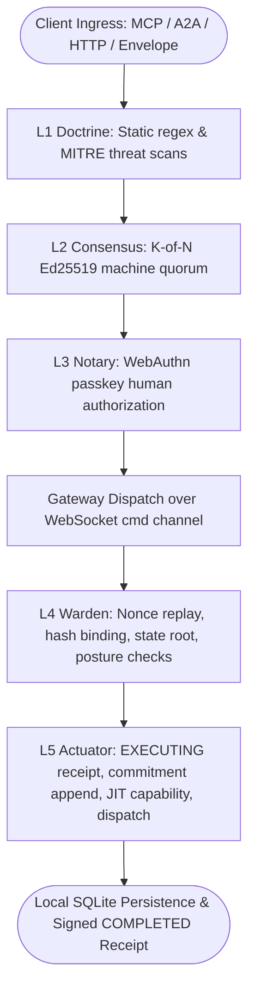
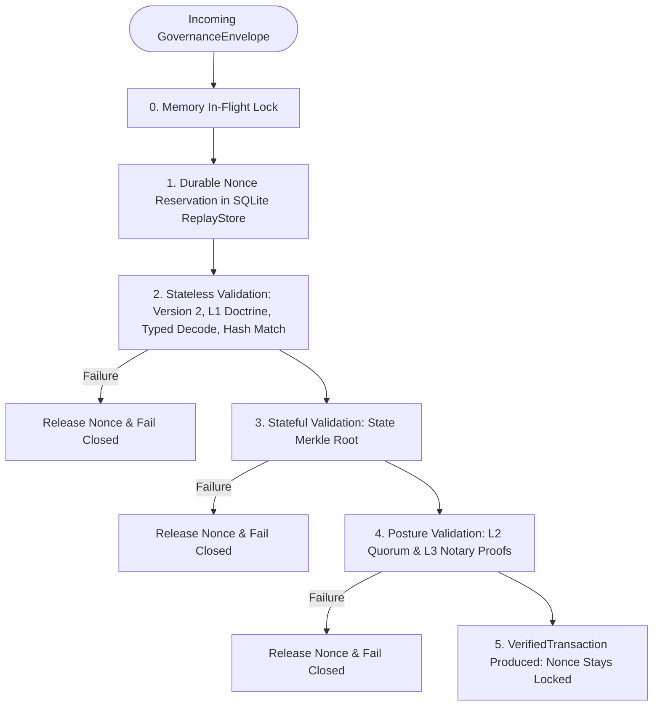

# Governance Architecture

## Purpose

Defines the governance architecture of the ztd platform: the five-layer verification pipeline (L1 through L5), immutable governance postures (`doctrine`, `consensus`, `ratify`, `notary`), canonical transaction container (`GovernanceEnvelope`) hashing and canonicalization, pre-dispatch verification in the L4 Warden, fail-closed execution in the L5 Actuator, just-in-time capability lifecycle, and deterministic protocol stage evidence attestation. The architecture enforces zero-trust execution across distributed runtimes: *A model can ask, but it cannot directly act.*

## Quick index

- [Purpose](#purpose)
- [Quick index](#quick-index)
- [Invariants](#invariants)
  - [Posture and Enforcement (`INV-GOV-POST`)](#posture-and-enforcement-inv-gov-post)
  - [Canonical Envelope and Hashing (`INV-GOV-ENV`)](#canonical-envelope-and-hashing-inv-gov-env)
  - [Bedrock Layers and Posture Rules (`INV-GOV-LAY`)](#bedrock-layers-and-posture-rules-inv-gov-lay)
  - [L4 Warden Pre-Dispatch (`INV-GOV-WARD`)](#l4-warden-pre-dispatch-inv-gov-ward)
  - [L5 Actuator and Execution (`INV-GOV-ACT`)](#l5-actuator-and-execution-inv-gov-act)
  - [Audit Trail and Evidence Chain (`INV-GOV-EVID`)](#audit-trail-and-evidence-chain-inv-gov-evid)
- [Owned surfaces](#owned-surfaces)
- [Procedures](#procedures)
  - [The Five-Layer Interlock Sequence](#the-five-layer-interlock-sequence)
  - [Governance Postures and Enforcement Matrix](#governance-postures-and-enforcement-matrix)
  - [Canonical Transaction Envelope and Deterministic Hashing](#canonical-transaction-envelope-and-deterministic-hashing)
  - [Layer 1 (L1) Doctrine: Technical Bedrock](#layer-1-l1-doctrine-technical-bedrock)
  - [FILE_EDIT Runtime State Protection](#file_edit-runtime-state-protection)
  - [Layer 2 (L2) Consensus: Multi-Agent Quorum](#layer-2-l2-consensus-multi-agent-quorum)
  - [Layer 3 (L3) Notary: Human Authorization](#layer-3-l3-notary-human-authorization)
  - [Layer 4 (L4) Warden: Pre-Dispatch Verification Pipeline](#layer-4-l4-warden-pre-dispatch-verification-pipeline)
  - [Layer 5 (L5) Actuator: Fail-Closed Execution Boundary](#layer-5-l5-actuator-fail-closed-execution-boundary)
  - [Deterministic Protocol Chain and Evidence Graph](#deterministic-protocol-chain-and-evidence-graph)
  - [End-to-End Transaction Lifecycles](#end-to-end-transaction-lifecycles)
- [Anti-patterns](#anti-patterns)
- [Links out](#links-out)

## Invariants

Ids are stable. Append the next free number within each group; do not renumber.

### Posture and Enforcement (`INV-GOV-POST`)

| ID | Rule |
| :--- | :--- |
| INV-GOV-POST-01 | The four canonical governance postures (`doctrine`, `consensus`, `ratify`, `notary`) MUST be parsed via `ParseGovernancePosture` and MUST fail closed on unrecognized names with an error wrapping `ErrInvalidPosture`. Callers MUST propagate that error; neither function panics or degrades to a weaker posture. |
| INV-GOV-POST-02 | The Gateway MUST inject the configured governance posture into `GovernanceEnvelope.Posture` at construction time. The L4 Warden MUST read posture per-envelope from `envelope.Posture` and fail closed with `ErrEnvelopePostureMissing` if absent. |
| INV-GOV-POST-03 | Posture configuration is immutable for the lifetime of the process. In gateway mode, `--posture` defaults to `doctrine`. In outbound operator mode, posture is authoritative from the received envelope. |
| INV-GOV-POST-04 | L2 consensus is enforced under `consensus` and `notary` postures (`RequiresL2Signature() == true`). L3 notary proof is enforced for mutation action types under `ratify` and `notary` postures (`RequiresL3Proof() == true`). |

### Canonical Envelope and Hashing (`INV-GOV-ENV`)

| ID | Rule |
| :--- | :--- |
| INV-GOV-ENV-01 | All new ingress transactions MUST declare protocol version `"2"` (`GovernanceProtocolVersionV2`). Envelopes with version `"1.0"` or other values MUST fail closed at L4 with `ErrTxProtocolVersionUnsupported`. |
| INV-GOV-ENV-02 | The canonical transaction hash (`GenerateMessageID`) for protocol version 2 MUST hash the prefix `ztd-tx-v2\|` followed by `action_type\|event_type\|` and the canonical v1 string representation with SHA-256 encoded as lowercase hex. |
| INV-GOV-ENV-03 | The v1 canonical string MUST serialize fields in strict documented order: `action_type`, `target_resource`, base64-encoded `payload`, `state_merkle_root`, `nonce`, RFC3339 `expires_at`, canonicalized `intent_data`, `requestor_user_id`, `acting_app_id`, `operator_id`, `operator_session_id`, `case_id`, `investigation_id`, `task_id`, `web_session_id`, and `cli_session_id`. Each non-empty field is followed by `\|`; empty or absent fields are omitted together with their delimiter. |
| INV-GOV-ENV-04 | `envelope.Id` and `envelope.TransactionHash` MUST both equal the recomputed transaction hash. Any mismatch MUST be rejected at L4 with `ErrTxTransactionIDMismatch` or `ErrTxTransactionHashMismatch`. |
| INV-GOV-ENV-05 | Posture and L2/L3 governance proofs MUST NOT be included in the transaction hash canonicalization, allowing L2 consensus members to sign before human notary approval and allowing the gateway to set envelope posture without invalidating hashes. |

### Bedrock Layers and Posture Rules (`INV-GOV-LAY`)

| ID | Rule |
| :--- | :--- |
| INV-GOV-LAY-01 | L1 Doctrine MUST validate protobuf field options `(ztd.common.v1).forbidden_patterns` on string fields and run MITRE ATT&CK threat detectors across command, MCP argument, A2A payload, and critical system file edit requests. Any violation MUST reject the transaction fail closed with `ErrTxL1ValidationFailed` across all postures. |
| INV-GOV-LAY-02 | L2 Consensus member votes MUST be Ed25519 signatures over `<transaction_hash>\|<decision>`. Under `consensus` and `notary` postures, affirmative votes (`decision=true`) from distinct members (when `require_distinct` is true) MUST meet policy quorum, or reject with `ErrTxL2QuorumNotMet`. |
| INV-GOV-LAY-03 | Platform bootstrap action types (`actionType.IsBootstrapAction()`) MUST be exempt from L2 consensus gating across all postures, allowing platform enrollment before consensus members are enrolled. |
| INV-GOV-LAY-04 | L3 Notary verification MUST gate mutation actions under `ratify` and `notary` postures (`ErrTxL3ProofMissing`). Read-only actions MUST NOT require an L3 proof under any posture. |
| INV-GOV-LAY-05 | In gateway mode, L3 Notary requires a WebAuthn passkey assertion with challenge matching the transaction hash (`ErrPasskeyProofRequired`). In outbound operator mode, L3 Notary verifies an approved suspended transaction recorded for the same user within the 30-minute window (`L3ApprovalWindow`) and an Ed25519 `cli_signature` over the transaction hash that verifies against the approval public key stored with that suspended transaction; when the record carries an expected certificate fingerprint, the proof's `mtls_cert_fingerprint` MUST match it. L4 passes `requestor_user_id` as the approving user; `operator_id` identifies the execution target. Attaching approval proof MUST preserve every hashed envelope field. |

### L4 Warden Pre-Dispatch (`INV-GOV-WARD`)

| ID | Rule |
| :--- | :--- |
| INV-GOV-WARD-01 | L4 Warden MUST track nonces in memory (`inFlight`) before stateful operations to prevent race conditions, and MUST durably reserve the nonce in `ReplayStore` before payload validation. |
| INV-GOV-WARD-02 | Expiry (`envelope.ExpiresAt`) MUST be strictly checked against the clock before nonce reservation. Expired transactions MUST fail closed with `ErrTxTransactionExpired`. |
| INV-GOV-WARD-03 | Stateless checks MUST run before stateful checks: protocol version, L1 doctrine presence, non-empty ID, event and action agreement (a governed request event MUST map to the envelope `action_type`, otherwise `ErrTxEventActionMismatch`), known action type, non-empty payload (except heartbeat and shutdown, whose typed messages have no required fields and marshal to zero bytes when all-default; `PayloadMayBeEmpty` is the single owner of that exemption), typed payload decoding, document collection scope, execution target ownership, L1 doctrine scanning, and dual hash matching. |
| INV-GOV-WARD-04 | The state Merkle root (`envelope.StateMerkleRoot`) MUST be nonempty and match the admission snapshot in context for Gateway-built transactions, including delivery over the authenticated outbound command channel and resumption of a suspended transaction after L3 approval. That snapshot MUST remain bound by canonical hash and required proof verification; Operators MUST NOT re-fetch it from the Gateway or substitute a local root. Direct submissions without that context MUST match the current local root from `StateRootProvider`; mismatches MUST fail closed with `ErrTxStateRootMismatch`. |
| INV-GOV-WARD-05 | Any validation failure occurring after nonce reservation MUST release the nonce reservation via `replayStore.ReleaseNonce` so that non-admitted transactions do not leave dangling replay locks. |
| INV-GOV-WARD-06 | A `DOCUMENT_UPDATE` or `DOCUMENT_DELETE` payload MUST target a collection marked `_governed` in `protocol/constants/collections.json` (`CollectionName.IsGovernedDocument`); any other collection MUST fail closed with `ErrTxDocumentCollectionNotGoverned` before execution. |
| INV-GOV-WARD-07 | After document collection scope and before doctrine scanning, L4 MUST require `ExecutionTarget.ExecutesFor(envelope.OperatorId)`: an outbound runtime executes only for its own enrolled Operator ID, and the Gateway executes only for the embedded Operator owned by `embedded.Service`. A missing target dependency, empty target on a host action, or foreign target fails closed with `ErrTxTargetOperatorMismatch`. |
| INV-GOV-WARD-08 | Immediately after the `ExecutesFor` check, L4 MUST verify a non-empty `envelope.OperatorSessionId` equals the session `ExecutionTarget.RuntimeIdentity` reports for the runtime, and MUST reject a session claimed without an `operator_id`; a mismatch fails closed with `ErrTxTargetSessionMismatch`. The claim is hashed but proves only what the sender wrote. An empty claim (app record writes, platform enrollment) is admitted and recorded under the runtime's own session. |

### L5 Actuator and Execution (`INV-GOV-ACT`)

| ID | Rule |
| :--- | :--- |
| INV-GOV-ACT-01 | The L5 Actuator MUST enforce fail-closed execution: receipt signing key, non-empty event type, and execution handler MUST be present. When SQL audit is enabled, auditor signing key, key ID, and commitment ledger MUST be present. |
| INV-GOV-ACT-02 | The Actuator MUST sign and persist an `EXECUTING` status `ActionReceipt` to the audit stores before invoking the execution handler. Failure to sign or persist MUST abort execution without invoking the handler (`ErrL5ActuatorSignReceipt`, `ErrL5ActuatorLogReceipt`). |
| INV-GOV-ACT-03 | When `SQLAuditStore` is configured, the Actuator MUST append a signed `CommitmentAttestation` to the SQLite hash-chained commitment ledger against the current chain head before execution. |
| INV-GOV-ACT-04 | The Actuator MUST mint a transaction-scoped, single-action `Capability` bound to the transaction hash, action type, target resource, operator ID, session, and expiry before execution, and MUST dissolve the capability immediately after execution completes or fails. |
| INV-GOV-ACT-05 | The Actuator MUST finalize the `ActionReceipt` with status (`COMPLETED` or `FAILED`), state root after, execution timestamp, and typed `ReceiptFailureCode`. It MUST sign the final receipt, log it, and attach a signed `ReceiptPersistenceAttestation`. |
| INV-GOV-ACT-06 | Remote receipt publication to the Gateway (`PublishActionReceipt`) is best effort and MUST NOT alter or gate local execution outcome. The executing runtime's local SQLite audit record remains authoritative under LFAA. |
| INV-GOV-ACT-07 | A governed `FILE_EDIT` or `RESTORE_FILE` MUST NOT write runtime control or evidence state under `.ztd/` except the executing runtime's controlled evaluation target directory. The executing runtime MUST open the target through `RuntimeFileService.OpenFileEditTarget` before any I/O, and all I/O MUST go through the returned `FileEditTarget`. |
| INV-GOV-ACT-08 | Receipts MUST be filed under a session the executing runtime owns, taken from the L5 `Identity` (the runtime's `ExecutionTarget`), never from an unverified envelope claim. A rejection (`RecordRejectedTransaction`) is always filed under the runtime's own operator and session; the claimed ids stay in the signed receipt's stage evidence, and the rejection receipt is published under the runtime's own identity. A verified envelope that names no session executes under the runtime's own session. Without a resolvable identity the Actuator fails closed (`ErrL5ActuatorRuntimeIdentityMissing`) before anything executes. A rejection receipt that cannot be persisted returns `ErrL5ActuatorRejectionReceiptPersist`, not `ErrL5ActuatorLogReceipt`: nothing executed. The embedded Operator's own session is its claimed operator session, or the Gateway's `EmbeddedOperatorBootstrapSessionID` audit session before the claim. |

### Audit Trail and Evidence Chain (`INV-GOV-EVID`)

| ID | Rule |
| :--- | :--- |
| INV-GOV-EVID-01 | Deterministic stage evidence MUST maintain strict monotonic ordering: `L1_DOCTRINE`, `PROTOCOL_L2`, `L3_NOTARY`, `L4_VERIFICATION`, `RECEIPT_PERSISTENCE`, `COMMITMENT_APPEND`, and `L5_EXECUTION`. |
| INV-GOV-EVID-02 | Stage parentage MUST bind strictly: L1, L2, and L3 stages declare parent ID equal to the L4 stage ID; L4, receipt persistence, and commitment append declare parent ID equal to the L5 stage ID. |
| INV-GOV-EVID-03 | Identity fields (`OperatorID`, `OperatorSessionID`, `RequestorUserID`, `ActingAppID`, `CaseID`, `InvestigationID`, `TaskID`) MUST remain identical across all deterministic stages in a transaction. |
| INV-GOV-EVID-04 | The final `ReceiptPersistenceAttestation` MUST bind the transaction ID, audit record ID, signer key ID, timestamp, and SHA-256 digest of the final receipt signature, signed by the Actuator's private key. |
| INV-GOV-EVID-05 | Relayed receipts at the Gateway MUST be verified against both the Actuator public key signature and the persistence attestation before acceptance; invalid attestations MUST cause rejection. |

## Owned surfaces

| Claim | Path | Verify |
| :--- | :--- | :--- |
| Governance posture definitions and factory | `internal/services/governance/posture.go` | Unit tests in `internal/services/governance/l4_warden_test.go` |
| Envelope proto definition and schema | `protocol/proto/ztd/common/v1/common.proto`, `protocol/models/governance.json` | `make proto-generate` and schema validation tests |
| Envelope hashing and canonicalization | `internal/governance/envelope.go` | Parity tests in `internal/governance/envelope_hash_parity_test.go` |
| L1 Doctrine validation and threat detectors | `internal/services/governance/l1_doctrine.go` | Unit tests in `internal/services/governance/l1_doctrine_test.go` |
| L2 Consensus verification | `internal/services/governance/l2_consensus.go` | Unit tests in `internal/services/governance/l4_warden_consensus_test.go` |
| L3 Notary authorization | `internal/services/governance/l3_notary.go` | Unit tests in `internal/services/governance/l3_notary_test.go` |
| L4 Warden pre-dispatch pipeline | `internal/services/governance/l4_warden.go` | Unit tests in `internal/services/governance/l4_warden_test.go` |
| L5 Actuator execution boundary | `internal/services/governance/l5_actuator.go` | Unit tests in `internal/services/governance/l5_actuator_test.go` |
| Just-in-time capability lifecycle | `internal/services/governance/capability.go` | Unit tests in `internal/services/governance/capability_test.go` |
| Deterministic protocol chain verification | `internal/services/governance/protocol_chain.go` | Chain tests in `internal/services/governance/protocol_chain_test.go` |
| Gateway dispatch envelope construction | `internal/services/gateway/dispatch_service.go` | Unit tests in `internal/services/gateway/dispatch_service_test.go` |
| Operator execution receipts proto | `protocol/proto/ztd/operator/v1/operator.proto` | `make proto-generate` |

## Procedures

### The Five-Layer Interlock Sequence

Every transaction submitted to the platform traverses the five-layer verification pipeline before any state mutation can occur:



1. **L1 Doctrine**: Technical bedrock. Hard static regex analysis over string fields (`forbidden_patterns`) and MITRE ATT&CK threat heuristics across commands, MCP arguments, A2A payloads, and file edits. Enforced fail-closed across all postures.
2. **L2 Consensus**: Multi-agent machine quorum. Evaluates K-of-N threshold signatures from enrolled members over `<transaction_hash>|<decision>`. Enforced under `consensus` and `notary`; audited under `doctrine` and `ratify`.
3. **L3 Notary**: Human authorization. Verifies cryptographic proof of human intent for mutating actions. Enforced under `ratify` and `notary`; audited under `doctrine` and `consensus`. Read-only actions bypass L3.
4. **L4 Warden**: Pre-dispatch verification gate. Reserves transaction nonces in durable SQLite storage, checks expiration, decodes typed payload, validates target ownership, recomputes the canonical transaction hash, verifies state Merkle root, and evaluates posture-required L2/L3 proofs.
5. **L5 Actuator**: Execution boundary. Establishes zero standing privileges. Logs an `EXECUTING` receipt to local SQLite audit storage, appends a signed `CommitmentAttestation` to the commitment ledger, rehydrates scrubbed tokens via local vault keys, mints a single-action JIT capability, invokes the handler, dissolves the capability immediately, captures final state root, signs a `COMPLETED` or `FAILED` receipt, and attaches a signed `ReceiptPersistenceAttestation`.

### Governance Postures and Enforcement Matrix

| Posture | L1 Doctrine | L2 Consensus | L3 Notary (Mutations) | L3 Notary (Read-Only) | Operational Use Case |
| :--- | :--- | :--- | :--- | :--- | :--- |
| **`doctrine`** | Enforced | Audited | Audited | Not Required | Local development, automated testing, and CI pipelines |
| **`consensus`** | Enforced | Enforced ($K$-of-$N$) | Audited | Not Required | Autonomous multi-agent workflows with machine peer review |
| **`ratify`** | Enforced | Audited | Enforced (Human) | Not Required | Interactive workflows requiring human sign-off on mutations |
| **`notary`** | Enforced | Enforced ($K$-of-$N$) | Enforced (Human) | Not Required | High-assurance production environments with full interlock |

The posture is declared at Gateway startup via `--posture` and stamped into `GovernanceEnvelope.Posture`. The executing Operator's L4 Warden evaluates `envelope.Posture` as authoritative.

### Canonical Transaction Envelope and Deterministic Hashing

The `GovernanceEnvelope` (`protocol/proto/ztd/common/v1/common.proto`) is the canonical wire container binding identity, state, payload, and governance proofs.

#### Deterministic Hash Calculation (`GenerateMessageID`)
All transactions enforce protocol version `"2"` (`GovernanceProtocolVersionV2`):

```text
canonical_v2 = "ztd-tx-v2|" + action_type + "|" + event_type + "|" + canonical_v1
transaction_hash = sha256_hex(canonical_v2)
```

The embedded `canonical_v1` string serializes fields in strict deterministic sequence with `|` delimiters:
1. `action_type`
2. `target_resource`
3. `payload` (Base64 standard encoding)
4. `state_merkle_root`
5. `nonce`
6. `expires_at` (RFC3339 formatted)
7. `intent_data` (recursively sorted keys: `key=val,key2=val2`)
8. `requestor_user_id`
9. `acting_app_id`
10. `operator_id`
11. `operator_session_id`
12. `case_id`
13. `investigation_id`
14. `task_id`
15. `web_session_id`
16. `cli_session_id`

Non-empty fields are terminated with `|`. Empty optional fields and their delimiters are omitted. Posture (`posture`), envelope ID (`id`), transaction hash (`transaction_hash`), timestamp (`timestamp`), and governance metadata (`governance`) are excluded from hashing. This guarantees that:
- L2 consensus members can sign the transaction hash before human L3 notary approval is obtained.
- The Gateway can stamp the posture into `envelope.Posture` without altering cryptographic signatures.
- Both `envelope.Id` and `envelope.TransactionHash` MUST match `transaction_hash`.

### Layer 1 (L1) Doctrine: Technical Bedrock

L1 Doctrine performs static verification on raw intent without network dependencies:
1. **Protobuf Field Option Screening**: Scans fields of decoded messages for the `(ztd.common.v1).forbidden_patterns` custom extension, evaluating regular expressions against string values.
2. **Payload Threat Detection**: Analyzes command lines, MCP arguments, A2A skill payloads, and file edits against built-in MITRE ATT&CK detectors and directory-loaded doctrine rules (`internal/services/governance/l1_doctrine.go`).
3. **Directory Doctrine Files**: `NewL1DoctrineFromDir` loads external JSON catalogs (e.g. `blacklist_doctrine.json`, `gitleaks_doctrine.json`, `owasp_crs_doctrine.json`).
4. **Doctrine Bundle Identity**: Records a deterministic `doctrine_bundle_hash` and `doctrine_bundle_version` (`ztd-l1-doctrine-v1+<source@version>`) in stage evidence.

### FILE_EDIT Runtime State Protection

Governed `FILE_EDIT` and `RESTORE_FILE` actions cannot write runtime control or evidence state under `.ztd/`. The sole writable runtime subtree is the controlled evaluation target directory `.ztd/eval/targets/`.
1. **L1 Lexical Screen**: Gateway and Operator L1 reject file paths for which `security.IsProtectedRuntimePath` is true. The check is lexical, case-insensitive, and treats `/` and `\` as path separators.
2. **Execution Confinement**: The executing runtime opens the target via `RuntimeFileService.OpenFileEditTarget`. It resolves symlinks, confirms the path lies outside protected state, and roots all I/O inside an `os.Root` boundary.

### Layer 2 (L2) Consensus: Multi-Agent Quorum

L2 Consensus authenticates machine review by requiring independent affirmative cryptographic votes:
1. **Vote Format**: Ed25519 signature over the UTF-8 payload `<transaction_hash>|<decision>` (`true` or `false`).
2. **Policy Evaluation**: The Warden resolves the policy ID from `envelope.Governance.L2.ConsensusSetId`. The policy defines `MemberKeyIDs`, `Quorum`, `RequireDistinct`, and `Enabled`.
3. **Distinct Member Verification**: If `RequireDistinct` is true, duplicate votes from the same `signer_key_id` reject the transaction with `ErrTxL2DuplicateSigner`.
4. **Quorum Evaluation**: Only affirmative (`decision=true`) votes signed by enrolled, trusted members count toward quorum. Negative votes record authenticated dissent.
5. **Bootstrap Exemption**: Platform bootstrap actions (`actionType.IsBootstrapAction() == true`) are exempt from L2 enforcement across all postures.

### Layer 3 (L3) Notary: Human Authorization

L3 Notary provides non-repudiable human-in-the-loop authorization for mutations (`actionType.IsMutation() == true`):
1. **Mutation Classification**: Action types carry an intrinsic `_mutation` boolean. Read-only actions (`FS_READ`, `FS_LIST`, etc.) bypass L3 enforcement.
2. **Gateway Mode**: Requires a WebAuthn passkey assertion with challenge matching `transaction_hash`. When CLI callers present `mtls_cert_fingerprint`, the session is verified against local CRL records.
3. **Outbound Operator Mode**: Verifies an approved record in `SuspendedTransactionStore` matching `transaction_hash` and `requestor_user_id` within the 30-minute approval window (`L3ApprovalWindow`), signed with an authorized Ed25519 CLI signature.
4. **Suspension Mechanics**: On Gateway MCP/A2A ingress, transactions lacking required L3 proofs suspend, persist in `SuspendedTransactionStore`, and return an approval URL. Once approved, execution resumes via `ResumeWithL3Proof`. Direct envelope submissions and HTTP command dispatches do not suspend; they fail closed if proofs are missing.

### Layer 4 (L4) Warden: Pre-Dispatch Verification Pipeline



1. **In-Flight Lock**: `trackInFlight(envelope.Nonce)` acquires an in-memory lock to eliminate concurrency races.
2. **Durable Nonce Reservation**: Validates `envelope.ExpiresAt` against the clock and reserves `envelope.Nonce` in SQLite (`replayStore.ReserveNonce`).
3. **Stateless Validation**: Enforces protocol version 2, validates action type, decodes protobuf payload, confirms target ownership (`ExecutesFor`), evaluates L1 Doctrine, and verifies dual hash equality (`transaction_hash == envelope.Id == recomputed_hash`).
4. **Stateful Validation**: Validates `envelope.StateMerkleRoot` against the admission snapshot in context.
5. **Posture Validation**: Evaluates posture-required L2 Consensus votes and L3 Notary proofs from `envelope.Posture`.
6. **Fail-Closed Nonce Release**: Any validation failure after Step 1 immediately invokes `releaseNonceReservation` so unadmitted transactions do not leave dangling locks.

### Layer 5 (L5) Actuator: Fail-Closed Execution Boundary

The L5 Actuator owns the execution boundary and enforces zero standing privileges:
1. **Pre-Execution Invariants**: Verifies `ExecutionHandler`, `SigningKey`, `EventType`, and (when SQL audit is active) `AuditorSigningKey` and `CommitmentLedger`.
2. **Initial Receipt Logging**: Constructs and signs an initial `ActionReceipt` with status `EXECUTION_STATUS_EXECUTING`, persists to local SQLite audit storage, and sets stage `DETERMINISTIC_STAGE_KIND_RECEIPT_PERSISTENCE`.
3. **Commitment Append**: Appends a signed `CommitmentAttestation` to the SQLite hash-chained commitment ledger under write lock.
4. **Payload Rehydration**: Rehydrates scrubbed tokens via local vault keys (`ScrubbingService`).
5. **JIT Capability Lifecycle**:
   - Mints a single-action capability (`MintCapability`) binding transaction hash, action type, target resource, operator ID, session ID, and expiry.
   - Dispatches execution to `ExecutionHandler.ExecuteVerifiedTransaction`.
   - Dissolves the capability immediately upon return in a defer-safe block.
6. **Receipt Finalization**: Marks receipt `COMPLETED` or `FAILED`, captures final state root, maps errors to typed `ReceiptFailureCode`, signs final receipt, and attaches a signed `ReceiptPersistenceAttestation`.
7. **Gateway Relay**: Publishes the final receipt to `receipts:<operator_id>:<operator_session_id>` on a best-effort basis. The local SQLite record remains authoritative under LFAA.

### Deterministic Protocol Chain and Evidence Graph

Every completed or failed transaction that reaches the Actuator generates a deterministic protocol evidence chain (`DeterministicProtocolChain`):
- **Ordered Stages**: Enforces strict monotonic ordering: `L1_DOCTRINE` -> `PROTOCOL_L2` -> `L3_NOTARY` -> `L4_VERIFICATION` -> `RECEIPT_PERSISTENCE` -> `COMMITMENT_APPEND` -> `L5_EXECUTION`.
- **Parentage Relationships**: L1, L2, and L3 stages set `ParentStageId` to the L4 stage ID. L4, receipt persistence, and commitment append set `ParentStageId` to the L5 stage ID.
- **Identity Invariance**: Identity attributes (`OperatorID`, `OperatorSessionID`, `RequestorUserID`, `ActingAppID`, `CaseID`, `InvestigationID`, `TaskID`) remain identical across all stages.
- **Content Addressing**: Canonical stages serialize into a content reference: `urn:ztd:evidence:stages:sha256:<hex>`.

### End-to-End Transaction Lifecycles

#### Synchronous Gateway Execution (Embedded Operator)
1. Client submits intent via HTTP or MCP.
2. Gateway constructs `GovernanceEnvelope`, evaluates L1 Doctrine, binds state root, injects posture, and hashes transaction.
3. L4 Warden reserves nonce in SQLite, verifies stateless properties, state root, and posture proofs.
4. L5 Actuator logs `EXECUTING` receipt, appends commitment, rehydrates secrets, mints capability, executes handler, dissolves capability, signs persistence attestation, and persists `COMPLETED` receipt.
5. Signed `ActionReceipt` returns directly in the client response.

#### Outbound Operator WebSocket Dispatch
1. Client submits intent to the Gateway.
2. Gateway constructs envelope, validates L1 Doctrine, verifies mutations under `ratify`/`notary` have L3 proofs, and publishes to `cmd:<operator_id>:<operator_session_id>`.
3. Operator receives envelope, runs L4 Warden, and reserves nonce in its local SQLite replay store.
4. Operator L5 Actuator executes the command, logs receipts to local SQLite audit store, and appends commitment to local ledger.
5. Operator relays signed receipt to `receipts:<operator_id>:<operator_session_id>`.
6. Gateway verifies signatures and persistence attestation before updating its mirrored audit projection.

## Anti-patterns

- **Trusting Client-Supplied Posture**: Allowing clients to set or override governance posture per request. Posture is immutable and set at Gateway startup.
- **Executing Before Initial Receipt Persistence**: Invoking execution handlers before the initial `EXECUTING` receipt and commitment attestation are persisted to durable storage (INV-GOV-ACT-02).
- **Retaining Standing Privileges**: Maintaining persistent credentials or long-lived capabilities. Capabilities must be minted just-in-time and dissolved immediately (INV-GOV-ACT-04).
- **Hashing Posture or Proofs**: Including `posture`, `governance.l2`, or `governance.l3` in `GenerateMessageID`. Hashing governance metadata prevents L2 members from signing prior to human authorization (INV-GOV-ENV-05).
- **Dangling Nonce Reservations**: Failing an envelope verification without releasing the nonce reservation in `ReplayStore` (INV-GOV-WARD-05).
- **Treating Gateway Mirrors as Sovereign Truth**: Relying on Gateway receipt mirrors rather than the executing Operator's local SQLite database under LFAA (INV-GOV-ACT-06).
- **Blocking Bootstrap Actions on Consensus Quorums**: Requiring L2 consensus for platform bootstrap actions. Bootstrap actions must succeed to create the consensus quorum (INV-GOV-LAY-03).

## Links out

- [Platform Architecture Overview](overview.md): High-level system topology and node boundaries.
- [Consensus Architecture](consensus.md): L2 multi-member Ed25519 policies, deliberation mechanics, and quorum verification.
- [Gateway Architecture](gateway.md): Gateway operational modes, reverse proxy routing, and admission control.
- [Operator Architecture](operator.md): Operator runtime daemon, command execution boundary, and local audit storage.
- [Authentication Architecture](auth.md): mTLS identity binding, WebAuthn passkey enrollment, and CLI session verification.
- [Encryption Architecture](encryption.md): Cryptographic primitives, key hierarchies, and TLS 1.3 configuration.
- [Network Architecture](network.md): PKI topology, SPIFFE identities, and pub/sub communication channels.
- [Events Architecture](events.md): Canonical event taxonomy, routing keys, and action classifications.
- [AI Agents and Governance Boundary](agents.md): Agent ingress paths, downstream MCP egress, and tool call constraints.
- [Storage Architecture](storage.md): SQLite schema layouts, commitment ledgers, and document stores.
