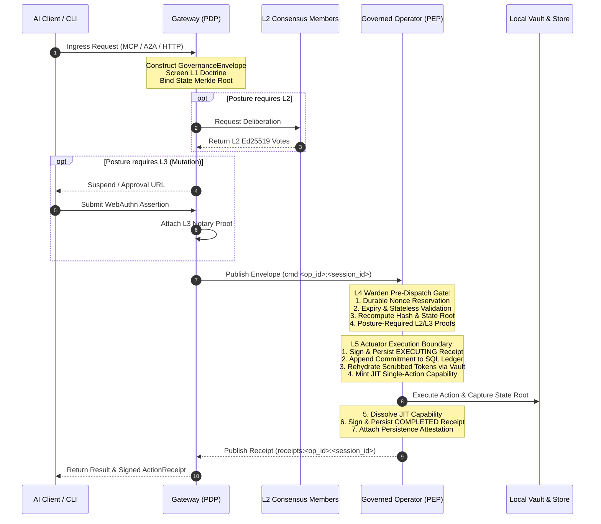

# Platform Architecture Overview

## Purpose

Defines the architecture of the ztd zero-trust governance and execution platform. ztd establishes a deterministic, cryptographic five-layer governance interlock between AI agents, human operators, and execution runtimes. The platform enforces the principle: *A model can ask, but it cannot directly act.* The Governance Gateway acts as the central Policy Decision Point (PDP) and protocol coordinator, while the host-side Governed Operator acts as the sovereign Policy Execution Point (PEP). Every mutation is cryptographically signed, evaluated against immutable security doctrine, validated through pre-dispatch gates, executed under single-action just-in-time capabilities, and recorded in a local-first audit ledger.

## Quick index

- [Purpose](#purpose)
- [Quick index](#quick-index)
- [Invariants](#invariants)
  - [Pipeline and Interlock (`INV-ARCH-PIPE`)](#pipeline-and-interlock-inv-arch-pipe)
  - [Node Topology and Operating Modes (`INV-ARCH-NODE`)](#node-topology-and-operating-modes-inv-arch-node)
  - [Ingress and Client Boundary (`INV-ARCH-INGR`)](#ingress-and-client-boundary-inv-arch-ingr)
  - [Identity and Trust Boundaries (`INV-ARCH-TRUST`)](#identity-and-trust-boundaries-inv-arch-trust)
  - [Storage and Sovereign Audit (`INV-ARCH-STOR`)](#storage-and-sovereign-audit-inv-arch-stor)
- [Owned surfaces](#owned-surfaces)
- [Procedures](#procedures)
  - [Core Operating Modes and Binaries](#core-operating-modes-and-binaries)
  - [The Five-Layer Governance Pipeline](#the-five-layer-governance-pipeline)
  - [Governance Postures and Enforcement Matrix](#governance-postures-and-enforcement-matrix)
  - [End-to-End Governance Execution Flow](#end-to-end-governance-execution-flow)
  - [Client Ingress Surfaces and Protocol Adapters](#client-ingress-surfaces-and-protocol-adapters)
  - [Operator Capability Model and Coexistence](#operator-capability-model-and-coexistence)
  - [Network Topology, Ports, and SPIFFE Identity](#network-topology-ports-and-spiffe-identity)
  - [Authentication, Sessions, and Enrollment Lifecycle](#authentication-sessions-and-enrollment-lifecycle)
  - [Cryptographic Key Custody and Vault Hierarchy](#cryptographic-key-custody-and-vault-hierarchy)
  - [Local-First Audit Architecture (LFAA)](#local-first-audit-architecture-lfaa)
  - [Server-Sent Events (SSE) Infrastructure](#server-sent-events-sse-infrastructure)
  - [Observation Projections and Public Spectator Mirror](#observation-projections-and-public-spectator-mirror)
  - [Protocol Contracts and Code Generation](#protocol-contracts-and-code-generation)
  - [Compliance Evidence and Verification Engine](#compliance-evidence-and-verification-engine)
  - [Host Deployment Topology](#host-deployment-topology)
- [Anti-patterns](#anti-patterns)
- [Links out](#links-out)

## Invariants

Ids are stable. Append the next free number within each group; do not renumber.

### Pipeline and Interlock (`INV-ARCH-PIPE`)

| ID | Rule |
| :--- | :--- |
| INV-ARCH-PIPE-01 | Every operation entering a governed platform path MUST pass through the five-layer verification pipeline (L1 Doctrine, L2 Consensus, L3 Notary, L4 Warden, L5 Actuator). Universal checks (hash integrity, replay nonce reservation, expiration, state Merkle root, payload decode) and posture-required proofs fail closed. Optional L2/L3 proofs are verified and recorded as audit evidence without gating execution. |
| INV-ARCH-PIPE-02 | The Gateway selects one of four immutable governance postures (`doctrine`, `consensus`, `ratify`, `notary`) at startup via `--posture` and stamps it into its constructed `GovernanceEnvelope`. The executing Operator's L4 Warden applies the posture carried in that Gateway-built envelope; client-supplied posture is not authoritative. |
| INV-ARCH-PIPE-03 | The L5 Actuator is the sole execution boundary. It MUST sign an `EXECUTING` receipt, append to the commitment chain when SQL audit is active, rehydrate scrubbed secrets at the execution site, mint a short-lived capability bound to the transaction hash, dispatch the action, dissolve the capability, and persist a final `COMPLETED` or `FAILED` receipt. |

### Node Topology and Operating Modes (`INV-ARCH-NODE`)

| ID | Rule |
| :--- | :--- |
| INV-ARCH-NODE-01 | The Gateway (PDP) and Operator (PEP) MUST be instantiated from the single static `ztd` Go binary (`ztd gw start` and `ztd operator start`). The Gateway coordinates ingress, PKI, and L1–L3 deliberation; the Operator maintains sovereign execution and local audit evidence. |
| INV-ARCH-NODE-02 | Outbound Operators MUST establish outbound-only mTLS connections to the Gateway and subscribe to exact session-specific command channels (`cmd:<operator_id>:<operator_session_id>`). The Gateway MUST NOT expose or require inbound management listeners into remote Operator environments. |
| INV-ARCH-NODE-03 | Multiple Operator instances running on the same host MUST be disambiguated by a composite SHA-256 system fingerprint combining host properties with `local_dir`, `account`, `port`, and `operator_capabilities` (`data`, `inference`, `provenance`, `observer`). Witness-only operators (`provenance`, `observer`) MUST reject arbitrary command execution; adding `data` enables governed commands in the same process. |
| INV-ARCH-NODE-04 | Every read of an Operator document MUST move an active remote Operator without a heartbeat for longer than `constants.OperatorStaleAfter` (twice its declared heartbeat interval, floor 60 seconds, ceiling 10 minutes) to `stale` on read. The embedded Operator is exempt. Heartbeats restore `stale` to `active`; heartbeats MUST NOT revive `stopped` or `terminated` Operators. |
| INV-ARCH-NODE-05 | Enrolling an Operator whose `system_fingerprint` matches an existing non-terminated remote Operator held by the same owner MUST terminate the earlier Operator document and deactivate its session in the same governed issuance step. One Operator identity MUST NOT hold multiple active leases. |

### Ingress and Client Boundary (`INV-ARCH-INGR`)

| ID | Rule |
| :--- | :--- |
| INV-ARCH-INGR-01 | Client-native tools, direct shell execution, MCP servers reached directly by clients, and unmonitored side channels remain outside the governance boundary. Tools are governed ONLY when invoked through a ztd ingress (Gateway MCP, A2A, Governed HTTP dispatch, CLI `operator run`, or direct envelope) and executed via the L5 Actuator. |
| INV-ARCH-INGR-02 | Direct envelope submission (`POST /api/v1/governance/envelopes`) and governed HTTP dispatch (`POST /api/v1/operators/commands`) MUST NOT synthesize missing L2 votes or L3 proofs; transactions missing posture-required evidence MUST fail closed at L4 verification. |

### Identity and Trust Boundaries (`INV-ARCH-TRUST`)

| ID | Rule |
| :--- | :--- |
| INV-ARCH-TRUST-01 | All internal network transport MUST enforce TLS 1.3 with mutual TLS (mTLS) for protected routes and pub/sub channels. Certificates MUST use ECDSA P-256 and carry SPIFFE URI SANs under the `ztd.local` trust domain. |
| INV-ARCH-TRUST-02 | The Gateway PKI hierarchy MUST isolate the Hub Intermediate CA (signing the Gateway serving certificate) from the Operator Intermediate CA (signing workload leaves). Workload leaf certificates MUST NOT exceed 7 days validity. Certificate revocation MUST be verified per request against local CRL storage. |

### Storage and Sovereign Audit (`INV-ARCH-STOR`)

| ID | Rule |
| :--- | :--- |
| INV-ARCH-STOR-01 | Under the Local-First Audit Architecture (LFAA), each executing runtime (Gateway and remote Operators) is authoritative for its sovereign SQLite audit database, execution events, and local state root. Gateway receipt copies mirrored over pub/sub are best-effort projections. |
| INV-ARCH-STOR-02 | Sensitive command results, diffs, and governed file contents MUST be encrypted at rest using AES-256-GCM via a three-tier vault key hierarchy (vault key sealed under the platform master key, HKDF-derived KEK, and wrapped DEK). |

## Owned surfaces

| Claim | Path | Verify |
| :--- | :--- | :--- |
| Unified CLI entrypoint and commands | `cmd/ztd/main.go`, `internal/cli/cmd/` | `make build && ./ztd --help` |
| Gateway daemon and lifecycle | `internal/cli/cmd/gw/`, `internal/services/gateway/` | `ztd gw start`, `ztd gw status` |
| Operator daemon and lifecycle | `internal/cli/cmd/operator/`, `internal/services/operator/` | `ztd operator start`, `ztd operator list` |
| Five-layer governance pipeline | `internal/services/governance/` | `internal/services/governance/` |
| Machine consensus and deliberation | `internal/services/consensus/`, `internal/services/governance/l2_consensus.go` | `internal/services/consensus/` |
| MCP server and native tool registry | `internal/services/mcp/` | `internal/services/mcp/native_tool_registry.go` |
| Network, PKI, and SPIFFE identity | `internal/services/network/`, `protocol/workload_identity.go` | `internal/services/network/` |
| Cryptographic vault and keystore | `internal/services/vault/`, `internal/services/keystore/` | `internal/services/vault/` |
| Sovereign audit and SQLite storage | `internal/services/storage/`, `internal/services/audit/` | `internal/services/storage/` |
| SSE event bridge and pub/sub broker | `internal/services/sse/`, `internal/services/pubsub/` | `internal/services/sse/` |
| Terminal UI (`ztd tui`) | `internal/cli/tui/`, `internal/cli/cmd/tui/` | `./ztd tui --help` |
| Console (Gateway-embedded browser frontend) | `console/`, `internal/services/gateway/console/` | `make console-embed-check` |
| Protocol definitions and bindings | `protocol/proto/ztd/`, `protocol/` | `make proto-generate`, `make doctrines-validate` |
| Compliance catalogs and KSI verification | `protocol/compliance/`, `internal/cli/cmd/compliance/` | `ztd compliance evidence-graph verify` |

## Procedures

### Core Operating Modes and Binaries

The platform ships as a single static Go binary (`ztd`) serving multiple operational roles:

1. **Governance Gateway (`ztd gw start`)**: The central Policy Decision Point (PDP) and protocol coordinator. The Gateway admits client transactions, manages PKI, runs L1 Doctrine screening, coordinates L2 Consensus deliberation, manages L3 Notary approval suspensions, brokers outbound-only pub/sub WebSocket channels to Operators, and persists Gateway coordination state. For local operations, the Gateway executes through an in-process embedded Operator substrate (`internal/services/gateway/embedded/`).
2. **Governed Operator (`ztd operator start`)**: The sovereign Policy Execution Point (PEP) for target runtimes. The Operator exposes no inbound management listeners, initiates an outbound-only TLS 1.3 mTLS connection to the Gateway, pulls work exclusively from a dedicated session command channel (`cmd:<operator_id>:<operator_session_id>`), independently executes L4 Warden verification, and executes accepted actions through the L5 Actuator.
3. **Embedded Operator**: The in-process Operator substrate inside the Gateway (`operator_type: embedded`). It runs concurrently with the Gateway, always carries the `data` and `inference` capabilities, works in `.ztd/operators/embedded-operator`, and accesses local execution evidence via `storage.OpenLocalExecutionEvidence`.
4. **CLI Client (`ztd`)**: Unified command-line interface encompassing command groups: `gw`, `auth`, `mcp`, `operator`, `vault`, `test`, `audit`, `report`, `public`, `swagger`, `tui`, `version`, `compliance`, and `eval`. Flags and defaults resolve via `./ztd <command> --help`.
5. **Terminal UI (`ztd tui`)**: Interactive terminal interface monitoring Gateway state, connected Operators, session leases, and recent transactions.
6. **Console**: React and TypeScript Single Page Application embedded into the Gateway binary and served at `/console/` on the Gateway HTTPS origin. It calls Gateway APIs for WebAuthn authentication, human approvals, Operator inventory, and audit telemetry; it does not communicate directly with Operators.
7. **Evaluation Explorer**: Optional evaluation campaign interface served by the Gateway's loopback Explorer listener when enabled and configured. It is an auxiliary surface, not a separate always-running platform service.

### The Five-Layer Governance Pipeline

Every transaction entering a governed platform path traverses five distinct verification and execution layers:

| Layer | Owner | Responsibilities | Failure Mode |
| :--- | :--- | :--- | :--- |
| **L1 Doctrine** | Gateway (PDP) & Operator (PEP) | Static forbidden-pattern matching, MITRE ATT&CK heuristics, and command safety analysis. Detects privilege escalation, destructive disk operations, reverse shells, and credential access. | Fails closed with `ErrTxL1ValidationFailed` across all postures. |
| **L2 Consensus** | Gateway (Coord.) & Operator (Verify) | $K$-of-$N$ Ed25519 multi-agent machine quorum over `<transaction_hash>\|<decision>`. Members independently deliberate and sign affirmative or negative votes. | Fails closed with `ErrTxL2QuorumNotMet`, or `ErrTxL2SignatureInvalid` for a forged member vote, under `consensus` and `notary`. Audited under `doctrine` and `ratify`. |
| **L3 Notary** | Gateway (Coord.) & Operator (Verify) | Human authorization for mutating operations. Gateway challenges require WebAuthn passkey assertions. Operator verification checks approved suspended transactions with authorized cryptographic proofs. | Fails closed with `ErrTxL3ProofMissing` for mutations under `ratify` and `notary`. Audited under `doctrine` and `consensus`. |
| **L4 Warden** | Executing Operator (PEP) | Pre-dispatch verification gate: reserves nonce in durable SQLite replay store, verifies TTL expiry, decodes typed payload, validates target ownership, re-runs L1 Doctrine, recalculates transaction hash, checks state Merkle root, and enforces posture-required L2/L3 proofs. | Fails closed; releases reserved nonce and records a signed failed receipt. |
| **L5 Actuator** | Executing Operator (PEP) | Sole execution boundary: signs and persists an initial `EXECUTING` receipt, appends signed commitment to SQL ledger, rehydrates scrubbed secrets via local vault, mints a short-lived JIT capability, dispatches typed action handler, dissolves capability, and persists signed `COMPLETED` or `FAILED` receipt. | Fails closed; execution aborts if receipt signing, commitment append, or capability minting fails. |

### Governance Postures and Enforcement Matrix

The platform operates under one of four immutable governance postures set at Gateway startup via `--posture <posture>`:

| Posture | L1 Doctrine | L2 Consensus | L3 Notary (Mutations) | L3 Notary (Read-Only) |
| :--- | :--- | :--- | :--- | :--- |
| **`doctrine`** | Enforced | Audited | Audited | Not Required |
| **`consensus`** | Enforced | Enforced ($K$-of-$N$) | Audited | Not Required |
| **`ratify`** | Enforced | Audited | Enforced (Human) | Not Required |
| **`notary`** | Enforced | Enforced ($K$-of-$N$) | Enforced (Human) | Not Required |

Posture selects which evidence gates execution; it does not by itself configure Consensus services, voters, or human identities.

Universal invariants enforced across every posture: L1 Doctrine evaluation, canonical transaction hash integrity, durable replay nonce reservation, expiration validation, state Merkle root verification, execution target matching, and payload decoding.

### End-to-End Governance Execution Flow

A caller can instead deny a suspended transaction through `POST /api/v1/approvals/respond`. The Gateway resubmits it with an L3 deny marker; the Operator rejects it and returns a signed `L3_DENIED` receipt, which the Gateway returns and publishes as `approval.completed`. The denied transaction does not continue through normal execution.

### Client Ingress Surfaces and Protocol Adapters

ztd provides five distinct ingress channels:

1. **Model Context Protocol (MCP)**: JSON-RPC 2.0 endpoint at `POST /mcp` and stdio bridge via `ztd mcp stdio`. Translates `tools/call`, `resources/read`, and `prompts/get` into canonical `GovernanceEnvelope` transactions.
2. **Agent-to-Agent (A2A)**: JSON-RPC endpoint at `POST /api/v1/a2a/call` for cross-agent skill invocation wrapped in `A2A_CALL` envelopes.
3. **Governed HTTP Dispatch**: Authenticated applications post registered request event types and serialized protobuf payloads to `POST /api/v1/operators/commands`. The Gateway validates session identity, derives `action_type`, attaches posture, and publishes to the Operator command channel. Fails closed if L3 proofs are required.
4. **Direct Envelope Submission**: Pre-constructed envelopes submitted via `POST /api/v1/governance/envelopes` with pre-gathered L2/L3 proofs. The Gateway does not synthesize missing proofs; unproved transactions fail closed at L4.
5. **CLI-Directed Execution**: Enrolled operators bound via `ztd operator bind` receive parallel commands dispatched through `ztd operator run`.

The reference binary includes a native registry of 32 typed tools (`internal/services/mcp/native_tool_registry.go`) covering database triage, filesystem profiling, network probing, process monitoring, system introspection, Git operations, shell execution, and audit queries.

### Operator Capability Model and Coexistence

A single host can run multiple Operator processes concurrently. Each Operator is disambiguated by its `system_fingerprint`: a SHA-256 composite hash over host hardware properties combined with `local_dir`, `account`, `port`, and `operator_capabilities`.

| Capability | Startup Flag | Core Responsibility | Boundary Constraints |
| :--- | :--- | :--- | :--- |
| **`data`** | Default, `--capabilities data` | Governed tool execution, local shell commands, filesystem operations | Primary PEP for tool execution. Discovered for general command dispatch. |
| **`inference`** | `--capabilities inference` | Governed LLM inference backend, model registry sync, Ollama provider dispatch | Serves model queries; executes model pull/residency. Excluded from general tool dispatch. |
| **`provenance`** | `--capabilities provenance --model-storage-root <path>` | Storage-side model weight attestation and SHA-256 manifest hashing | Read-only witness. Arbitrary command execution is rejected by `ValidateWitnessCommand`. |
| **`observer`** | `--capabilities observer` | Hardware, temperature, power, and residency telemetry sampling | Read-only witness. Arbitrary command execution is rejected by `ValidateWitnessCommand`. |

### Network Topology, Ports, and SPIFFE Identity

The network topology strictly isolates management, application, observation, and public surfaces:

| Port | Protocol | Listener | Authentication Policy | Purpose |
| :--- | :--- | :--- | :--- | :--- |
| **8080 default** | HTTP | Gateway | Public / Token Bootstrap | Plaintext discovery (`/.well-known/ztd/pki/*`), health, bootstrap WebSocket, and redirects to the resolved HTTPS listener |
| **8443 default** | HTTPS | Gateway | Route-Gated (`RouteAuthNone`, `RouteAuthMTLS`, `RouteAuthWebSession`, `RouteAuthDual`) | Authenticated API, Console SPA, MCP, A2A, WebSocket pub/sub command channels, and governance routes |
| **8081** | HTTP | Gateway | Loopback Only | Private ingest listener for exporting public spectator mirror feeds |
| **8082** | HTTP | Public Mirror | Anonymous / Public | Public spectator mirror serving sanitized feeds, SSE, and content-addressed proofs |
| **5173 default** | HTTP | Gateway Explorer | Loopback Only | Optional evaluation Explorer SPA when enabled/configured |
| **11434**| HTTP | Ollama Provider | Localhost / Private LAN | Model provider dialed exclusively by the Inference Operator |

The Gateway's HTTP and HTTPS values are defaults. After configuration validation, startup checks availability and may bind both listeners at the same higher offset; the selected values are persisted in the launch profile. Auxiliary mirror and Explorer listeners have separate loopback defaults and may be configured independently.

Certificates are issued under the `ztd.local` SPIFFE trust domain:
- Operator: `spiffe://ztd.local/operator/<organization_id>/<operator_id>/<operator_session_id>`
- CLI: `spiffe://ztd.local/cli/<user_id>/<cli_session_id>`
- App Workload: `spiffe://ztd.local/app/<app_id>`
- Human User: `spiffe://ztd.local/user/<user_id>`
- Gateway Hub: `spiffe://ztd.local/hub/operator-listen`

### Authentication, Sessions, and Enrollment Lifecycle

Authentication enforces strong cryptographic identity:
1. **Workload and Operator Authentication**: Mutual TLS using ECDSA P-256 leaf certificates with a 7-day maximum validity. Re-enrollment of an existing active fingerprint supersedes the previous lease.
2. **Console Browser Sessions**: Web sessions authenticated via WebAuthn/FIDO2 passkey assertions registered during initial Gateway bootstrap.
3. **CLI Authentication**: Mutual TLS certificates issued through interactive browser ceremonies or headless enrollment requiring administrative approval (`POST /api/v1/auth/approve-cli`).
4. **Revocation**: Administrative revocation immediately adds the certificate serial to local CRL storage, invalidates active sessions, and terminates WebSocket connections.

### Cryptographic Key Custody and Vault Hierarchy

ztd protects sensitive data using a three-tier encryption hierarchy:
- **Platform Master Key**: 32-byte key sealed by the OS key store, or by an ssh-agent key on hosts without one. Never stored in plaintext, and a host with neither fails closed.
- **Vault Key**: 32-byte key sealed under the master key and stored in `.ztd/secrets/vault_key`.
- **Key Encryption Key (KEK)**: Derived from the vault key using HKDF-SHA256 with domain-specific salt and info strings.
- **Data Encryption Key (DEK)**: 256-bit AES key wrapped by the KEK using AES Key Wrap and stored in `.ztd/vault/vault.header`. Encrypts sensitive audit logs, file diffs, and scrubber tokens using AES-256-GCM.

### Local-First Audit Architecture (LFAA)

Under the Local-First Audit Architecture (LFAA), each executing runtime is authoritative for its own local execution evidence:
- **Primary SQLite Database (`ztd.db`)**: Located in `.ztd/data/` for each runtime. Contains audit logs, nonce replay tables, receipts, and commitment ledgers.
- **Commitment Ledger**: Hash-chained SQLite table linking consecutive execution commitments cryptographically to prove historical tamper resistance.
- **Git-Backed File Ledger**: Tracks all governed file mutations under `.ztd/data/ledger/` as encrypted Git commits, exposing the repository HEAD commit as a verifiable state snapshot.
- **Gateway Projection**: Receipts mirrored to the Gateway over WebSocket channels are best-effort projections and do not supersede local Operator evidence.

### Server-Sent Events (SSE) Infrastructure

The Gateway operates an SSE streaming infrastructure for live observation:
- **Internal Production**: The Gateway publishes internal events for operator status, passkey registration, and L3 approval notifications. External observe producers push run and agent telemetry over mTLS routes (`POST /api/v1/observe/producer/*`).
- **Client Consumption**: Browsers and CLI tools stream live updates via `GET /api/v1/sse/stream` or query historical buffers via `GET /api/v1/sse/events`.
- **Telemetry Boundary**: SSE is strictly transient delivery telemetry. It does not carry durable governance state or modify the state Merkle root.

### Observation Projections and Public Spectator Mirror

Observation operates across strict trust tiers:
1. **Private Observe API**: Authenticated Gateway endpoints serving raw operational telemetry to authorized operators and CLI clients.
2. **Evaluation Explorer**: Optional Gateway auxiliary listener, loopback port 5173 by default, providing evaluation campaign views when enabled/configured.
3. **Public Spectator Mirror**: Operates on loopback port 8082 as a read-only, sanitized mirror. The Gateway exports public-safe event projections over internal port 8081. All credentials, paths, identities, and private payloads are scrubbed prior to export.

### Protocol Contracts and Code Generation

The protocol library (`protocol/`) establishes the canonical platform contracts:
- **Protobuf Contracts**: Schemas defined under `protocol/proto/ztd/` generate Go and TypeScript bindings via `make proto-generate`. Hand-editing generated code is prohibited.
- **Constants Registries**: Central JSON registries in `protocol/constants/` define events, action types, error codes, and ports. Validated via `make constants-check`.
- **Canonical Serialization**: Transaction hashing enforces canonical protojson serialization (`ztd-tx-v2|<action_type>|<event_type>|<canonical_v1>`) to guarantee cross-language signature compatibility.

### Compliance Evidence and Verification Engine

The platform provides a built-in compliance evidence engine:
- **Framework Mapping**: Protocol catalogs map platform governance controls directly to FedRAMP, NIST SP 800-53, SOC 2, and COSAiS frameworks.
- **Evidence Graphs**: Evaluation and runtime evidence is imported into a content-addressed evidence graph verified via `ztd compliance evidence-graph verify --eval-run <run-id>`.
- **Release Preparation**: `ztd compliance release-prepare` exports bounded operational evidence, generates a sealed public report bundle, exports and verifies it offline, and generates immutable compliance evidence projections.

### Host Deployment Topology

The primary deployment model is host-native execution using the single static binary:
- `make up`: Compiles the binary and starts the Gateway on localhost.
- `make gw`: Starts the Gateway with its embedded Operator configured with specified capabilities.
- `make operator`: Launches an outbound Operator connecting to the Gateway over mTLS.
- `make status`: Reports health and active Operator sessions.
- `make down`: Gracefully stops running Gateway and Operator daemons.

## Anti-patterns

- **Bypassing the Five-Layer Pipeline for Client-Native Tools**: Assuming client-native tools or directly reached MCP servers provide governance without traversing a ztd ingress (INV-ARCH-INGR-01).
- **Mutating Governance Posture at Runtime**: Attempting to alter `--posture` after Gateway startup without a process restart (INV-ARCH-PIPE-02).
- **Synthesizing Missing L2/L3 Proofs on Direct Ingress**: Allowing direct envelope submissions or HTTP command dispatch to fabricate missing consensus votes or notary proofs (INV-ARCH-INGR-02).
- **Treating Gateway Mirrors as Authoritative Execution Truth**: Relying on Gateway receipt mirrors rather than the executing Operator's sovereign local audit store (INV-ARCH-STOR-01).
- **Opening Inbound Management Listeners on Operators**: Exposing inbound network ports on remote Operators instead of maintaining outbound-only mTLS connections (INV-ARCH-NODE-02).
- **Dispatching Mutating Actions to Witness Operators**: Routing general command execution to Provenance or Observer operators rather than Data operators (INV-ARCH-NODE-03).
- **Exposing Internal Gateway Routes to Public Spectators**: Routing public traffic directly to the private Gateway on port 8443 rather than through the isolated public mirror on port 8082 (INV-ARCH-TRUST-01).
- **Hard-Wrapping Source Prose Lines or Inserting Dynamic Timestamps**: Breaking context cache prefix stability and formatting guidelines during documentation edits (INV-DOC-STYLE-01, INV-DOC-CACHE-01).

## Links out

- [Gateway Architecture](gateway.md): Gateway operating modes, route mapping, session types, and embedded Operator substrate.
- [Operator Architecture](operator.md): Operator execution boundary, native tool catalog, and local audit vault.
- [Governance Architecture](governance.md): Five-layer verification pipeline, envelope structure, and posture semantics.
- [Consensus Architecture](consensus.md): Machine consensus, deliberation mechanics, and signature verification.
- [Authentication & Authorization](auth.md): CLI enrollment, recovery, rotation, and WebAuthn notary approvals.
- [Network Architecture](network.md): PKI hierarchy, TLS 1.3/mTLS transport, SPIFFE identity, and port topology.
- [Encryption Architecture](encryption.md): Vault lifecycle, three-tier key hierarchy, and FIPS compliance.
- [Storage Architecture](storage.md): Audit store, commitment ledger, replay store, and SQLite persistence.
- [Events Architecture](events.md): Canonical event taxonomy, routing keys, and action classifications.
- [AI Agents and Governance Boundary](agents.md): Agent ingress paths, downstream MCP egress, and tool call constraints.
- [Evaluations](evals.md): Model evaluation framework, campaign scoring, and Operator capabilities used by evaluations.
- [Model Provenance](model-provenance.md): Model weight attestation and chain-of-custody verification.
- [Public Spectator Architecture](public_spectator.md): Read-only spectator mirror and threat model.
- [Console Architecture](console.md): Gateway-embedded browser frontend and its trust boundaries.
- [Protocol Library](protocol.md): Protobuf definitions, JSON registries, and code generation.
- [Documentation Guide](../devs/docs.md): Invariant definitions, metadata specifications, and audit workflows.
- [Developer Guidelines](../devs/devs.md): Repository coding standards and invariant rules.
- [Compliance Alignment Reference](../reference/compliance-alignment.md): KSI evaluation framework and control crosswalks.
