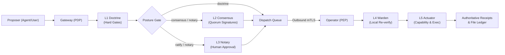

# Governing Agentic Execution Without Surrendering Data Custody

## Abstract

Autonomous artificial intelligence agents combine probabilistic reasoning with direct access to enterprise data, tools, credentials, and persistent state. This integration exposes a structural architectural vulnerability: a model prediction can trigger an irreversible infrastructure action before an independent policy authority has verified that the mutation is authentic, permitted, fresh, and attributable. Empirical evaluations of tool-augmented language models demonstrate that indirect prompt injection, memory poisoning, and tool misuse succeed across diverse model families, while global regulatory frameworks mandate strict boundaries for data privacy, authorization, and human oversight [1–7]. While improving model alignment and safety filtering is necessary, safety-tuned model behavior does not establish an execution boundary.

ztd posits that an AI system may propose an action, but it must never authorize its own execution. The platform enforces a strict separation between probabilistic reasoning and execution authority, retains authoritative state and cryptographic evidence at the data owner's boundary, encapsulates governed mutations as typed, state-bound transactions, and independently re-verifies every transaction where execution occurs. This paper articulates this zero-trust execution thesis, maps it to established least-privilege principles, formalizes the ztd reference architecture, and distinguishes implemented technical mechanisms from empirical evaluation benchmarks.

## 1. Introduction

The defining security challenge in agentic computing is not that large language models generate occasional hallucinations. Rather, it is that modern software architectures convert probabilistic model outputs into unconstrained infrastructure side effects. An agent reads an inbound email, retrieves enterprise documentation, queries an API, modifies configuration files, executes operating-system commands, or approves financial transfers. When reasoning engines and tool execution layers share ambient credentials and mutable runtime contexts, prompt-level manipulation immediately escalates into catastrophic integrity, confidentiality, and availability failures.

This failure mode is thoroughly documented across empirical literature:
- **InjecAgent** benchmarks indirect prompt injection against tool-integrated agents and reports substantial attack success [1].
- **AgentDojo** benchmarks the task utility and security of tool-using agents under adversarial conditions and reports that defenses do not reliably provide both [2].
- **Agent Security Bench (ASB)** formalizes and benchmarks attacks and defenses against LLM-based agents across multiple scenarios, tools, and model backbones [3].

These findings demonstrate that conversational context constitutes both data and instruction surfaces; therefore, prompt filtering and fine-tuning alone cannot serve as an authorization boundary. NIST's Generative AI Profile (NIST AI 600-1) classifies prompt injection, information disclosure, and improper human-AI configuration as holistic system risks requiring architectural controls [4]. The 2026 International AI Safety Report warns that autonomous agents amplify systemic risk by eliminating windows for human intervention prior to execution [5]. Furthermore, NIST's concept paper on software and agent identity identifies cryptographic identification, least-privilege authorization, and non-repudiable auditability as mandatory prerequisites for agent deployment [6].

To address these vulnerabilities, ztd enforces three core architectural propositions:

1. **Reasoning is not authority.** An AI model, agentic workflow, or human operator produces proposals. An independent, deterministic policy enforcement authority decides whether a proposal may mutate state.
2. **Governance attaches to the action.** Identity, canonical intent, target resource, payload, state Merkle binding, temporal freshness, and policy proofs are cryptographically bound to a single transaction rather than an open-ended session.
3. **Claims follow evidence.** Cryptographically signed receipts and independently verifiable hash chains determine what occurred on the governed path. High-level architecture claims or isolated benchmark demonstrations do not substitute for reproducible cryptographic proofs.

The ztd architecture operationalizes these propositions through clear protocol roles: Governance Gateway (Policy Decision Point), Governed Operator (Policy Execution Point), L1 Doctrine, L2 Consensus, L3 Notary, L4 Warden, and L5 Actuator.

## 2. Operational Foundations

This architectural position is grounded in the requirements of operating high-consequence remote data systems: changes are made within the resource owner's policy controls, credentials are narrowly scoped, and each change leaves an audit record. ztd expresses these requirements as code-enforced mechanisms: a typed proposal (Section 5.2), a five-layer verification pipeline (Section 5.3), host-local execution (Sections 5.3 and 5.4), and signed receipts (Section 5.6).

Reasoning workflows—whether powered by proprietary frontier models, local open-weights engines, or human operators—operate strictly as proposers outside the trusted computing base. The platform supplies the identity, policy enforcement, verification, execution, and receipt boundary between proposed intent and target systems.

## 3. The Coupling Problem in Agent Architectures

### 3.1 Reasoning, Context, and Authority

Conventional agent frameworks couple four distinct architectural responsibilities into a single process:
- **Epistemic State**: What the model has observed, inferred, or summarized in its context window.
- **Authoritative State**: The ground-truth configuration, records, and files resident on the managed host.
- **Execution Authority**: The ambient operating-system credentials, API keys, or permissions granted to the agent process.
- **Evidence**: The logs and telemetry that verify what was requested, admitted, executed, and completed.

Coupling these concerns creates structural vulnerabilities. Because model context serves simultaneously as data input and execution instruction, indirect prompt injection allows third-party inputs to hijack model execution [1, 2]. Memory poisoning allows malicious instructions to persist across conversational turns [3]. Tool misuse turns legitimate capabilities toward unauthorized objectives. Increasing model parameter scale or reasoning depth does not resolve this fundamental ambiguity.

### 3.2 Custody as an Architectural Variable

Enterprise adoption of AI inference does not require surrendering custody of authoritative state to third-party model providers. Workloads can instead maintain raw data, cryptographic keys, and execution environments within local boundaries while transmitting minimized projections to remote inference endpoints. The model generates a proposal; the local execution boundary verifies and executes it.

Minimizing disclosure does not guarantee zero leakage. Some analytical tasks require semantically meaningful payloads. The sovereign execution boundary provides bounded token scrubbing and local rehydration for governed pathways: sensitive tokens are masked as reversible placeholders (`{{UEI_<owner>_N}}`) before leaving the host and rehydrated strictly at the execution site (L5 Actuator). The resource owner retains explicit responsibility for external model inputs, account permissions, and bypass pathways.

### 3.3 Session Authority Versus Action Authority

Session-based authorization models answer whether a principal is authenticated to interact with a system over an extended time interval. Agentic systems require a fundamentally different authorization granularity: *May this principal execute this specific mutation, against this target resource, in this exact state, before this expiration timestamp, supported by these verified governance proofs?*

NIST SP 800-207 defines Zero Trust Architecture around dynamic, least-privilege access decisions evaluated per request under assumed network compromise [7]. Saltzer and Schroeder's principle of least privilege dictates that every program and user must operate with the minimum privileges necessary to complete a task [8]. ztd applies these principles directly to agentic execution: identity establishes who proposed the work, but execution authority is minted just-in-time for a single, verified transaction.

## 4. Design Requirements for Governed Execution

1. **Treat Every Proposer as Untrusted**: Human operators, AI models, workflow engines, MCP tools, and A2A clients may propose mutations. None receives execution authority simply by virtue of generating a plausible plan. Model alignment is removed from the trusted computing base for authorization.
2. **Bind Policy to Canonical Intent**: Governed intent must explicitly encode action type, target resource, typed payload, requesting identities, Merkle state binding, nonce, expiration, and governance metadata. Canonical serialization and deterministic hashing are designed so that a signature over one intent cannot authorize a modified mutation; the L4 Warden recomputes the hash before execution.
3. **Verify at the Execution Site**: A remote admission decision must not compel a local host mutation. The component resident on the target system must independently verify freshness, replay state, canonical intent, state Merkle roots, and posture-mandated proofs prior to execution.
4. **Minimize Standing Authority**: The L5 Actuator mints a single-use, transaction-bound capability for each dispatch and dissolves it after the handler returns. This narrows standing authority; it does not remove host-level credentials, which remain in scope for host hardening (Section 8).
5. **Preserve Evidence Before and After Dispatch**: A system recording only completed outcomes cannot distinguish between an unexecuted request and a crashed execution. The execution boundary must persist signed pre-execution (`EXECUTING`) and post-execution (`COMPLETED`/`FAILED`) receipts, backed by durable storage attestations.
6. **Make Claim Boundaries Explicit**: Cryptographic receipts attest strictly to operations traversing the governed path. They do not attest to activity on ungoverned shell sessions, unmanaged tools, or compromised host accounts.

## 5. The ztd System Model

### 5.1 Roles and Trust Boundaries

ztd implements a clean separation between Policy Decision Points (PDP) and Policy Execution Points (PEP) [7]:

- **Governance Gateway (`ztdg`) — Policy Decision Point (PDP)**: Authenticates callers, constructs canonical envelopes, evaluates L1 Doctrine, coordinates L2 Consensus and L3 Notary workflows, and routes transactions. The Gateway cannot bypass downstream verification and hosts an in-process Operator substrate strictly for Gateway-local actions.
- **Governed Operator (`ztdo`) — Policy Execution Point (PEP)**: Runs directly on managed target hosts. It initiates an outbound-only mTLS connection to the Gateway, pulls work from session-bound channels, performs independent L4 Warden verification, executes through L5 Actuator, and retains a host-authoritative Local-First Events Store. The Operator exposes no inbound network ports.
- **Reasoning Applications**: External agents, MCP clients, and client applications that analyze telemetry and formulate proposals. These operate entirely outside the trusted execution boundary.
- **Human Authorizers**: Supply transaction-bound cryptographic signatures (via WebAuthn passkeys or signed CLI proofs) when the active posture requires explicit human oversight.

### 5.2 Canonical GovernanceEnvelope

The universal unit of governed work is the protobuf `GovernanceEnvelope`. It binds:
- **Identity Context**: `id`, timestamps, `source_component`, `operator_id`, `operator_session_id`, `requestor_user_id`, and `acting_app_id`.
- **Intent Specification**: Routing `event_type`, typed protobuf `payload` bytes, structured `intent_data`, `action_type`, and `target_resource`.
- **State and Replay Controls**: `state_merkle_root`, `nonce`, `transaction_hash`, and `protocol_version`.
- **Governance Proofs**: `governance` metadata containing L1 Doctrine results, L2 Consensus Ed25519 signatures, and L3 Notary human authorization proofs.
- **Policy Metadata**: Gateway-selected `posture` (`doctrine`, `consensus`, `ratify`, or `notary`).

The canonical transaction hash covers all normalized identity, intent, state root, and replay fields. Dynamic policy metadata, including the active posture, is excluded from transaction hash canonicalization, while required proofs are validated against the hash at L4 Warden.

### 5.3 The Five-Layer Verification Pipeline

Every governed mutation traverses five deterministic layers:

1. **L1 Doctrine**: Checks `forbidden_patterns` regex field options (`ztd.common.v1`) on string fields, and runs deterministic MITRE ATT&CK-based detection on command, MCP argument, and A2A payloads. Enforced across all postures.
2. **L2 Consensus**: Validates Ed25519 signatures over `<transaction_hash>|<decision>` from enrolled consensus members against the configured quorum. It gates only state-changing, non-bootstrap actions, and only under the consensus and notary postures. The vote producer is either the Gateway-hosted Tribunal or an enrolled application.
3. **L3 Notary**: Validates transaction-bound human approval, and is required only under the ratify and notary postures. Gateway workflows require WebAuthn passkeys; outbound Operator workflows accept either a signed CLI approval proof or a passkey proof.
4. **L4 Warden**: Pre-dispatch gate executed on the target host. In order, it checks expiry, durably reserves the nonce, runs L1 Doctrine, recomputes and checks the transaction hash, verifies the state Merkle root, and verifies the posture-required L2 and L3 proofs.
5. **L5 Actuator**: Sole execution boundary. Persists an initial signed `EXECUTING` receipt, appends a signed commitment to the SQLite commitment ledger, rehydrates scrubbed tokens locally, mints a single-use transaction capability, dispatches the handler, dissolves the capability, and persists the signed final receipt and persistence attestation.

Posture selects which of L2 and L3 gate execution: `doctrine` requires neither, `consensus` requires L2, `ratify` requires L3, and `notary` requires both. Envelopes are admitted at the Gateway (PDP), and the Operator receives them only over its outbound mTLS channel, so the Operator is the trust boundary for L4 and L5. Identity requirements are the Operator's workload mTLS identity, the WebAuthn or CLI proof identity for L3, and the Ed25519 key of each L2 member. Limitations are listed in Section 8.

### 5.4 Sovereign Execution Boundary and Token Rehydration

To safeguard sensitive operational data, the Operator deploys a Sovereign Execution Boundary. Bounded scrubbing transforms sensitive values in tool outputs into placeholders of the form `{{UEI_<owner>_N}}` before transmission across network boundaries. The owner segment is an optional 12-hex runtime identifier, and token mappings are held in the scrubbing service's in-memory maps. When an admitted transaction returns to the host for execution, L5 Actuator rehydrates only this runtime's own placeholders, in memory, immediately before dispatching commands to the operating system. A payload that cannot be rehydrated is not dispatched, and the receipt finalizes as `FAILED`.

### 5.5 Transaction-Bound Human Authorization

L3 Notary binds human approval to the specific transaction hash rather than granting standing session access. In WebAuthn workflows, the authenticator signs client data whose challenge is the base64url-encoded transaction hash [12]. In outbound Operator workflows, a cryptographic approval proof is signed and linked to the suspended transaction. This design is intended to prevent authorization replay: because the transaction hash covers the mutation parameters, an approval is bound to those parameters. The proof's identity requirements are listed in Section 5.3.

### 5.6 Receipts, Commitments, and Forensic Memory

L5 Actuator signs and persists an initial `EXECUTING` receipt to local SQLite storage before invoking execution handlers. Upon completion, L5 signs and persists the final `EventReceipt` along with a `ReceiptPersistenceAttestation`. The SQLite `commitment_ledger` is created with the audit schema on every store and appends hash-chained `CommitmentAttestation` records, and the git file ledger creates encrypted pre- and post-mutation snapshots.

These artifacts provide signed, hash-chained evidence of what was proposed, verified, and executed on the governed path. Autonomous workflows and human operators can query signed receipts to establish exactly what was proposed, verified, and executed.

### 5.7 Confidential Edge Execution and Governed Mutation

The reference architecture composes four distinct roles across edge and distributed topologies:
1. **Local Artifact Provenance**: An Operator with the Provenance capability attests the integrity of inference inputs (e.g. SHA-256 model weight digests and manifests; see [Model Provenance](../architecture/model-provenance.md)).
2. **Runtime Telemetry Observation**: A read-only witness captures execution telemetry, test outcomes, and physical signals without mutating target state.
3. **Central Policy Decision**: The Gateway functions as the Policy Decision Point (PDP), evaluating posture, freshness, and required governance proofs.
4. **Outbound State Mutation**: An Operator at the data owner's boundary acts as the sole Policy Execution Point (PEP) for authorized side effects.

This topology is illustrated for the following high-consequence domains (illustrative examples, not an inventory of implemented integrations):

| Domain | Provenance Layer | Observer Layer | Data Operator (PEP) | Gateway (PDP) |
| :--- | :--- | :--- | :--- | :--- |
| **DevSecOps Auto-Remediation** | Source tree & compiler digests | Build & test execution telemetry | Signed pull request merge | Code release policy gate |
| **OT / SCADA Control** | PLC configs & firmware hashes | Heat, pressure, & latency telemetry | Actuation commands to controllers | Physical safety envelope policy |
| **Healthcare AI** | DICOM headers & model weight digests | PHI isolation & inference confidence | EHR record update dispatch | Regulatory privacy policy gate |
| **Sovereign FinTech** | Market feed & risk model digests | Execution latency & slippage data | Exchange order execution | Treasury & risk limit policy |

Across these domains, the design rule is: **reasoning may execute locally or remotely, but policy decisions and execution authority remain separable.**

## 6. Evidence and Claim Discipline

### 6.1 External Literature Context

The following external studies are cited for design context. They are not verified against ztd code.

| Evaluation | Benchmark Scope | Key Finding | Architectural Implication |
| :--- | :--- | :--- | :--- |
| **InjecAgent** [1] | Indirect prompt-injection test cases against tool-integrated agents | Reports substantial attack success via indirect injection | Tool calls require deterministic policy hard gates outside model context. |
| **AgentDojo** [2] | Task-utility and security test cases for tool-using agents | Defenses fail to provide joint security and task completion | Security cannot rely on prompt-level instructions; execution must be constrained. |
| **Agent Security Bench** [3] | Attacks and defenses across multiple scenarios, tools, and model backbones | Reports high average attack success rates across tested attacks | Vulnerabilities span memory, planning, and execution; multi-layer governance is required. |
| **NIST AI 600-1** [4] | Lifecycle risk management framework | Classifies prompt injection and human-AI configuration as system-level risks | Governance must attach to the transaction boundary. |
| **AI Safety Report 2026** [5] | Scientific consensus report | Agentic autonomy diminishes human intervention windows before damage occurs | Independent, transaction-bound human approval ceremonies are necessary for mutations. |

### 6.2 Published ztd Evidence

ztd maintains a verifiable, proof-backed compliance and evidence engine:
- The assertion catalog (`protocol/constants/compliance/assertion-catalog.json`, v2.1.0) defines 13 technical assertions covering governed allow and block outcomes, receipt integrity and persistence, commitment integrity, workload mTLS, notary authorization, local rehydration, sensitive-data detection, model-boundary leakage, and declared cryptographic mode.
- The framework catalog (`protocol/constants/compliance/framework-catalog.json`, `support_status`) covers FedRAMP 20x CR26 (31 controls: 14 mapped, 17 unsupported) and NIST SP 800-53 Rev. 5 (100 controls: 20 mapped, 80 unsupported).
- Catalog coverage is distinguished from customer compliance; unsupported controls are reported rather than hidden.
- Evidence levels are ordered L0 through L5 in code (`internal/services/compliance/catalog/validation.go`). The grader assigns L3 when an observation node is corroborated by an L2 node for the same subject (`internal/services/compliance/evidence/assertion_grader.go`, `achievedEvidenceLevel`).

### 6.3 Explicit Boundaries and Non-Claims

ztd explicitly disclaims universal security guarantees:
- Receipts attest strictly to mutations processed across the governed path; they do not attest to side channels, unmanaged local shells, or client-native tools.
- Token scrubbing and local rehydration reduce exposure but do not guarantee zero prompt leakage across unconstrained analytical queries.
- Cryptographic verification cannot compensate for compromised host operating-system credentials, stolen private keys, or root-level host tampering.
- This paper makes no legal, organizational-certification, or auditor-accreditation claims about any ztd deployment.

## 7. Reasoning Topology and Governance Economics

Governing execution does not imply running expensive frontier models at every verification layer. Within ztd:
- L1 Doctrine, transaction canonicalization, signature verification, nonce reservation, Merkle state root checking, capability minting, and receipt persistence are deterministic algorithmic operations.
- L2 Consensus involves model deliberation only when the deployment explicitly binds a deliberating consensus provider (the Gateway-hosted Tribunal panel, or an enrolled application), and only for state-changing actions.
- L3 Notary is a human approval ceremony.

Belcak et al. argue that small, specialized models are suitable for targeted agentic tasks, reserving frontier models for general reasoning [9]. Multi-agent debate research also highlights trade-offs: Bertalanič and Fortuna report that unguided debate among homogeneous models increases token consumption without accuracy gains [10], whereas Lin et al. report that structured role separation (critic, defender, judge) enhances safety evaluation [11]. These citations are external and are not verified against ztd code.

ztd remains agnostic to reasoning topology: it enforces deterministic policy gates, coordinates consensus when configured, and is designed so that no mutation executes without passing through the L4/L5 host boundary on the executing Operator.

## 8. Limitations and Scope

1. **Governed Path Boundary**: Host hardening must disable unmonitored shell access, bypass ports, and overprivileged accounts to ensure all mutations route through the governed Operator.
2. **Data Minimization Boundaries**: Pattern matching and placeholder tokenization cannot detect all domain-specific semantic secrets. Workloads must calibrate scrubbing rules.
3. **Human Authorization Integrity**: A WebAuthn signature proves possession of a registered credential; it does not guarantee operator comprehension or freedom from approval fatigue.
4. **Endpoint Compromise**: Host integrity is foundational. If the underlying host kernel, private keys, or vault unlock passphrases are compromised, host-level execution cannot be defended by protocol verifiers alone.

## 9. Conclusion

Agentic computing requires an unyielding architectural boundary between generating a plan and exercising operational authority. Prompt instructions, model fine-tuning, and application-level confirmations are insufficient defenses against prompt injection, memory poisoning, and tool compromise.

ztd's thesis is that the data owner must retain custody of authoritative state, execution authority, and forensic evidence, while AI systems operate as untrusted reasoning components. An agent proposal becomes an executable side effect only as a canonical, state-bound transaction that clears deterministic policy gates and is independently verified where execution occurs. Human approval binds cryptographically to the transaction, execution receives a single-use capability, and signed evidence records the governed lifecycle. Through this separation of Policy Decision Points from Policy Execution Points, ztd provides the zero-trust execution and evidence foundation for the agentic era.

## References

1. Qiusi Zhan, Zhixiang Liang, Zifan Ying, and Daniel Kang. “[InjecAgent: Benchmarking Indirect Prompt Injections in Tool-Integrated Large Language Model Agents](https://doi.org/10.18653/v1/2024.findings-acl.624).” *Findings of the Association for Computational Linguistics: ACL 2024*, 2024.
2. Edoardo Debenedetti, Jie Zhang, Mislav Balunović, Luca Beurer-Kellner, Marc Fischer, and Florian Tramèr. “[AgentDojo: A Dynamic Environment to Evaluate Prompt Injection Attacks and Defenses for LLM Agents](https://doi.org/10.52202/079017-2636).” *Advances in Neural Information Processing Systems 37*, Datasets and Benchmarks Track, 2024.
3. Hanrong Zhang, Jingyuan Huang, Kai Mei, Yifei Yao, Zhenting Wang, Chenlu Zhan, Hongwei Wang, and Yongfeng Zhang. “[Agent Security Bench (ASB): Formalizing and Benchmarking Attacks and Defenses in LLM-based Agents](https://openreview.net/forum?id=V4y0CpX4hK).” *International Conference on Learning Representations*, 2025.
4. Chloe Autio, Reva Schwartz, Jesse Dunietz, Shomik Jain, Martin Stanley, Elham Tabassi, Patrick Hall, and Kamie Roberts. “[Artificial Intelligence Risk Management Framework: Generative Artificial Intelligence Profile](https://doi.org/10.6028/NIST.AI.600-1).” NIST AI 600-1, 2024.
5. Yoshua Bengio et al. “[International AI Safety Report 2026](https://internationalaisafetyreport.org/publication/international-ai-safety-report-2026).” DSIT 2026/001, 2026.
6. National Cybersecurity Center of Excellence. “[Accelerating the Adoption of Software and Artificial Intelligence Agent Identity and Authorization](https://csrc.nist.gov/pubs/other/2026/02/05/accelerating-the-adoption-of-software-and-ai-agent/ipd).” NIST concept paper, 2026.
7. Scott Rose, Oliver Borchert, Stu Mitchell, and Sean Connelly. “[Zero Trust Architecture](https://doi.org/10.6028/NIST.SP.800-207).” NIST Special Publication 800-207, 2020.
8. Jerome H. Saltzer and Michael D. Schroeder. “[The Protection of Information in Computer Systems](https://doi.org/10.1109/PROC.1975.9939).” *Proceedings of the IEEE* 63, no. 9, 1975.
9. Peter Belcak, Greg Heinrich, Shizhe Diao, Yonggan Fu, Xin Dong, Saurav Muralidharan, Yingyan Celine Lin, and Pavlo Molchanov. “[Small Language Models are the Future of Agentic AI](https://doi.org/10.48550/arXiv.2506.02153).” arXiv, 2025.
10. Blaž Bertalanič and Carolina Fortuna. “[The Cost of Consensus: Isolated Self-Correction Prevails Over Unguided Homogeneous Multi-Agent Debate](https://doi.org/10.48550/arXiv.2605.00914).” arXiv, 2026.
11. Dachuan Lin, Guobin Shen, Zihao Yang, Tianrong Liu, Dongcheng Zhao, and Yi Zeng. “[Efficient LLM Safety Evaluation through Multi-Agent Debate](https://doi.org/10.48550/arXiv.2511.06396).” arXiv, 2025, revised 2026.
12. World Wide Web Consortium. “[Web Authentication: An API for Accessing Public Key Credentials, Level 3](https://www.w3.org/TR/webauthn-3/).” W3C Recommendation, 2026.

## Related Documentation

- [About ztd](about.md): The operating method, platform overview, and reference implementation.
- [System Architecture Overview](../architecture/overview.md): Component topology, trust boundaries, and transaction lifecycles.
- [Governance Architecture](../architecture/governance.md): Five-layer pipeline specifications, posture policies, and receipts.
- [AI Agents and Governance Boundary](../architecture/agents.md): Agent integration patterns, tool boundaries, and bypass limits.
- [Authentication Architecture](../architecture/auth.md): mTLS, SPIFFE workload identities, WebAuthn, and CLI proofs.
- [Encryption Architecture](../architecture/encryption.md): Vault hierarchy, envelope encryption, token scrubbing, and key management.
- [Storage Architecture](../architecture/storage.md): SQLite audit persistence, state Merkle trees, and git file ledgers.
- [Consensus Architecture](../architecture/consensus.md): Quorum algorithms, policy rules, and multi-agent deliberation.
- [Proof-Backed Compliance Evidence](../reference/compliance-evidence.md): Evidence levels, typed assertions, verification, and claim boundaries.
- [Evaluations](../architecture/evals.md): Evaluation programs, witness-operator topology, and domain mirrors.
- [Model Provenance](../architecture/model-provenance.md): Storage-side model weight attestation for campaign inference.
- [Protocol Specification](../../protocol/docs/spec.md): Wire format definitions, message schemas, and transaction hashing.
- [Glossary](../reference/glossary.md): Canonical platform terminology and concept definitions.
