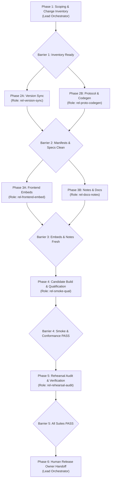

# Release Process

## Purpose

Defines release preparation, change inventory, documentation reconciliation, version synchronization, multi-agent orchestration roles, and release publication for the ztd platform and protocol packages. Compliance report generation remains available as a standalone workflow and is run only when explicitly requested.

## Quick index

- [Purpose](#purpose)
- [Quick index](#quick-index)
- [Invariants](#invariants)
  - [Separation of duties (`INV-REL-DUTY`)](#separation-of-duties-inv-rel-duty)
  - [Version synchronization (`INV-REL-VER`)](#version-synchronization-inv-rel-ver)
  - [Release smoke evidence (`INV-REL-SMOKE`)](#release-smoke-evidence-inv-rel-smoke)
  - [Multi-agent release orchestration (`INV-REL-ORCH`)](#multi-agent-release-orchestration-inv-rel-orch)
- [Owned surfaces](#owned-surfaces)
  - [Platform claims and maintained paths](#platform-claims-and-maintained-paths)
  - [Release agent roles and surface ownership](#release-agent-roles-and-surface-ownership)
- [Procedures](#procedures)
  - [Release Orchestration Architecture](#release-orchestration-architecture)
  - [Release Role Specifications](#release-role-specifications)
  - [Phased Release Preparation Sequence (e.g. Bumping to v1.4.2)](#phased-release-preparation-sequence-eg-bumping-to-v142)
  - [Release Owner Tagging and Publication (Post-Merge)](#release-owner-tagging-and-publication-post-merge)
  - [Release Signing](#release-signing)
  - [Website Download Set and Promotion (R2)](#website-download-set-and-promotion-r2)
- [Anti-patterns](#anti-patterns)
- [Links out](#links-out)

## Invariants

Ids are stable. Append the next free number in a topic. Do not renumber.

### Separation of duties (`INV-REL-DUTY`)

| ID | Rule |
| :--- | :--- |
| INV-REL-DUTY-01 | The AI coding agent MUST NOT run `git commit`, `git push`, `gh pr create`, or `make release`. The agent prepares the working tree, audits docs, and hands back the prepared tree to the release owner. |
| INV-REL-DUTY-02 | The release owner MUST review prepared changes, commit, open and merge the PR, pull the merged `main` branch locally, and execute `make release` to tag and push. |

### Version synchronization (`INV-REL-VER`)

| ID | Rule |
| :--- | :--- |
| INV-REL-VER-01 | `VERSION` is the single source of truth for the platform and protocol version (`vX.Y.Z\n`). |
| INV-REL-VER-02 | PR preparation MUST synchronize `Version: vX.Y.Z` headers in `protocol/docs/a2a.md`, `protocol/docs/constants.md`, `protocol/docs/mcp.md`, and `protocol/docs/spec.md`, and first-party `package.json` versions (with their `package-lock.json` root versions) declared in `internal/tools/versionsync`. `make version-sync` performs the sync and `make version-sync-check` verifies it. |
| INV-REL-VER-03 | Retired. Never assigned. |
| INV-REL-VER-04 | `CHANGELOG.md` MUST include a row under the minor-version section (`## vX.Y.x`) linking to the new release notes file `docs/release_notes/vX.Y.x/vX.Y.Z.md`. When a release adds a new minor-version section, the release creates both the `## vX.Y.x` section above existing sections and `docs/release_notes/vX.Y.x/`; `make release` derives notes path from `VERSION` and aborts when missing. |
| INV-REL-VER-05 | Before tagging, every verified evaluation campaign MUST state the release it measured. The release is recorded in the campaign digest or, when the digest does not record it, carried as an asserted tag set with `ztd eval campaigns tag --release vX.Y.Z <campaign>...`. `ztd eval campaigns list` shows any campaign whose release is `unknown`. |
| INV-REL-VER-06 | The Evaluation Explorer bundle compiles the current release from `VERSION` (`CURRENT_PLATFORM_RELEASE`). After changing `VERSION`, PR preparation MUST rebuild the bundle, refresh Gateway embed (`make explorer-embed`), and commit `internal/services/gateway/explorer/static/`. The Explorer's release filter defaults to the newest attributed release present in the public feed and falls back to `CURRENT_PLATFORM_RELEASE` only before any attributed record lands; a stale embed only mislabels which release is "(current)". |
| INV-REL-VER-07 | The console embed (`internal/services/gateway/console/static/`) carries no release string, but `make console-embed-check` MUST pass before PR so committed embeds match `console/` at the release commit. |
| INV-REL-VER-08 | Current installation examples in `README.md` and `.github/CONTRIBUTING.md` and the homepage hero status chip in `website/src/index.html` (`ztd <b>vX.Y.Z</b>`) MUST match `VERSION`. After updating `website/src/index.html`, PR preparation MUST rebuild static assets with `make website-build` so `website/dist/index.html` is current. Audit prerequisites and startup commands against current `Makefile`. Audit `AGENTS.md` and `CLAUDE.md` for removed paths, commands, and targets. Historical release notes and scoped evidence retain original versions. |
| INV-REL-VER-09 | The first line of `docs/release_notes/vX.Y.x/vX.Y.Z.md` MUST be `## [X.Y.Z] - YYYY-MM-DD - <Title>`, where `<Title>` is a short title-case phrase naming what the release delivers (for example `Onboarding and Host Configuration`), and `YYYY-MM-DD` is the planned tag date in UTC. A version number alone is not a title, and `Unreleased` is not a date. The `CHANGELOG.md` row carries the same date. |
| INV-REL-VER-10 | While the major version is 1, a release that breaks a CLI, wire, or evidence contract, or that requires the Gateway and Operators to upgrade together, MUST bump the minor version (`v1.Y+1.0`). A patch release (`v1.Y.Z+1`) MUST be compatible with the previous release in the same minor series. The `CHANGELOG.md` preamble states this rule. |

### Release smoke evidence (`INV-REL-SMOKE`)

| ID | Rule |
| :--- | :--- |
| INV-REL-SMOKE-01 | Release PR preparation MUST run `./ztd test release-smoke` (default root `.ztd/operators/release-smoke-<UTC timestamp>`) against the built candidate binary and retain its complete output. The maintained smoke does not require Python, an LLM, or provider credentials. |
| INV-REL-SMOKE-02 | The runner MUST create and own an isolated Gateway and dedicated data Operator through the supported enrollment/deployment lifecycle. It MUST exercise governed `FILE_EDIT` with exact Operator-local receipt verification and read-back, and embedded governed document create/merge preserving fields not included in the merge. |
| INV-REL-SMOKE-03 | The data Operator MUST run in its dedicated runtime, and `report all` MUST read that Operator's populated `.ztd` stores. A report against Gateway state, an empty runtime, or stores combined from different runtime roots is not release evidence. |
| INV-REL-SMOKE-04 | Release smoke acceptance requires non-empty local receipts, commitments, and file mutations in both Operator and Gateway runtimes; `commitment_chain`, `git_merkle_root`, `file_mutation_linkage`, and `receipt_commitment_crosslink` MUST be `PASS` in each runtime report; every `verification_summary.csv` row MUST be `PASS` (any `FAIL`, `SKIPPED`, or unrecognized result rejects the run); and the scenario receipts listed in `docs/guides/ux_smoke_test.md` MUST be present and completed. |
| INV-REL-SMOKE-05 | Smoke artifacts are engineering acceptance evidence and do not expand claims of tested `doctrine` posture. |
| INV-REL-SMOKE-06 | The runner MUST retain command logs, metadata, per-runtime reports, and a summary identifying binary SHA-256, source revision and dirty state, platform, posture, ingress, runtime roots, local signed receipts, and start/end times. `make ci` is not a substitute for runtime smoke acceptance. |

### Multi-agent release orchestration (`INV-REL-ORCH`)

| ID | Rule |
| :--- | :--- |
| INV-REL-ORCH-01 | Release preparation may be performed directly or delegated. When delegating, the coordinator assigns clear responsibilities and path boundaries; no specific agent model is required. |
| INV-REL-ORCH-02 | Delegated agents MUST operate strictly within their assigned surface paths defined in [Assignable code surfaces and agent boundaries](codemap.md#assignable-code-surfaces-and-agent-boundaries). Modifying files outside the assigned surface is prohibited. |
| INV-REL-ORCH-03 | Release preparation follows the phase dependencies below. Record any skipped or failed gates in the handoff and do not claim release readiness until required gates pass. |
| INV-REL-ORCH-04 | Every delegated agent MUST return a structured completion deliverable confirming executed command exit codes, mutated files, and verification status. The Lead Orchestrator MUST verify these deliverables before advancing the pipeline. |

## Owned surfaces

### Platform claims and maintained paths

| Claim | Path | Verify |
| :--- | :--- | :--- |
| Repository version | `VERSION` | `cat VERSION` |
| Release index | `CHANGELOG.md` | Table row under `## vX.Y.x` |
| Installation and contributor entry points | `README.md`, `.github/CONTRIBUTING.md` | `README.md` version badge matches `VERSION`; prerequisites and startup commands match `Makefile` |
| Website homepage hero version | `website/src/index.html` | Hero status chip `ztd <b>vX.Y.Z</b>` matches `VERSION`; `make website-build` refreshes `website/dist/index.html`; verified by `make website-test` |
| Agent entry points | `AGENTS.md`, `CLAUDE.md` | Repository map and build/test examples reference maintained paths and targets |
| Protocol spec headers | `protocol/docs/a2a.md`, `constants.md`, `mcp.md`, `spec.md` | `Version: vX.Y.Z` header |
| Explorer embed | `internal/services/gateway/explorer/static/` | `make explorer-embed`; `grep -l "$(cat VERSION)" internal/services/gateway/explorer/static/assets/*.js` lists the current bundle |
| Console embed | `internal/services/gateway/console/static/` | `make console-embed-check` |
| Core-platform smoke runbook | `docs/guides/ux_smoke_test.md` | `./ztd test release-smoke` |
| Cross-process evaluation loop qualification | `internal/cli/cmd/test/eval_loop_e2e_test.go` | `./ztd test eval-loop` |
| Cross-process conformance loop qualification | `internal/cli/cmd/test/conformance_loop.go`, `internal/cli/cmd/test/conformance_loop_e2e_test.go` | `./ztd test conformance-loop` |
| Live Tier 4 evaluation loop (explicit provider run) | `internal/cli/cmd/test/eval_loop_live_e2e_test.go` | `./ztd test eval-loop --live-ollama-endpoint <url> --live-model <name>` |
| Smoke evidence artifacts | `<root>/` | `evidence/smoke-summary.json`, `reports/{gateway,worker}/`, and logs under `logs/` |
| Tag and push target | `Makefile` (`make release`) | Release owner only on merged `main` |

### Release agent roles and surface ownership

| Role Name | Model Tier | Surface Key | Assigned Path Scope | Primary Deliverable |
| :--- | :--- | :--- | :--- | :--- |
| **Lead Release Orchestrator** | `inherit` | `surface-release-ci` | Full repository (performs or coordinates preparation) | Release plan, subagent dispatch, verification synthesis, and Release Owner handoff |
| **Release Version Synchronizer** (`rel-version-sync`) | Available model | `surface-release-ci`, `surface-docs` | `VERSION`, `internal/tools/versionsync/`, `protocol/docs/*.md`, `*/package.json`, `*/package-lock.json`, `website/src/index.html`, `README.md`, `.github/CONTRIBUTING.md` | Synchronized `VERSION`, specs, manifests, website hero chip, and passing `make version-sync-check` |
| **Protocol & Code Generation Auditor** (`rel-proto-codegen`) | Available model | `surface-protocol` | `protocol/proto/ztd/`, `protocol/constants/`, `internal/constants/*_gen.go`, `console/src/generated/`, `evaluation-explorer/src/content/scenario-catalog.generated.ts`, `internal/services/gateway/docs/swagger.*` | Validated doctrine JSON, regenerated constants and OpenAPI specs, clean `make constants-check` |
| **Frontend Embed & Web Asset Builder** (`rel-frontend-embed`) | Available model | `surface-frontend` | `console/`, `evaluation-explorer/`, `ztd-adapter/`, `website/`, `internal/services/gateway/console/static/`, `internal/services/gateway/explorer/static/` | Fresh explorer and console embeds containing `VERSION`, passing `make console-embed-check`, fresh `website/dist/` |
| **Release Notes & Documentation Auditor** (`rel-docs-notes`) | Available model | `surface-docs` | `docs/release_notes/vX.Y.x/vX.Y.Z.md`, `CHANGELOG.md`, affected documents under `docs/`, `AGENTS.md`, `CLAUDE.md` | Authored `vX.Y.Z.md` release notes, updated `CHANGELOG.md` row, and audited documentation metadata |
| **Release Smoke & Qualification Runner** (`rel-smoke-qual`) | Available model | `surface-release-ci`, `surface-tests` | `bin/`, `.ztd/operators/release-smoke-*`, `test-results/` | Built candidate binary, passing `./ztd test release-smoke`, passing eval loop, and passing conformance loop |
| **Release Rehearsal & Verification Auditor** (`rel-rehearsal-audit`) | Available model | `surface-release-ci` | `scripts/release-*.sh`, `.github/workflows/`, repo-wide lint and unit test runners | Passing `make test-release-scripts`, `./ztd test lint`, `./ztd test unit`, and verified rehearsal runbook |

## Procedures

### Release Orchestration Architecture

Release preparation may be performed by one agent or coordinated across agents (`INV-REL-ORCH-01`):

1. **Lead Release Orchestrator (Parent Agent)**: Ingests the release target (e.g. `v1.4.2`), performs diff analysis, enforces phase barriers, dispatches predetermined tasks to specialized agents, validates deliverables at each phase barrier, and compiles the final handoff for the human Release Owner.
2. **Delegated agents**: When available and appropriate, agents may be assigned a role and path boundaries from [Assignable code surfaces and agent boundaries](codemap.md#assignable-code-surfaces-and-agent-boundaries). The coordinator may perform the work directly.
3. **Phase Barrier Synchronization**: The release sequence is organized into 6 distinct phases. Subagents in parallel phases operate on strictly disjoint surfaces. Complete prerequisite work before dependent work; report incomplete gates without claiming release readiness (`INV-REL-ORCH-03`).



### Release Role Specifications

The following roles describe work to perform directly or delegate with the listed path boundaries.

---

#### Role 1: Release Version Synchronizer (`rel-version-sync`)

- **Identity**: `Release Version Synchronizer`
- **Surface**: `surface-release-ci`, `surface-docs`
- **Assigned Paths**: `VERSION`, `internal/tools/versionsync/`, `protocol/docs/*.md`, `*/package.json`, `*/package-lock.json`, `website/src/index.html`, `README.md`, `.github/CONTRIBUTING.md`
- **Purpose**: Advance platform version, synchronize protocol doc version headers, update npm package manifests and lockfiles, and update website hero and README badges.
- **Strict Boundary**: MUST NOT touch Go backend code, proto definitions, or release notes.
- **Predetermined Task Instructions**:
  1. Write target version `vX.Y.Z\n` into `VERSION`.
  2. Run `make version-sync` to propagate version across protocol docs and npm manifests.
  3. Run `make version-sync-check` to verify zero drift.
  4. Update hero status chip in `website/src/index.html` to `ztd <b>vX.Y.Z</b>`.
  5. Update version badge in `README.md` and check `.github/CONTRIBUTING.md`.
  6. Run `make website-build` to refresh `website/dist/index.html`.
- **Deliverable Contract**:
  - Exit code of `make version-sync-check`.
  - List of updated files.
  - Confirmation of `website/dist/index.html` regeneration.

---

#### Role 2: Protocol & Code Generation Auditor (`rel-proto-codegen`)

- **Identity**: `Protocol & Code Generation Auditor`
- **Surface**: `surface-protocol`
- **Assigned Paths**: `protocol/proto/ztd/`, `protocol/constants/`, `internal/constants/*_gen.go`, `console/src/generated/`, `evaluation-explorer/src/content/scenario-catalog.generated.ts`, `internal/services/gateway/docs/swagger.*`
- **Purpose**: Ensure that Protobuf stubs, constant registries, doctrine JSON schemas, and OpenAPI specs are generated, valid, and synchronized.
- **Strict Boundary**: MUST NOT edit handwritten Go or frontend logic. Hand edits allowed only in `.proto` sources or JSON registries if fixing schema syntax.
- **Predetermined Task Instructions**:
  1. Run `make doctrines-validate` to confirm all doctrine definitions are valid JSON.
  2. Run `make constants-check`. If drifted, run `make constants-generate` and re-verify.
  3. Run `make explorer-catalog-check`. If drifted, run `make explorer-catalog-generate` and re-verify.
  4. If `.proto` schemas changed, run `make proto-generate`.
  5. Run `make swagger-generate` to regenerate OpenAPI spec from Go Swagger annotations.
- **Deliverable Contract**:
  - Status of `make doctrines-validate`, `make constants-check`, and `make explorer-catalog-check`.
  - List of generated code artifacts modified.

---

#### Role 3: Frontend Embed & Web Asset Builder (`rel-frontend-embed`)

- **Identity**: `Frontend Embed & Web Asset Builder`
- **Surface**: `surface-frontend`
- **Assigned Paths**: `console/`, `evaluation-explorer/`, `ztd-adapter/`, `website/`, `internal/services/gateway/console/static/`, `internal/services/gateway/explorer/static/`
- **Purpose**: Compile production frontend bundles, refresh Gateway Go embed assets, ensure no stale assets remain, and validate web packages.
- **Prerequisite**: Phase 2 must be complete so `VERSION` and package manifests are synchronized.
- **Strict Boundary**: MUST NOT touch backend Go code or documentation outside website assets.
- **Predetermined Task Instructions**:
  1. Run `make explorer-embed` (`INV-REL-VER-06`) to compile `VERSION` into Explorer bundle and refresh `internal/services/gateway/explorer/static/`.
  2. Run `make console-embed-check` (`INV-REL-VER-07`). If stale, run `make console-embed`.
  3. Verify that `grep -l "$(cat VERSION)" internal/services/gateway/explorer/static/assets/*.js` finds the current bundle.
  4. Run `make console-lint console-test`.
  5. Run `make explorer-lint explorer-test`.
  6. Run `make website-test website-build`.
- **Deliverable Contract**:
  - Verification that Explorer bundle embeds `vX.Y.Z`.
  - Status of `make console-embed-check` (PASS).
  - Status of frontend test suites.

---

#### Role 4: Release Notes & Documentation Auditor (`rel-docs-notes`)

- **Identity**: `Release Notes & Documentation Auditor`
- **Surface**: `surface-docs`
- **Assigned Paths**: `docs/release_notes/vX.Y.x/vX.Y.Z.md`, `CHANGELOG.md`, affected documents under `docs/`, `AGENTS.md`, `CLAUDE.md`
- **Purpose**: Draft comprehensive release notes, update the changelog index, and audit modified documentation according to `docs/devs/docs.md` standards.
- **Prerequisite**: Change inventory from Phase 1.
- **Strict Boundary**: MUST NOT modify production code, manifests, or test scripts.
- **Predetermined Task Instructions**:
  1. Determine minor series directory `docs/release_notes/vX.Y.x/`. If release starts a new minor series, create directory and table header in `CHANGELOG.md` (`INV-REL-VER-04`).
  2. Create `docs/release_notes/vX.Y.x/vX.Y.Z.md` with required header `## [X.Y.Z] - YYYY-MM-DD - <Title>` (`INV-REL-VER-09`) and standard sections: Overview, Added, Changed, Removed, Fixed, Qualification evidence, Compatibility (`INV-REL-VER-10`), Tests, Documentation, Deferred.
  3. Add release row under `## vX.Y.x` in `CHANGELOG.md` linking to `vX.Y.Z.md`.
  4. Walk documentation catalog in `docs/devs/docs.md` for documents affected by the change inventory. For audited documents, update `last_updated: YYYY-MM-DD` and `version: vX.Y.Z` (`INV-DOC-FMT-02`).
  5. Audit `AGENTS.md` and `CLAUDE.md` to ensure all build, test, and CLI commands match current code.
- **Deliverable Contract**:
  - Path of created release notes file.
  - Diff of `CHANGELOG.md`.
  - List of audited documentation files with updated front matter.

---

#### Role 5: Release Smoke & Qualification Runner (`rel-smoke-qual`)

- **Identity**: `Release Smoke & Qualification Runner`
- **Surface**: `surface-release-ci`, `surface-tests`
- **Assigned Paths**: `bin/`, `.ztd/operators/release-smoke-*`, `test-results/`
- **Purpose**: Build host candidate binary and execute provider-free release smoke test and cross-process qualification loops.
- **Prerequisite**: Phase 3 complete (embedded frontends refreshed).
- **Strict Boundary**: MUST NOT edit application source code.
- **Predetermined Task Instructions**:
  1. Compile candidate binary: `make build`.
  2. Run release smoke gate: `./ztd test release-smoke` (`INV-REL-SMOKE-01`).
  3. Verify exit status 0 and check `evidence/smoke-summary.json` for `result: PASS`.
  4. Verify that `commitment_chain`, `git_merkle_root`, `file_mutation_linkage`, and `receipt_commitment_crosslink` are `PASS` in both Operator and Gateway reports (`INV-REL-SMOKE-04`).
  5. Verify that every row in `verification_summary.csv` is `PASS`.
  6. Run cross-process evaluation loop: `./ztd test eval-loop`.
  7. Run cross-process conformance loop: `./ztd test conformance-loop`.
- **Deliverable Contract**:
  - Full path of smoke evidence root `.ztd/operators/release-smoke-<timestamp>`.
  - Content summary of `evidence/smoke-summary.json`.
  - Exit status of `eval-loop` and `conformance-loop`.

#### Role 6: Release Rehearsal & Verification Auditor (`rel-rehearsal-audit`)

- **Identity**: `Release Rehearsal & Verification Auditor`
- **Surface**: `surface-release-ci`
- **Assigned Paths**: `scripts/release-*.sh`, `.github/workflows/`, test suites
- **Purpose**: Execute repository verification suite, test release automation scripts, and audit CI/CD workflow configurations.
- **Prerequisite**: Phase 4 complete (candidate build and qualification gates).
- **Strict Boundary**: Read-only validation; MUST NOT push or trigger live publication.
- **Predetermined Task Instructions**:
  1. Run release script regression suite: `make test-release-scripts`.
  2. Run repository linter: `./ztd test lint`.
  3. Run platform unit test suite: `./ztd test unit`.
  4. Run targeted integration tests for modified packages: `./ztd test integration --pkg <package>`.
  5. Verify that `.github/workflows/release-binary.yml` and `.github/workflows/deploy-website.yml` match maintained script targets.
  6. Prepare the exact post-merge rehearsal instructions for the Release Owner.
- **Deliverable Contract**:
  - Test suite results table (Lint, Unit, Integration, Release Scripts).
  - Confirmation of workflow health.
  - Formatted handoff notes.

---

### Phased Release Preparation Sequence (e.g. Bumping to v1.4.2)

When an AI Orchestrator receives a release directive (such as "Bump version to v1.4.2 and prepare release"), it executes this predetermined 6-phase sequence:

#### Phase 1: Scoping & Change Inventory (Lead Orchestrator)

1. Identify previous release tag (e.g. `v1.4.1` from `VERSION`).
2. Collect the change inventory across commits since previous release. Identify all added, changed, removed, fixed, and security-sensitive behaviors across surfaces.
3. Formulate the release theme title `<Title>` for `INV-REL-VER-09` (e.g. `Performance Optimization and Fleet Scalability`).
4. Establish barrier requirement: Proceed to Phase 2.

#### Phase 2: Manifest & Specification Synchronization (Preparation)

Perform these tasks:
- **Task 1**: role "Release Version Synchronizer".
  - Instruct to set `v1.4.2` in `VERSION`, run `make version-sync`, verify with `make version-sync-check`, update `website/src/index.html` hero chip, update `README.md` badge, and rebuild website.
- **Task 2**: role "Protocol & Code Generation Auditor".
  - Instruct to run `make doctrines-validate`, `make constants-check`, `make explorer-catalog-check`, `make proto-generate`, and `make swagger-generate`.

*Barrier Check 2*: Both tasks complete without errors. `make version-sync-check` passes.

#### Phase 3: Frontends, Embeds & Release Documentation (Preparation)

Perform these tasks:
- **Task 3**: role "Frontend Embed & Web Asset Builder".
  - Instruct to run `make explorer-embed`, verify `v1.4.2` string in bundle, run `make console-embed-check`, run `make console-lint console-test`, `make explorer-lint explorer-test`, and `make website-test website-build`.
- **Task 4**: role "Release Notes & Documentation Auditor".
  - Pass the Phase 1 change inventory and release title.
  - Instruct to draft `docs/release_notes/v1.4.x/v1.4.2.md`, add row to `CHANGELOG.md`, update affected developer documentation metadata (`last_updated: 2026-10-26`, `version: v1.4.2`), and audit `AGENTS.md` and `CLAUDE.md`.

*Barrier Check 3*: Explorer bundle contains `v1.4.2`. `make console-embed-check` passes. Release notes exist.

#### Phase 4: Candidate Build & Qualification Gates (Preparation)

Perform this task:
- **Task 5**: role "Release Smoke & Qualification Runner".
  - Instruct to run `make build`, `./ztd test release-smoke`, `./ztd test eval-loop`, and `./ztd test conformance-loop`.
  - Instruct to inspect `evidence/smoke-summary.json` and verification summary CSVs for strict `PASS`.

*Barrier Check 4*: Candidate binary built. Smoke summary is `PASS`. Conformance and eval loops pass.

#### Phase 5: Release Rehearsal & Verification Audit (Preparation)

Perform this task:
- **Task 6**: role "Release Rehearsal & Verification Auditor".
  - Instruct to run `make test-release-scripts`, `./ztd test lint`, and `./ztd test unit`.

*Barrier Check 5*: All test suites pass. Rehearsal scripts verified.

#### Phase 6: Human Release Owner Handoff (Lead Orchestrator)

1. The Lead Orchestrator inspects the working tree to verify that only expected release files are modified.
2. The Lead Orchestrator MUST NOT commit, push, create a PR, or run `make release` (`INV-REL-DUTY-01`).
3. Compile a structured Release Preparation Summary including:
   - Target version (`vX.Y.Z`) and release notes link.
   - Core qualification and smoke summary metrics (`PASS`).
   - Compliance evidence status, if explicitly requested.
   - Verification suite outcomes.
4. Deliver exact, copy-paste Git commands for the human Release Owner to review and execute.

---

### Release Owner Tagging and Publication (Post-Merge)

Once the PR prepared by the agents is reviewed, approved, and merged to `main`, the human Release Owner executes the publication sequence from a clean local checkout:

```bash
# On merged main branch with clean tree:
git checkout main && git pull
make release-rehearse
make release
```

`make release-rehearse` runs `scripts/release-rehearse.sh`, which dispatches `.github/workflows/release-binary.yml` on `main` with `publish=false` and watches it. Dispatch success comes from the CLI exit status; the script discovers the new run using structured `gh run list` output filtered by workflow, dispatch event, branch, and commit. It polls for up to 55 seconds while Actions makes the new run visible and preserves CLI error diagnostics. A rehearsal runs preflight, a write/read/delete probe of the real `ztd-releases` R2 bucket with the publish credential (`scripts/release-r2.sh check`), `build-all`, checksums, keyless signing, staging, and the shared publication procedure described below.

`scripts/release-publish.sh` owns both publication modes. Its `rehearse` mode creates a temporary GitHub draft named `rehearsal-<run>-<attempt>`, uploads every asset, downloads and compares every byte, and exercises R2 upload and pointer promotion under `_rehearsal/<run>-<attempt>/` in the real bucket. Cleanup removes the temporary draft, any matching temporary tag, and the isolated R2 objects; cleanup failure fails the rehearsal. It never publishes the draft or writes the public `latest.json`. The real release builds and signs independently and calls the same script in `publish` mode against its release tag and public R2 prefix. Rehearsal artifacts are test outputs and are not promoted into the release.

The `Release procedure and failure recovery` CI job runs `make test-release-scripts` on pull requests and `main`. Its offline transport doubles inject signing conflicts, partial bundles, lost upload replies, authorization errors, mismatched assets, and publication failure. These tests exercise the production scripts and assert bounded retries, immutable existing bytes, cleanup, and publication ordering. A passing rehearsal establishes that its invocation succeeded; runtime recovery handles failures that occur during a later release.

If a rehearsal was dispatched but the local command exited before watching it, use `gh run list --workflow release-binary.yml --event workflow_dispatch --branch main --commit "$(git rev-parse HEAD)"` to find it, then `gh run watch <id> --exit-status` to resume watching. A silent `gh workflow run` is not evidence of dispatch failure. Once that rehearsal succeeds, `make release` accepts it; another dispatch or merge is unnecessary.

`make release` aborts unless the current branch is `main`, `HEAD` equals `origin/main` after a fetch, and a successful `workflow_dispatch` rehearsal exists for `HEAD`. It then runs `internal/tools/versionsync -write` (identical sync to `make version-sync`) and aborts if the working tree is dirty. It aborts when the release notes file is missing or the tag already exists. Otherwise it creates tag `vX.Y.Z` and pushes to origin. `.github/workflows/release-binary.yml` validates the tag, builds and signs binaries, tests the shared publication procedure with isolated targets, then calls `release-publish.sh publish` to create or resume the GitHub draft, verify its uploaded assets, upload and verify the versioned R2 set, publish the GitHub release, and promote website downloads. After publication, a separate matrix verifies fresh `go install` on Linux, macOS, and Windows.

### Release Signing

`.github/workflows/release-binary.yml` signs each binary in the release set keylessly with `cosign sign-blob --bundle`, using the workflow's GitHub OIDC identity. Each binary ships with `<binary>.sha256` and `<binary>.sigstore.json`; the Sigstore bundle carries the signature, certificate, and transparency-log proof. No long-lived signing key exists for release binaries. `scripts/release-artifacts.sh` owns signing and verification helpers (`sign`, `verify-signatures`, `verify-set`), and the workflow verifies every bundle before staging and again after download. Each binary gets at most three signing attempts, each with a two-minute signing timeout and a fresh process, ephemeral key, and bundle. Failed attempts wait five and ten seconds respectively before retrying. Partial or stale bundles are discarded; a successful signing attempt must pass certificate identity, issuer, and artifact verification before its bundle enters the release set. Verification failure stops immediately. A release set must contain exactly the files derived from the binary catalog.

The public signer identity is `https://github.com/zerotrustdata/ztd/.github/workflows/release-binary.yml@refs/tags/vX.Y.Z`, with OIDC issuer `https://token.actions.githubusercontent.com`. Verification procedures reside in [Verify a release binary](../guides/getting_started.md#verify-a-release-binary).

### Website Download Set and Promotion (R2)

The publish job in `.github/workflows/release-binary.yml` publishes the 23-file release set (7 targets × binary, `.sha256`, `.sigstore.json`, plus `checksums-sha256.txt` and `ztd-binaries.json`) to the `ztd-releases` R2 bucket (the bucket `website/wrangler.jsonc` binds as `RELEASES`) in three steps. `scripts/release-r2.sh` owns the R2 writes and runs the website's pinned `wrangler r2 object` commands, authenticated with the repository secrets `CLOUDFLARE_ACCOUNT_API_TOKEN` and `CLOUDFLARE_ACCOUNT_ID`. These are repository-level, not `release` environment secrets: the `release` environment admits only `v*` tags, so an environment copy is invisible to rehearsals and shadows the credential they verified. The `credentials` job runs `release-r2.sh check` against the real bucket on every run. The `verify-download` job exercises the shared publication script against a temporary GitHub draft and isolated objects in that same bucket.

1. **Versioned upload:** `release-r2.sh upload` checks every existing object under `ztd-releases/v<VERSION>/` against the verified local file before writing anything. Matching objects are retained, missing objects are uploaded and read back by SHA-256, and differing bytes fail without being overwritten. The manifest is uploaded last. An existing manifest with missing objects fails as an incomplete published set.
2. **GitHub publish:** `gh release edit --draft=false` marks GitHub release public.
3. **Promotion:** `release-r2.sh promote` re-checks every `v<VERSION>/` object against the set, then writes `ztd-releases/latest.json` last as `{"version": "<VERSION>"}` and reads it back. This is the sole object updating unversioned download routes.

`website/worker.js` serves the set:
- `/v/<version>/<file>` serves `v<version>/<file>` directly with `public, max-age=31536000, immutable`.
- Unversioned routes (`/ztd`, `/ztd-linux-amd64`, `/checksums-sha256.txt`, ...) read `latest.json` on each request and serve `v<version>/<file>` with `public, max-age=300`.
- Missing or malformed `latest.json` returns plain-text 503 with `cache-control: no-store`.

**Failure behavior:** Failures before step 3 leave unversioned routes pointing at the previous version. Use `gh run rerun <run-id> --failed` and `gh run watch <run-id> --exit-status` to recover the existing tag's workflow. When build has succeeded, rerun the failed jobs so publication downloads the same verified release set; rebuilding would generate different signatures and possibly different build metadata. The publication script checks existing GitHub assets before uploading missing assets, verifies all downloaded bytes, resumes matching R2 objects, and skips GitHub publication if the release is already public. It then verifies the complete versioned R2 set before moving the pointer. No tag movement, object deletion, or asset replacement is required for an interrupted upload. A mismatch stops recovery and requires investigation. `make release` still refuses an existing tag. If only pointer promotion needs recovery, `scripts/release-r2.sh promote <release-dir> <version>` verifies every versioned object against the original verified release set before moving `latest.json`.

**Rollback:** Rewrite `latest.json` to the target rollback version (e.g. `{"version": "2.3.1"}`). Immutable `v<version>/` prefixes remain intact; unversioned routes restore within the 5-minute cache TTL.

## Anti-patterns

- Using non-lite models or open-ended, ad-hoc prompts for release subagents (`INV-REL-ORCH-01`).
- Allowing a subagent to touch files outside its assigned surface path boundary (`INV-REL-ORCH-02`).
- Disregarding or bypassing phased execution barriers (e.g. running smoke tests before candidate build, or generating compliance before candidate binary) (`INV-REL-ORCH-03`).
- Agent running `git commit`, `git push`, or `make release` (`INV-REL-DUTY-01`).
- Running `make release` from a feature branch or with unmerged changes (`INV-REL-DUTY-02`).
- Pushing a release tag by hand instead of `make release`, or tagging before `make release-rehearse` passes on that commit.
- Updating document metadata without auditing entire document against code (`INV-DOC-FMT-02` in [Documentation Guide](docs.md)).
- Leaving README, contributor installation examples, or the website homepage hero chip in `website/src/index.html` pinned to a release other than `VERSION`, or agent instructions pointing to removed commands (`INV-REL-VER-08`).
- Bumping `VERSION` without rebuilding Explorer embed, leaving the "(current)" release label stale (`INV-REL-VER-06`).
- Release notes headed with a bare version number or `Unreleased` instead of a release date and title (`INV-REL-VER-09`).
- Adding release rows to non-existent `## vX.Y.x` sections instead of creating new minor sections (`INV-REL-VER-04`).
- Treating `make ci` as release smoke acceptance, or failing to retain maintained runner evidence roots (`INV-REL-SMOKE-01`, `INV-REL-SMOKE-06`).
- Treating scenario exit status alone as smoke acceptance without verifying signed receipts, governed read-back, and populated data Operator stores (`INV-REL-SMOKE-02`, `INV-REL-SMOKE-04`).
- Generating release smoke reports from Gateway `.ztd` trees when mutations executed in dedicated data Operator runtimes (`INV-REL-SMOKE-03`).
- Adding `CLOUDFLARE_*` secrets to the `release` or `production` environment; they shadow the repository secrets that rehearsals verify.
- Writing `latest.json` before GitHub release publication, or without verifying versioned prefix completeness.
- Overwriting or deleting published `v<version>/` prefixes to change served versions. Roll back by rewriting `latest.json`.

## Links out

- [Developer Guidelines](devs.md): coding invariants and repository standards.
- [Documentation Guide](docs.md): documentation audit, catalog, and formatting standards.
- [Testing Guide](tests.md): test execution tiers and verification commands.
- [Code Map](codemap.md): package and runtime ownership maps, assignable code surfaces, and agent boundaries.
- [Troubleshooting Guide](troubleshooting.md): diagnostics and recovery procedures.
- [Host-Native Headless UX Smoke Test](../guides/ux_smoke_test.md): maintained release smoke command, runtime scenarios, evidence, and acceptance criteria.
