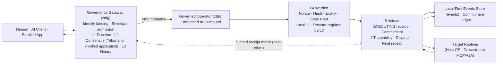

# Diagram: System Overview Flowchart

Traces governed intent from a client through Gateway admission (L1–L3 coordination), Operator pre-dispatch verification (L4 Warden), L5 Actuator execution, local audit evidence commitment, and target runtime execution.

## Ingress Surfaces

The Gateway receives governed work through distinct authenticated ingress paths:

- **MCP and A2A**: Ingress requests (`tools/call`, `resources/read`, `prompts/get`, `a2a/call`) are normalized into canonical `GovernanceEnvelope` messages by the MCP gateway layer (`internal/services/mcp/gateway.go`). Under `consensus` and `notary`, the Gateway coordinates L2 consensus votes on state-change actions. Under `ratify` and `notary`, it suspends mutations for L3 human approval. Read-only and observation actions get no L2 vote round.
- **Governed HTTP Dispatch**: Authenticated callers submit an `event_type` and serialized payload to `POST /api/v1/operators/commands` (`internal/services/gateway/dispatch_service.go`). The Gateway wraps the command into a `GovernanceEnvelope` and dispatches it to the bound Operator session.
- **Direct Envelope Ingress**: Authorized CLI or application workload identities submit pre-formed protojson envelopes to `POST /api/v1/governance/envelopes`.

## Verification and Execution

1. **L4 Warden Pre-Dispatch Gate**:
   - Durably reserves transaction nonces in SQLite (replay protection).
   - Validates envelope TTL expiry and decodes typed action payloads.
   - Re-runs L1 Doctrine heuristics locally at the execution site.
   - Recomputes and verifies the deterministic transaction hash (`Envelope.Id`).
   - Verifies the state Merkle root against the local current state root, or against a state root carried in the verification context when one is present.
   - Validates required L2 Consensus quorum signatures (state-change actions only, `governance.L2Enforced`) and L3 Notary WebAuthn assertions according to the active posture.
2. **L5 Actuator Execution Boundary**:
   - Signs and persists the initial `EXECUTING` `EventReceipt`.
   - Appends a signed `CommitmentAttestation` to the local SQLite commitment ledger.
   - Rehydrates its own scrubbed `{{UEI_<owner>_N}}` tokens in place via `ScrubbingService`.
   - Mints a JIT capability bound to the transaction hash and to the verified envelope expiry.
   - Dispatches the command to the registered execution handler.
   - Dissolves the capability after the handler returns.
   - Scrubs handler output into the signed result summary (fixed text when no scrubber is active) and signs the final `COMPLETED` or `FAILED` `EventReceipt`.
   - Persists the final receipt as the current event receipt on the local `events` chain, then publishes it to `receipts:<operator-id>:<operator-session-id>` as a best-effort mirror. Local storage remains strictly authoritative.
