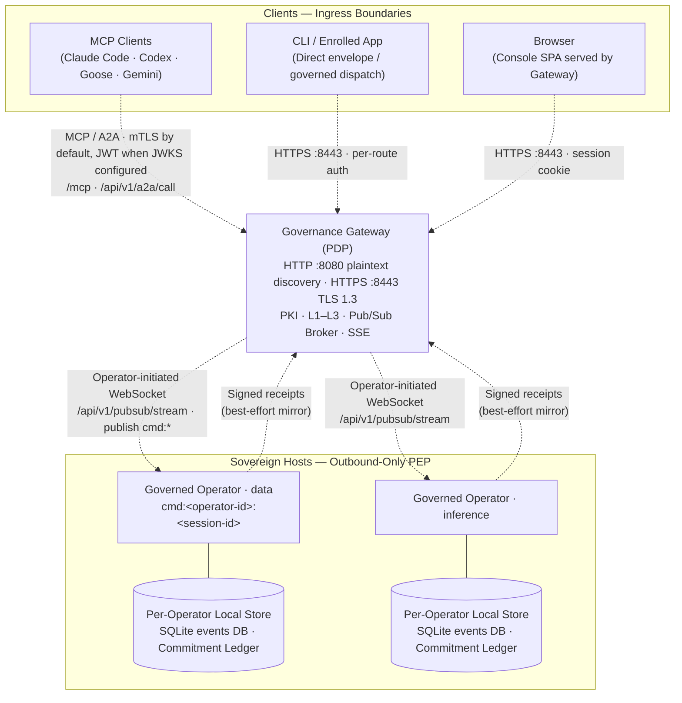

# Diagram: Gateway Fleet Host Topology

Depicts the standard fleet topology: a centralized Governance Gateway (Policy Decision Point, PDP) coordinating client ingress and one or more outbound Governed Operators (Policy Execution Points, PEP) deployed on sovereign host nodes.

## Ingress Paths

| Path | Primary Client | Gateway Surface | Executing Execution Point (PEP) |
| :--- | :--- | :--- | :--- |
| **Gateway MCP / A2A** | AI Agents, MCP Tools | `/mcp`, `/api/v1/a2a/call` | Embedded Operator substrate or outbound Operator, per operator type |
| **Governed HTTP Dispatch** | Enrolled Applications | `POST /api/v1/operators/commands` | Embedded Operator substrate or outbound Operator (cmd channel), per operator type |
| **Direct Envelope Ingress** | CLI, agent harness clients | `POST /api/v1/governance/envelopes` | Target operator resolved by the Gateway (embedded or outbound) |
| **SSE Telemetry** | Browsers, CLI | `GET /api/v1/sse/stream` | Telemetry stream only; not an execution path |

## Key Architectural Boundaries

- **Unified Binary, Distinct Modes**: A single static binary (`ztd`) runs as Gateway (`ztd gw start`) or Operator (`ztd operator start`). Gateway mode embeds an in-process Operator substrate for local execution.
- **Listener Isolation**: Remote Operators establish outbound WebSocket connections to the Gateway pub/sub broker (`/api/v1/pubsub/stream`). Operators expose no inbound listeners; `ztd operator start` has no listen flags.
- **Gateway Auxiliary Listeners**: Defaults from `ztd gw start --help`: `--listen-host` 127.0.0.1; public spectator private listener 127.0.0.1:8081 and public listener 127.0.0.1:8082; eval explorer 127.0.0.1:5173; pprof disabled unless `--pprof-listen` is set.
- **Sovereign Audit Storage (LFEA)**: Each Operator strictly owns its local SQLite events database and Commitment Ledger under `.ztd/`. Receipts published back to the Gateway are best-effort projections and never override local state.
