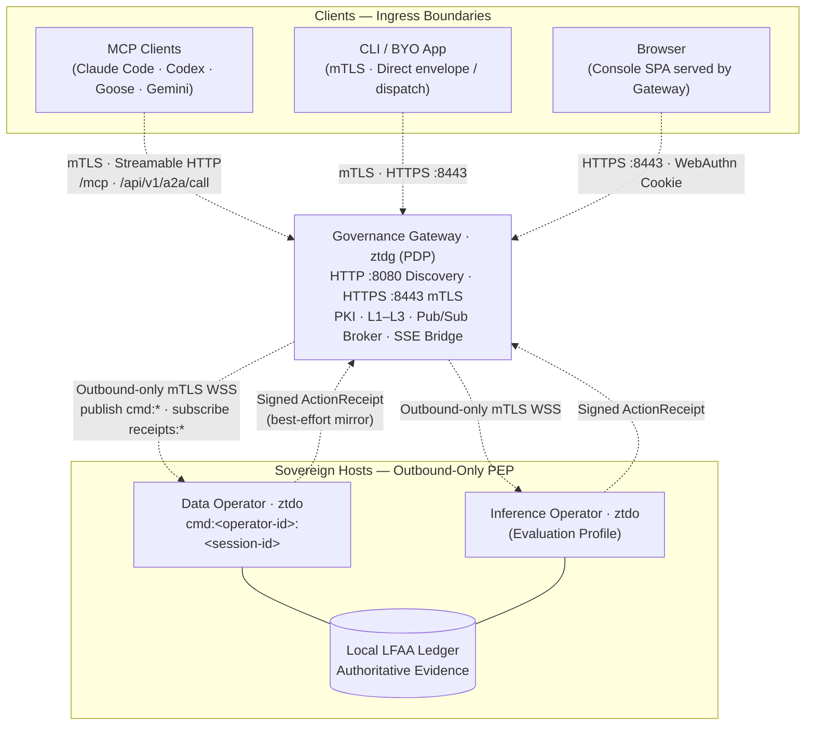

# Diagram: Gateway Fleet Host Topology

Depicts the standard fleet topology: a centralized Governance Gateway (Policy Decision Point, PDP) coordinating client ingress and one or more outbound Governed Operators (Policy Execution Points, PEP) deployed on sovereign host nodes.

## Ingress Paths

| Path | Primary Client | Gateway Surface | Executing Execution Point (PEP) |
| :--- | :--- | :--- | :--- |
| **Gateway MCP / A2A** | AI Agents, MCP Tools | `/mcp`, `/api/v1/a2a/call` | In-process Gateway Operator substrate or downstream target |
| **Governed HTTP Dispatch** | Enrolled Applications | `POST /api/v1/operators/commands` | Bound outbound Operator session |
| **Direct Envelope Ingress** | CLI, Operator Identity | `POST /api/v1/governance/envelopes` | In-process Gateway Operator substrate |
| **SSE Telemetry** | Browsers, CLI, TUI | `GET /api/v1/sse/stream` | Telemetry stream only; not an execution path |

## Key Architectural Boundaries

- **Unified Binary, Distinct Modes**: A single static binary (`ztd`) runs as Gateway (`ztd gw start`) or Operator (`ztd operator start`). Gateway mode embeds an in-process Operator substrate for local execution.
- **Listener Isolation**: Remote Operators establish outbound-only mTLS WebSocket connections to the Gateway pub/sub broker (`/api/v1/pubsub/stream`). Managed operator hosts expose **zero inbound listening ports**.
- **Sovereign Audit Storage (LFAA)**: Each Operator strictly owns its local SQLite audit database and Merkle state root under `.ztd/`. Receipts published back to the Gateway are best-effort projections and never override local state.
