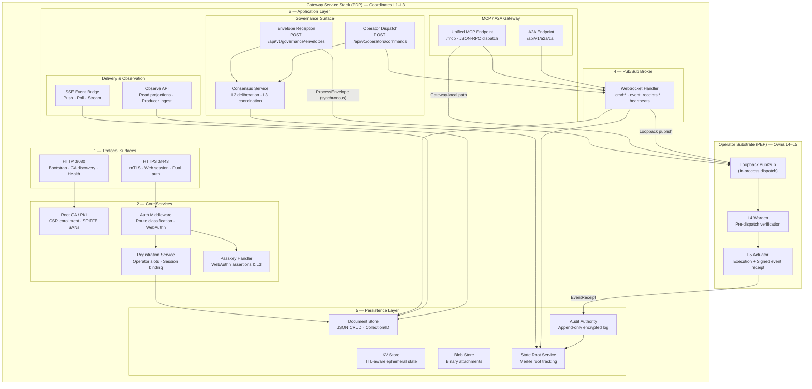

# Diagram: Gateway Service Stack

Depicts the internal service architecture of the Governance Gateway (`GatewayModeService` in `internal/services/gateway/gateway_service.go`) running in Gateway mode. The Gateway acts as the Policy Decision Point (PDP), coordinating L1–L3 governance layers, platform PKI, routing, pub/sub brokering, and SSE delivery, layered on top of an embedded Operator substrate (PEP) that handles L4 verification and L5 execution.

## Service Stack Composition

The Gateway coordinates policy decisions through five structured tiers:

1. **Protocol Surfaces**:
   - Plain HTTP on port `8080` serves discovery, health, deploy scripts, and token-scoped enrollment initiation, redirecting unauthenticated requests to HTTPS.
   - HTTPS on port `8443` serves authenticated APIs, the Console SPA, passkey challenges, WebSocket pub/sub streams, and mTLS endpoints.
2. **Core Security Services**:
   - `PKIAuthority`: Manages Root, Hub, Operator, and Peer CAs, signing CSRs with SPIFFE URI SANs under `ztd.local`.
   - `GatewayAuthMiddleware`: Evaluates routes against `RouteAuthRegistry` (`RouteAuthNone`, `RouteAuthMTLS`, `RouteAuthWebSession`, `RouteAuthDual`).
   - `PasskeyService`: Executes FIDO2 / WebAuthn registration and assertion ceremonies for login and L3 approvals.
3. **Application Ingress**:
   - MCP and A2A gateways normalize incoming tool invocations into typed `GovernanceEnvelope` messages.
   - Governance coordinators deliberate L2 consensus or hold suspended transactions for L3 notary signatures.
4. **Pub/Sub Brokering**:
   - Coordinates outbound WebSocket connections from remote Operators, multiplexing session-isolated channels (`cmd:`, `results:`, `heartbeat:`, `event_receipts:`).
5. **Operator Substrate**:
   - The Gateway process embeds an in-process Operator substrate. Gateway-local operations route through a loopback pub/sub bridge, executing through L4 Warden and L5 Actuator without traversing network sockets.
