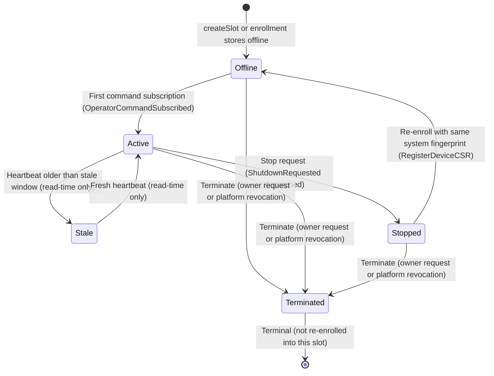

# Diagram: Operator Lifecycle State Machine

Depicts the stored lifecycle states of a remote Governed Operator (PEP) from enrollment through command subscription, heartbeat liveness tracking, stale reading, stop, and termination. Stale is a read-time reading of the stored `active` status, not a stored state. Session binding does not change the stored status.

## Lifecycle Phases

### 1. Enrollment

Remote Operators enroll through one of two Gateway paths:
- **Platform enrollment bootstrap**: the WebSocket at `/ws/operator/bootstrap` runs the platform enrollment flow (`internal/services/gateway/platform_enrollment_operator_bootstrap.go`). The completed enrollment persists the Operator document with status `offline`.
- **CSR registration**: `RegisterDeviceCSR` in `internal/services/gateway/registration_service.go`.

Steps:
1. **Slot Allocation**: `createSlot` stores a new slot as `offline`. Before creating one, `RegisterDeviceCSR` reuses a non-terminated Operator with the same user and system fingerprint, or an unclaimed `offline` slot.
2. **CSR Submission**: The Operator submits a CSR. `SignCSR` in `internal/services/gateway/gateway_certs.go` rejects any public key that is not on the P-256 curve.
3. **Issuance**: The Gateway signs the Operator leaf certificate with a SPIFFE URI SAN in the `ztd.local` trust domain and client and server auth extended key usage. Validity defaults to 7 days and is set by `OperatorLeafCertTTL`. The Gateway issues an `operator_session_id`. The record remains `offline`.
4. **Activation**: The Operator becomes `active` on its first command subscription (see Phase 2), not at issuance.
5. **L2 Trust**: Enrollment returns the Gateway's L2 consensus trust. Certificate renewal over the `renewal:` channel returns it again, and the Operator replaces its L2 trust store only on renewal (`internal/cli/serve/operator_cert_renewal.go`).

### 2. Outbound Connection

The Operator connects to `wss://<gateway-host>:8443/api/v1/pubsub/stream` over mTLS.
- **Channels**: The Operator subscribes to `cmd:<operator_id>:<operator_session_id>` to receive dispatched work and publishes telemetry to `heartbeat:<operator_id>:<operator_session_id>`.
- **Activation**: The Gateway's command-subscribed handler calls `OperatorCommandSubscribed`, which sets `active` only when the stored status is `offline` (`activateSubscribedOperator`, conditional write). A stopped or stale Operator is not revived by subscribing.
- **Connection loss**: No stored status write follows a dropped connection. The stored status stays `active` and reads as `stale` once the stale window passes.

### 3. Session Binding

An Operator is bound to the owner's web session for session-scoped use:
- **Binding Command**: `POST /api/v1/operators/bind` records the `operator_session_id` against the caller's validated `web_session_id`.
- **Identity Isolation**: `BindOperators` checks that the target Operator belongs to the authenticated user, writes the KV session bindings and the bound-sessions document, and sets `bound_web_session_id` on the Operator document. The Operator's stored status does not change.
- **Unbinding**: `UnbindOperators` clears `bound_web_session_id` and removes the Operator from the bound-sessions document. Bound is a view over `bound_web_session_id`, not a status value.

### 4. Heartbeats and Dynamic Liveness

- **Stamping**: The Gateway stamps `last_heartbeat_at` with its own clock when it receives a heartbeat (`handleHeartbeatPublish` in `internal/services/gateway/gateway_service.go`).
- **Stale Window**: `stale_at` is `last_heartbeat_at` (falling back to `claimed_at`, then `created_at`) plus `constants.OperatorStaleAfter` for the declared heartbeat interval. That window is the larger of 60 seconds and twice the declared interval. The declared interval defaults to 30 seconds (`internal/constants/status.go`). The platform enrollment bootstrap rejects a declared interval above 5 minutes (`internal/services/gateway/platform_enrollment_operator_bootstrap.go`), and the stale window clamps the interval to 5 minutes.
- **Derivation**: `deriveOperatorStaleness` (`internal/services/gateway/operator_staleness.go`) sets `stale_at` and a `stale` status on read only. Nothing is written or announced when it derives staleness. Only active remote Operators are derived; embedded Operators are never stale.
- **Effect**: A stale Operator fails checks that require `active`, such as inference dispatch selection (`internal/services/inference/dispatch/dispatch.go`) and the stop handler. A fresh heartbeat moves `last_heartbeat_at` forward and clears the reading on the next read.

### 5. Stop, Re-enrollment, and Termination

- **Stop**: `POST /api/v1/operators/stop` (`handleStopOperator` in `internal/services/gateway/operator_controller.go`) or the browser route `POST /api/v1/operators/{id}/stop` (`handleBrowserStopOperator` in `internal/services/gateway/operator_browser.go`). Each request requires a stored `active` remote Operator. The Gateway dispatches `ztd.v1.operator.shutdown.requested`, then `MarkOperatorStopped` stores `stopped`.
- **Re-enrollment**: A stopped Operator returns to `offline` when `RegisterDeviceCSR` matches its fingerprint, then becomes `active` on subscription.
- **Termination (Gateway)**: `POST /api/v1/operators/{id}` (`handleTerminateOperator`) calls `TerminateOperator`, which stores `terminated` for any non-terminated remote Operator and rejects embedded Operators. It does not revoke the certificate.
- **Termination (platform revocation)**: `HandleRevoke` in `internal/services/pubsub/platform_enrollment_handlers.go` revokes the leaf certificate serial, deactivates the Operator and CLI sessions, stores `terminated`, and disconnects the Operator and CLI identities.
- **Fail closed**: The Gateway rejects connections from terminated identities (`internal/services/gateway/gateway_auth.go`). A terminated Operator is not re-enrolled into the same slot.
