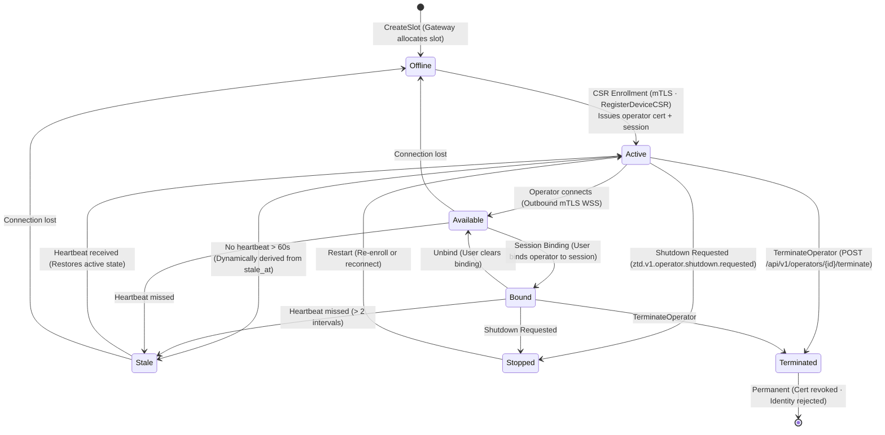

# Diagram: Operator Lifecycle State Machine

Depicts the lifecycle states of a Governed Operator (PEP) from CSR enrollment through outbound WebSocket connection, session binding, heartbeat liveness tracking, stale detection, and termination.

## Lifecycle Phases

### 1. Enrollment (CSR-Based)

Remote Operators enroll with the Gateway over the bootstrap WebSocket (`/ws/operator/bootstrap`):
1. **Slot Allocation**: The Gateway creates an Operator slot (`createSlot`) in the `offline` state.
2. **CSR Submission**: The remote host generates private keys and CSRs locally, submitting them with hardware fingerprints and token proofs over the bootstrap socket.
3. **Issuance**: The Gateway signs the Operator leaf certificate (ECDSA P-256, 7-day validity) with a SPIFFE URI SAN under `ztd.local`, issues an `operator_session_id`, and transitions the record to `active`.
4. **L2 Trust**: Enrollment returns the Gateway's current L2 consensus trust. Certificate renewal over the `renewal:` channel returns it again and replaces the trust the Operator holds. An Operator receives L2 trust only at these two points, not on each connection.

### 2. Outbound Connection

The Operator establishes an **outbound-only mTLS WebSocket** connection to `wss://<gateway-host>:8443/api/v1/pubsub/stream`:
- **Direction**: Strictly outbound. Remote hosts require no inbound open listening ports.
- **Multiplexed Channels**: The Operator subscribes to `cmd:<operator_id>:<operator_session_id>` to receive dispatched work.

### 3. Session Binding

To execute session-scoped commands, an active Operator is bound to the owner's web session:
- **Binding Command**: `POST /api/v1/operators/bind` maps the `operator_session_id` to the caller's validated `web_session_id`.
- **Identity Isolation**: The Gateway verifies that the target Operator belongs to the authenticated user before creating KV bindings and stamping `bound_web_session_id` on the Operator document.

### 4. Heartbeats and Dynamic Liveness

The Operator emits periodic telemetry to `heartbeat:<operator_id>:<operator_session_id>`:
- **Dynamic Derivation**: The Gateway derives `stale_at` from `last_heartbeat_at + (2 * heartbeat_interval)`.
- **Stale State**: If current time exceeds `stale_at`, the Operator is marked `stale` during reads. Stale Operators cannot receive dispatched commands until a fresh heartbeat restores the active state.

### 5. Termination and Revocation

- **Termination**: The owner terminates an Operator via `POST /api/v1/operators/{id}/terminate` or platform enrollment revocation.
- **Revocation**: The Gateway revokes the leaf certificate in the CRL, terminates the operator session, and severs all active WebSocket streams. Terminated identities fail closed upon any subsequent connection attempt.
