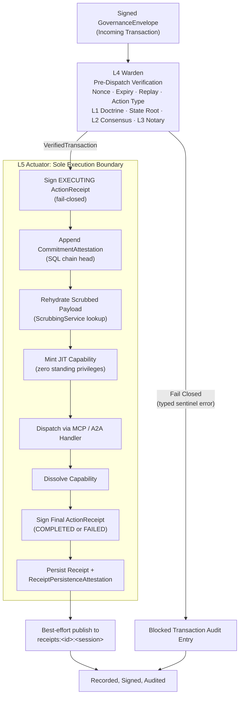

# Diagram: Operator L1–L5 Governance Pipeline

Depicts the Policy Execution Point (PEP) pipeline executed by the host-side Operator. Every incoming transaction must pass the strict pre-dispatch checks of L4 Warden before entering the L5 Actuator execution boundary.

## L4 Warden Verification Sequence

The L4 Warden (`internal/services/governance/l4_warden.go`) orchestrates pre-dispatch checks in a deterministic, fail-closed sequence. If any step fails, execution halts immediately:

1. **Nonce Reservation & Replay Prevention**: Durably records the transaction nonce in the local SQLite audit database before performing expensive cryptographic operations.
2. **Action Type & Payload Decoding**: Validates the action string against the action registry and decodes the typed Protobuf payload.
3. **Local L1 Doctrine Screening**: Independently evaluates static heuristics, blacklist rules, and Gitleaks signatures locally on the executing node, even if the Gateway screened the envelope previously.
4. **Transaction Hash Integrity**: Recomputes the SHA-256 hash across canonical envelope fields and verifies exact equality with `envelope.Id`.
5. **State Merkle Root Verification**: Confirms that the incoming `envelope.StateMerkleRoot` matches the current root of the local commitment ledger.
6. **L2 Consensus Quorum**: Under `consensus` and `notary` postures, verifies $K$-of-$N$ Ed25519 signatures from authorized consensus committee members over `<tx_hash>|<decision>`.
7. **L3 Notary Human Authorization**: Under `ratify` and `notary` postures, validates the presence of an authenticated WebAuthn signature assertion over the transaction hash.

## Governance Posture Gating

The active posture (`--posture`) configured at Gateway startup determines enforcement behavior:

| Posture | L1 Doctrine | L2 Consensus | L3 Notary | L4 Warden & L5 Actuator |
| :--- | :--- | :--- | :--- | :--- |
| **`doctrine`** | **Enforced** | Audited | Audited | **Enforced** |
| **`consensus`** | **Enforced** | **Enforced** | Audited | **Enforced** |
| **`ratify`** | **Enforced** | Audited | **Enforced** (Mutations) | **Enforced** |
| **`notary`** | **Enforced** | **Enforced** | **Enforced** (Mutations) | **Enforced** |

Universal checks (hash integrity, replay nonce, expiry, Merkle state root, and payload decode) are unconditionally enforced across all postures.

## L5 Actuator Execution Boundary

The L5 Actuator (`internal/services/governance/l5_actuator.go`) is the sole entity authorized to mutate system state:

1. **Pre-Execution Signing**: Generates and signs the initial `EXECUTING` `ActionReceipt` using the local Actuator Ed25519 signing key.
2. **Commitment Attestation**: Appends a signed attestation to the SQLite chain head.
3. **Payload Rehydration**: Resolves reversible `{{UEI_N}}` tokens to unredacted plaintext through `ScrubbingService`. Fails closed: a token that cannot be resolved, or any token when no `ScrubbingService` is configured, skips dispatch and finalizes a signed `FAILED` receipt.
4. **Just-In-Time (JIT) Capability**: Mints an ephemeral, transaction-scoped capability granting the exact permissions required by the handler.
5. **Execution Dispatch**: Invokes the registered MCP tool handler or native command runner.
6. **Capability Dissolution**: Destroys the ephemeral capability immediately upon command completion.
7. **Final Receipt Signing**: Scrubs outbound results and signs the final `COMPLETED` or `FAILED` `ActionReceipt`.
8. **Persistence & Mirroring**: Persists the signed receipt and attestation to local SQLite storage, then publishes a best-effort copy to `receipts:<operator-id>:<operator-session-id>`.
