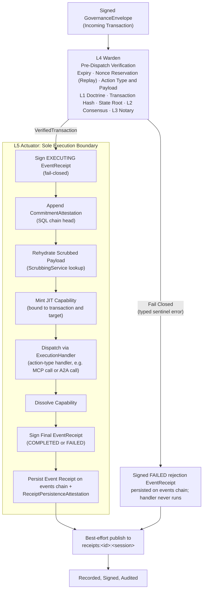

# Diagram: Operator L1–L5 Governance Pipeline

Depicts the Policy Execution Point (PEP) pipeline executed by the host-side Operator. Every incoming transaction must pass the strict pre-dispatch checks of L4 Warden before entering the L5 Actuator execution boundary.

## L4 Warden Verification Sequence

The L4 Warden (`internal/services/governance/l4_warden.go`) orchestrates pre-dispatch checks in a deterministic, fail-closed sequence. If any step fails, execution halts immediately:

1. **Vault, Expiry & Replay Prevention**: Refuses dispatch when the runtime vault is locked or absent, rejects a missing or expired `ExpiresAt`, and reserves the nonce in the replay store before any later verification. A nonce already in flight is rejected.
2. **Structure, Action Type & Payload Decoding**: Checks the protocol version and required identifiers, validates the action type against the known action types, and decodes the typed payload. Action-specific target checks also run here.
3. **L1 Doctrine Screening**: Evaluates doctrine over the decoded payload on the executing runtime, independent of any earlier Gateway screening. Outbound Operators construct doctrine with `NewL1Doctrine` (hardcoded detectors and proto forbidden patterns). The Gateway service constructs it with `NewL1DoctrineFromDir`, which adds file-based catalogs from its doctrine directory.
4. **Transaction Hash Integrity**: Recomputes the canonical transaction hash and verifies exact equality with `envelope.Id`.
5. **State Root Verification**: Requires `envelope.StateMerkleRoot` and compares it with the bound-state root. Gateway-built transactions compare against the admission snapshot carried in context. Direct submissions compare against the local state root provider.
6. **L2 Consensus Quorum**: Under `consensus` and `notary` postures, for state-change actions only (`governance.L2Enforced`), verifies that affirmative K-of-N Ed25519 votes over `<tx_hash>|<decision>` meet the policy quorum.
7. **L3 Notary Human Authorization**: Under `ratify` and `notary` postures, for mutations only (`governance.L3Required`), verifies the L3 proof over the transaction hash. It accepts a WebAuthn passkey approval or a CLI signature approval.

## Governance Posture Gating

The active posture (`--posture`) configured at Gateway startup determines enforcement behavior:

| Posture | L1 Doctrine | L2 Consensus | L3 Notary | L4 Warden & L5 Actuator |
| :--- | :--- | :--- | :--- | :--- |
| **`doctrine`** | **Enforced** | Audited | Audited | **Enforced** |
| **`consensus`** | **Enforced** | **Enforced** (state changes) | Audited | **Enforced** |
| **`ratify`** | **Enforced** | Audited | **Enforced** (Mutations) | **Enforced** |
| **`notary`** | **Enforced** | **Enforced** (state changes) | **Enforced** (Mutations) | **Enforced** |

Universal checks (hash integrity, replay nonce, expiry, Merkle state root, and payload decode) are unconditionally enforced across all postures.

## L5 Actuator Execution Boundary

The L5 Actuator (`internal/services/governance/l5_actuator.go`) is the sole entity authorized to mutate system state:

1. **Pre-Execution Signing**: Generates and signs the initial `EXECUTING` `EventReceipt` using the local Actuator Ed25519 signing key.
2. **Commitment Attestation**: Appends a signed attestation to the SQLite chain head.
3. **Payload Rehydration**: Resolves the runtime's own reversible `{{UEI_<owner>_N}}` tokens to unredacted plaintext through `ScrubbingService`. An `INFERENCE` payload keeps another runtime's tokens opaque. Fails closed: an own token that cannot be resolved, a foreign token in any other action, or any token when no `ScrubbingService` is configured, skips dispatch and finalizes a signed `FAILED` receipt.
4. **Just-In-Time (JIT) Capability**: Mints an ephemeral capability (`MintCapability`) scoped to the transaction hash, action type, target resource, operator, and session.
5. **Execution Dispatch**: Invokes the `ExecutionHandler`, which routes the verified action type to its registered handler (for example, MCP calls or A2A calls).
6. **Capability Dissolution**: Dissolves the capability as soon as the handler returns.
7. **Final Receipt Signing**: Scrubs the outbound result summary and signs the final `COMPLETED` or `FAILED` `EventReceipt`.
8. **Persistence & Mirroring**: Persists the signed receipt and its `ReceiptPersistenceAttestation` as the current event receipt on the local `events` chain, then publishes a best-effort copy to `receipts:<operator-id>:<operator-session-id>`.
