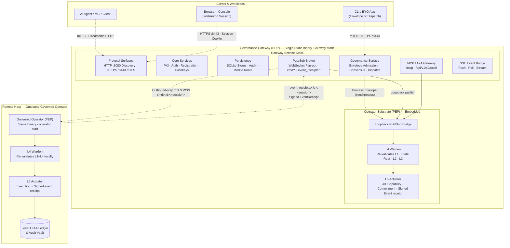

# Diagram: System Overview 50,000-Foot View

Provides the comprehensive 50,000-foot view of the platform. The single static `ztd` binary deploys into two primary architectural roles:

- **Governance Gateway (Policy Decision Point, PDP)**: Coordinates incoming agent intent, L1–L3 governance, platform PKI, WebSocket pub/sub brokering, and SSE delivery. Sits directly on top of an embedded Operator substrate in the same process when running in Gateway mode.
- **Governed Operator (Policy Execution Point, PEP)**: The execution substrate beneath all operations. Enforces L4 Warden pre-dispatch verification and L5 Actuator execution boundaries. Deploys embedded within the Gateway for local operations, or as an independent outbound daemon on sovereign remote nodes.

## Architecture Zoom Series

This diagram anchors the platform architecture zoom series:

1. **50k ft (This Document)**: Platform overview, dual-role single binary model, and Gateway/Operator relationship.
2. **Fleet Topology** ([graph-gateway-fleet-single-host-http-mtls.md](./graph-gateway-fleet-single-host-http-mtls.md)): Network port assignments, mTLS boundaries, and remote host deployments.
3. **Gateway Services** ([graph-gateway-services.md](./graph-gateway-services.md)): Internal Gateway service layers, dependency graphs, protocol endpoints, and in-process substrate layering.
4. **Operator Pipeline** ([graph-operator-pipeline-l1-l5.md](./graph-operator-pipeline-l1-l5.md)): Detailed five-layer governance interlock, L4 Warden verification, and L5 Actuator execution.
5. **Operator Lifecycle** ([graph-operator-lifecycle.md](./graph-operator-lifecycle.md)): State machine covering enrollment, connection, binding, liveness tracking, and termination.

## Key Architectural Invariants

- **Single Binary Architecture**: The single static binary (`ztd`) runs as Gateway (`ztd gw start --posture <posture>`) or Operator (`ztd operator start`).
- **Layered Substrate**: The Gateway is not an isolated service; it is an administrative service stack layered directly over the in-process Operator substrate. Local commands never traverse external network stacks.
- **Listener Isolation**: Remote Operators open **no inbound listening ports**, connecting strictly outbound to the Gateway via mTLS WebSockets.
- **Session-Scoped Channels**: Work is multiplexed across dedicated session channels (`cmd:<id>:<session>`, `event_receipts:<id>:<session>`), eliminating cross-tenant broadcast risks.
- **Local-First Audit Architecture (LFAA)**: Each executing Operator is the sole authority for its local audit database and state Merkle root. Gateway event receipt copies are verified mirrors.
