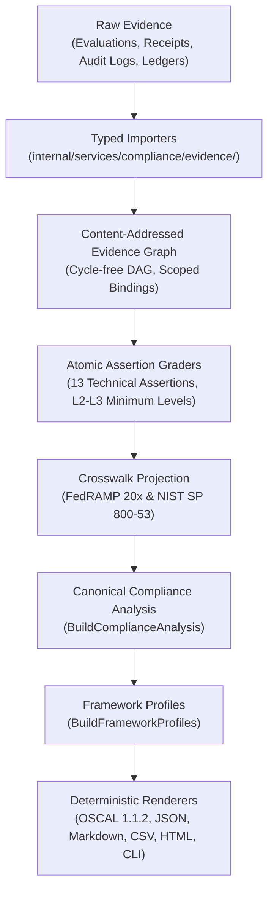

# Compliance Alignment

## Purpose and Claim Boundary

This document identifies the authoritative, machine-maintained sources for ztd compliance mappings and defines how cryptographically verified evidence translates into atomic assertion assessments, framework-control assessments, framework profiles, and rendered compliance reports.

ztd disclaims broad claims of external certification, accreditation, commercial authorization, legal compliance, or institutional maturity. Technical control satisfaction reports the deterministic outcome of declared evidence and verifier contracts for a single, immutable assessment scope and time window. A passing technical assertion does not satisfy customer-operated, organizational, procedural, or external assessor-dependent requirements. Missing or stale evidence resolves to the assertion's declared `missing_evidence_policy`, which is `unverifiable` or `customer_attestation_required`. Malformed, unsupported, or untrusted evidence fails closed rather than being inferred as passed or failed.

## Maintained Sources of Truth

| Source | Canonical Location | Description |
| :--- | :--- | :--- |
| **Atomic Assertions** | `protocol/constants/compliance/assertion-catalog.json` | Versioned, framework-neutral technical assertions, component scopes, responsibilities, grader references, evidence level thresholds, and passing rules. |
| **Framework Catalog** | `protocol/constants/compliance/framework-catalog.json` | Authoritative inventory of framework controls, responsibility classifications, source standards, and explicit support statuses. |
| **Reviewed Crosswalk** | `protocol/constants/compliance/fedramp-nist-crosswalk.json` | Content-addressed mappings from framework controls to atomic assertions, declaring mapping types, review timestamps, and reviewers. |
| **Protocol Contracts** | `protocol/proto/ztd/compliance/v1/compliance.proto` | Strongly typed Protobuf schemas defining assessment scopes, evidence nodes, assertion evaluations, framework profiles, and report manifests. |
| **FedRAMP KSI Catalog** | `docs/reference/ksi-catalog.json` | 31 machine-evaluable Key Security Indicator (KSI) definitions spanning ten operational categories under FedRAMP 20x. |
| **COSAiS Overlays** | `docs/reference/cosais-overlays.json` | Machine-readable AI security control overlay definitions, all in `draft` status. |

The assertion, framework, and crosswalk catalogs are compact, content-addressed documents with embedded version identifiers and SHA-256 digests. `protocol/constants/compliance/catalogs.go` embeds them into the binary. `LoadCanonicalCatalogs` in `internal/services/compliance/catalog/` verifies each digest and runs `ValidateCatalogSet`, which rejects duplicate IDs and invalid catalog semantics.

## Maintained Framework Scope

The platform reference catalogs define mappings for two primary frameworks:
- **FedRAMP 20x (CR26-2026-06-24)**: 31 Key Security Indicators (14 mapped to platform assertions, 17 unsupported).
- **NIST SP 800-53 Rev. 5**: 100 evaluated controls (20 mapped to platform assertions, 80 unsupported).

The framework catalog declares only `fedramp-20x` and `nist-sp-800-53`. No other framework (for example SOC 2, ISO/IEC 27001, HIPAA, PCI DSS, or GDPR) has a catalog in this repository, so none receives generated framework assessments. Relevant architectural capabilities are never presented as evaluated compliance outcomes without a corresponding reviewed crosswalk.

## The Proof-Backed Assessment Pipeline

The compliance engine decouples evidence collection, cryptographic verification, assertion grading, framework mapping, and multi-format rendering into a deterministic, seven-stage pipeline:



1. **Read-Only Ingestion**: Dedicated importers in `internal/services/compliance/evidence/` decode event receipts, persistence attestations, SQLite event records, commitment ledgers, ledger commit and state records, KSI history snapshots, build and configuration attestations, and operational export packages without modifying assessed runtime state. Evaluation runs are read from the eval run directories named by `--eval-run`.
2. **Evidence Graph Construction**: The evidence graph validates content-addressed hashes, resolves cross-references, rejects cyclic dependencies, and verifies that all artifacts bind to the declared `AssessmentScope`.
3. **Atomic Assertion Grading**: Registered, versioned graders evaluate evidence against the 13 catalog assertions, assigning achieved evidence levels based on reproducible cryptographic checks.
4. **Crosswalk Projection**: The engine maps assertion outcomes through the reviewed crosswalk, preserving mapping classifications (`supporting`, `partial`, `full`) without altering underlying assertion grades.
5. **Canonical Analysis Generation**: `BuildComplianceAnalysis` synthesizes evaluation outcomes, scope boundaries, gaps, findings, and remediation items into a unified record.
6. **Framework Profiling**: `BuildFrameworkProfiles` projects control outcomes into framework-specific profiles without re-grading evidence.
7. **Deterministic Multi-Format Rendering**: A shared renderer outputs identical analysis across JSON, CSV, OSCAL 1.1.2, Markdown, HTML, and terminal CLI views.

## Assessment Status Semantics

Compliance evaluation outcomes use unambiguous, machine-readable statuses:

| Status | Definition |
| :--- | :--- |
| **`satisfied`** | Cryptographically verified, scope-bound evidence satisfies the full passing rule defined by the assertion or control. |
| **`not_satisfied`** | Verified evidence demonstrates an explicit failure of the declared technical assertion rule. |
| **`not_applicable`** | The assertion is formally excluded by its declared component scope, applicable action classes, or applicable arms (`assertion-catalog.json`). |
| **`unverifiable`** | Required evidence is absent, stale, malformed, unsupported, or cryptographically invalid, and the assertion's `missing_evidence_policy` is `unverifiable`. The engine refuses to guess an outcome. |
| **`customer_attestation_required`** | The requirement demands organizational, policy, or operational evidence that only the customer can supply. |

Crosswalk mappings maintain `supporting`, `partial`, `full`, and `not_applicable` classifications. The framework grader derives control status only from `full` mappings. `supporting` and `partial` mappings record a limitation on the control assessment, and `not_applicable` mappings are excluded. A control with no `full` mapping resolves to `unverifiable`. The reviewed crosswalk currently declares only `supporting` mappings, so no framework control resolves to `satisfied` from it.

## Generating and Verifying Evidence

### Verify Persisted Evaluation Evidence

Validate imported evaluation runs as a content-addressed evidence graph. Eval runs are read from `data/eval/runs/<run-id>/` under the runtime tree. Set the shell variable `EVAL_RUN_ID` to the eval run ID to validate:

```bash
ztd compliance evidence-graph verify --eval-run "$EVAL_RUN_ID"
```

### Generate a Signed Compliance Report Bundle

Generate a signed, immutable compliance report bundle from an explicit assessment scope. Set these shell variables first: `SCOPE_FILE` to the assessment scope JSON file, `EVAL_RUN_ID` to the eval run ID, `OPERATIONAL_SOURCE_DIR` to the operational source directory, `REPORT_ID` to a new report identifier, `SIGNING_METADATA_FILE` to the signing metadata JSON file, `SIGNING_PRIVATE_KEY_FILE` to the hex-encoded signing private key file, and `EVIDENCE_TRUST_FILE` to the evidence trust JSON file:

```bash
ztd compliance report generate \
  --scope "$SCOPE_FILE" \
  --eval-run "$EVAL_RUN_ID" \
  --source "$OPERATIONAL_SOURCE_DIR" \
  --report-id "$REPORT_ID" \
  --profile restricted \
  --signing-metadata "$SIGNING_METADATA_FILE" \
  --signing-private-key "$SIGNING_PRIVATE_KEY_FILE" \
  --evidence-trust "$EVIDENCE_TRUST_FILE"
```

Generation defaults to the `restricted` profile. The `--profile public` flag is accepted only when every admitted evidence source is public.

The bundle is sealed at rest under `.ztd/reports/<report-id>/` with the runtime vault, because it carries the raw sources the verifier replays. To disclose it, export the plaintext copy to a new directory outside the runtime root. Set `EXPORT_DIR` to a directory outside the runtime root that does not exist yet:

```bash
ztd compliance report export --report-id "$REPORT_ID" --out "$EXPORT_DIR"
```

### Offline Independent Verification

Verify an exported bundle against trust policies that are supplied from outside the bundle. Set `REPORT_TRUST_FILE` to the assessed report trust JSON file and `ASSESSED_EVIDENCE_TRUST_FILE` to the assessed evidence trust JSON file, both kept outside the bundle:

```bash
ztd compliance report verify "$EXPORT_DIR/manifest.json" \
  --trust-policy "$REPORT_TRUST_FILE" \
  --evidence-trust "$ASSESSED_EVIDENCE_TRUST_FILE"
```

`--evidence-trust` is required when the bundle represents signed source evidence; the verifier rejects it when it is missing. `--trust-policy` is always required.

Verification checks:
- Report trust (`--trust-policy`) and evidence signer trust (`--evidence-trust`) are distinct inputs and must lie outside the bundle root.
- Directory inventories, protected payload hashes, checksum roots, and Ed25519 signatures.
- Registered source verification reports and decision replay against the signed analysis.
- Recorded rendered output formats against the signed analysis.

## Responsibility Boundaries

Catalog validation accepts five responsibility values: `platform`, `customer`, `shared`, `inherited`, and `assessor` (`internal/services/compliance/catalog/validation.go`). The current catalogs use `platform` and `shared` for assertions, `shared` and `customer` for framework controls, and `shared` for crosswalk mappings. `inherited` and `assessor` are accepted values with no current assignments.

## Procedures for Interpreting Compliance Alignment

1. Consult `protocol/constants/compliance/framework-catalog.json` to confirm whether a control is mapped, planned, or unsupported.
2. Review `protocol/constants/compliance/fedramp-nist-crosswalk.json` to identify the linked atomic assertions and mapping types.
3. Inspect the generated framework profile or OSCAL 1.1.2 assessment results for the target `AssessmentScope`.
4. Trace assertion outcomes back to the content-addressed evidence nodes in the canonical analysis.
5. Export the bundle with `ztd compliance report export`, then replay offline verification using `ztd compliance report verify` to validate all cryptographic signatures and checksum roots.

## Related Documentation

- [Proof-Backed Compliance Evidence](compliance-evidence.md): Atomic assertion specifications, evidence levels, and evidence graph internals.
- [FIPS 140-3 Module Linkage and Scope](fips140-3.md): Cryptographic module boundary, pure-Go linkage, and runtime verification.
- [Governance Architecture](../architecture/governance.md): Five-layer governance framework and posture policies.
- [Authentication Architecture](../architecture/auth.md): Identity enrollment, mTLS, and passkey authentication.
- [Storage Architecture](../architecture/storage.md): Local-First Events Architecture, the Local-First Events Store, and commitment ledgers.
- [Protocol Specification](../../protocol/docs/spec.md): Canonical wire contracts and protobuf schemas.
- [Evaluation Architecture](../architecture/evals.md): Evaluation campaigns, scoring engines, and telemetry capture.
- [Release Process](../devs/release_process.md): Release preparation, smoke tests, and compliance artifact publishing.
- [Glossary](glossary.md): Canonical platform terminology and concept definitions.
