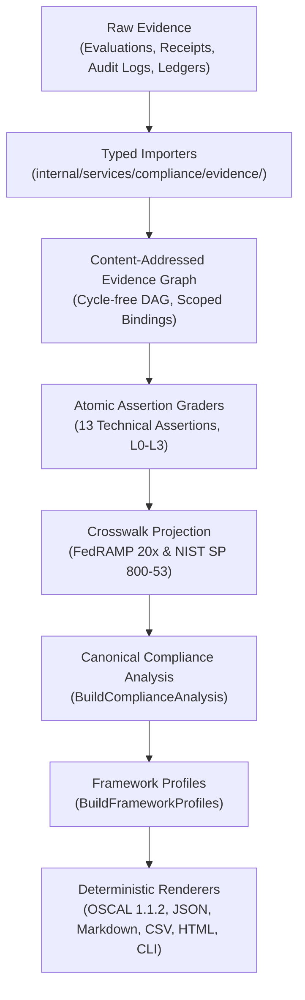

# Compliance Alignment

## Purpose and Claim Boundary

This document identifies the authoritative, machine-maintained sources for ztd compliance mappings and defines how cryptographically verified evidence translates into atomic assertion assessments, framework-control assessments, framework profiles, and rendered compliance reports.

ztd disclaims broad claims of external certification, accreditation, commercial authorization, legal compliance, or institutional maturity. Technical control satisfaction reports the deterministic outcome of declared evidence and verifier contracts for a single, immutable assessment scope and time window. A passing technical assertion does not satisfy customer-operated, organizational, procedural, or external assessor-dependent requirements. Missing, stale, malformed, unsupported, or untrusted evidence fails closed and is reported as `unverifiable` rather than being inferred as passed or failed.

## Maintained Sources of Truth

| Source | Canonical Location | Description |
| :--- | :--- | :--- |
| **Atomic Assertions** | `protocol/constants/compliance/assertion-catalog.json` | Versioned, framework-neutral technical assertions, component scopes, responsibilities, grader references, evidence level thresholds, and passing rules. |
| **Framework Catalog** | `protocol/constants/compliance/framework-catalog.json` | Authoritative inventory of framework controls, responsibility classifications, source standards, and explicit support statuses. |
| **Reviewed Crosswalk** | `protocol/constants/compliance/fedramp-nist-crosswalk.json` | Cryptographically signed mappings from framework controls to atomic assertions, declaring mapping types, review timestamps, and reviewers. |
| **Protocol Contracts** | `protocol/proto/ztd/compliance/v1/compliance.proto` | Strongly typed Protobuf schemas defining assessment scopes, evidence nodes, assertion evaluations, framework profiles, and report manifests. |
| **FedRAMP KSI Catalog** | `docs/reference/ksi-catalog.json` | 31 machine-evaluable Key Security Indicator (KSI) definitions spanning ten operational categories under FedRAMP 20x. |
| **COSAiS Overlays** | `docs/reference/cosais-overlays.json` | Machine-readable AI security control overlays mapped against platform KSI definitions. |

The JSON catalogs are compact, content-addressed documents with embedded version identifiers and SHA-256 digests. Platform catalog loaders in `internal/services/compliance/catalog/` validate digests and schemas at startup, rejecting duplicate IDs, malformed versions, and dangling references.

## Maintained Framework Scope

The platform reference catalogs define mappings for two primary frameworks:
- **FedRAMP 20x (CR26-2026-06-24)**: 31 Key Security Indicators (14 mapped to platform assertions, 17 unsupported or customer-operated).
- **NIST SP 800-53 Rev. 5**: 100 evaluated controls (20 mapped to platform assertions, 80 unsupported or customer-operated).

Frameworks lacking reviewed, canonical JSON crosswalks in this repository (e.g. SOC 2, ISO/IEC 27001, HIPAA, PCI DSS, GDPR) do not receive generated framework assessments. Relevant architectural capabilities are never presented as evaluated compliance outcomes without a corresponding reviewed crosswalk.

## The Proof-Backed Assessment Pipeline

The compliance engine decouples evidence collection, cryptographic verification, assertion grading, framework mapping, and multi-format rendering into a deterministic, seven-stage pipeline:



1. **Read-Only Ingestion**: Dedicated importers decode persisted evaluation campaigns, action receipts, persistence attestations, SQLite audit records, commitment ledgers, git file ledgers, KSI records, and build metadata without modifying assessed runtime state.
2. **Evidence Graph Construction**: The evidence graph validates content-addressed hashes, resolves cross-references, rejects cyclic dependencies, and verifies that all artifacts bind to the declared `AssessmentScope`.
3. **Atomic Assertion Grading**: Registered, versioned graders evaluate evidence against the 13 catalog assertions, assigning achieved evidence levels based on reproducible cryptographic checks.
4. **Crosswalk Projection**: The engine maps assertion outcomes through the reviewed crosswalk, preserving mapping classifications (`supporting`, `partial`, `full`) without altering underlying assertion grades.
5. **Canonical Analysis Generation**: `BuildComplianceAnalysis` synthesizes evaluation outcomes, scope boundaries, gaps, findings, and remediation items into a unified record.
6. **Framework Profiling**: `BuildFrameworkProfiles` projects control outcomes into framework-specific profiles without re-grading evidence.
7. **Deterministic Multi-Format Rendering**: A shared renderer outputs identical analysis across JSON, CSV, OSCAL 1.1.2, Markdown, HTML, and terminal CLI views.

## Assessment Status Semantics

Compliance evaluation outcomes use unambiguous, machine-readable statuses:

| Status | Definition |
| :--- | :--- |
| **`satisfied`** | Cryptographically verified, scope-bound evidence satisfies the full passing rule defined by the assertion or control. |
| **`not_satisfied`** | Verified evidence demonstrates an explicit failure of the declared technical assertion rule. |
| **`not_applicable`** | The assertion or control is formally excluded by component scope, action class, or deployment mode. |
| **`unverifiable`** | Required evidence is absent, stale, malformed, unsupported, or cryptographically invalid. The engine refuses to guess an outcome. |
| **`customer_attestation_required`** | The requirement demands organizational, policy, or operational evidence that only the customer can supply. |

Crosswalk mappings maintain `supporting`, `partial`, `full`, and `not_applicable` classifications. A `supporting` technical mapping cannot be aggregated into a complete control satisfaction claim without external customer or assessor evidence.

## Generating and Verifying Evidence

### Verify Persisted Evaluation Evidence

Validate imported evaluation runs as a content-addressed evidence graph:

```bash
ztd compliance evidence-graph verify --eval-run <eval-run-id>
```

### Generate a Signed Compliance Report Bundle

Generate a signed, immutable compliance report bundle from an explicit assessment scope:

```bash
ztd compliance report generate \
  --scope <assessment-scope.json> \
  --eval-run <eval-run-id> \
  --source <operational-source-dir> \
  --report-id <report-id> \
  --profile restricted \
  --signing-metadata <signing-metadata.json> \
  --signing-private-key <signing-private-key.hex> \
  --evidence-trust <evidence-trust.json>
```

Generation defaults to the `restricted` profile. The `--profile public` flag is accepted only when all admitted evidence sources are explicitly marked public-safe.

The bundle is sealed at rest under `.ztd/reports/<report-id>/` with the runtime vault, because it carries the raw sources the verifier replays. To disclose it, export the plaintext copy to a new directory outside the runtime root:

```bash
ztd compliance report export --report-id <report-id> --out <new-dir>
```

### Offline Independent Verification

Verify an exported bundle offline without network access or ambient runtime credentials:

```bash
ztd compliance report verify <new-dir>/manifest.json \
  --trust-policy <assessed-report-trust.json> \
  --evidence-trust <assessed-evidence-trust.json>
```

Verification enforces complete offline independence:
- Report trust (`--trust-policy`) and evidence signer trust (`--evidence-trust`) are distinct, external inputs outside the bundle.
- Verifies directory inventories, protected payload hashes, checksum roots, and Ed25519 signatures.
- Re-executes every registered source verifier, comparing reproduced evidence with signed analysis.
- Re-renders all output formats to confirm bit-for-bit rendering determinism.

## Responsibility Boundaries

The framework catalog enforces clear separation of operational responsibilities:

- **Platform**: Technical behavior operated by `ztd` and verified via local cryptographic evidence.
- **Customer**: Workforce management, organizational policy, physical security, and business continuity operated by the deploying organization.
- **Shared**: Controls requiring joint satisfaction, where `ztd` satisfies the technical portion and the customer satisfies organizational policies.
- **Inherited**: Controls satisfied by underlying infrastructure or cloud service providers.
- **Assessor**: Formal assessment, audit, or attestation determinations rendered by an independent third-party auditor.

## Procedures for Interpreting Compliance Alignment

1. Consult `protocol/constants/compliance/framework-catalog.json` to confirm whether a control is mapped, planned, or unsupported.
2. Review `protocol/constants/compliance/fedramp-nist-crosswalk.json` to identify the linked atomic assertions and mapping types.
3. Inspect the generated framework profile or OSCAL 1.1.2 assessment results for the target `AssessmentScope`.
4. Trace assertion outcomes back to the content-addressed evidence nodes in the canonical analysis.
5. Export the bundle with `ztd compliance report export`, then replay offline verification using `ztd compliance report verify` to validate all cryptographic signatures and checksum roots.

## Related Documentation

- [Proof-Backed Compliance Evidence](compliance-evidence.md): Atomic assertion specifications, evidence levels (L0–L5), and evidence graph internals.
- [FIPS 140-3 Module Linkage and Scope](fips140-3.md): Cryptographic module boundary, pure-Go linkage, and runtime verification.
- [Governance Architecture](../architecture/governance.md): Five-layer governance framework and posture policies.
- [Authentication Architecture](../architecture/auth.md): Identity enrollment, mTLS, and passkey authentication.
- [Storage Architecture](../architecture/storage.md): Local-First Audit Architecture, audit stores, and commitment ledgers.
- [Protocol Specification](../../protocol/docs/spec.md): Canonical wire contracts and protobuf schemas.
- [Evaluation Architecture](../architecture/evals.md): Evaluation campaigns, scoring engines, and telemetry capture.
- [Release Process](../devs/release_process.md): Release preparation, smoke tests, and compliance artifact publishing.
- [Glossary](glossary.md): Canonical platform terminology and concept definitions.
