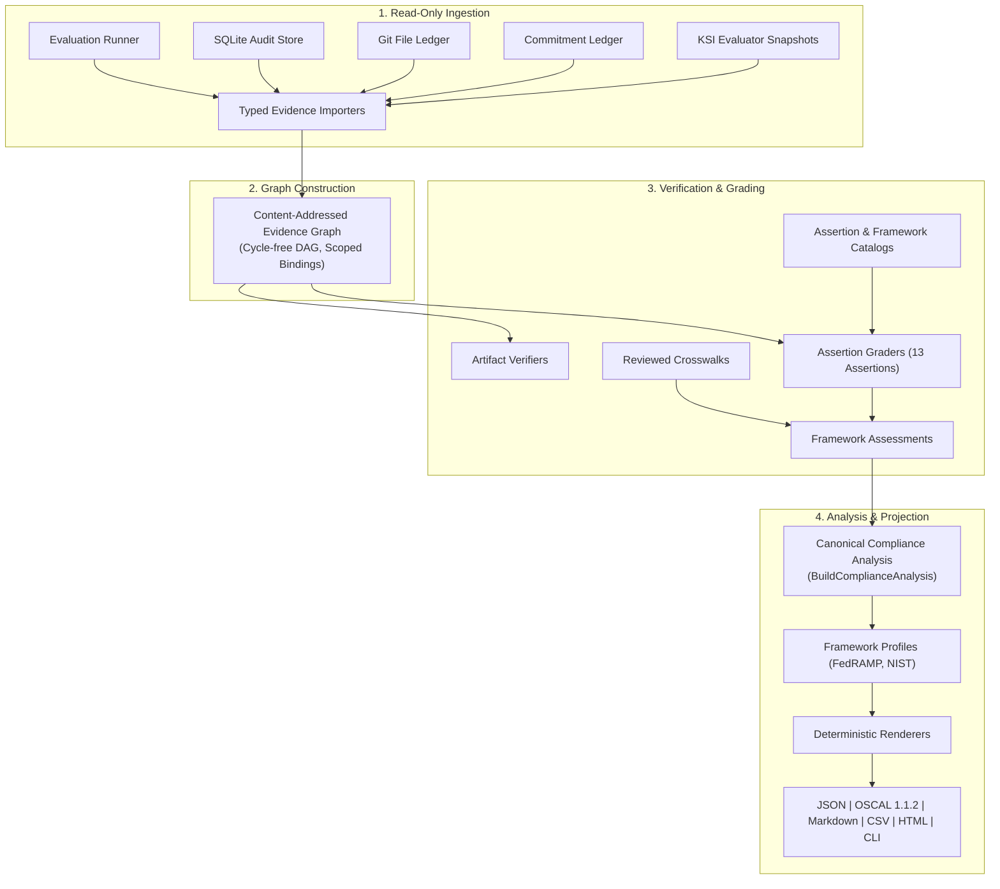

# Proof-Backed Compliance Evidence

## Purpose

This document provides the technical evidence specification for the [Compliance Alignment](compliance-alignment.md) framework. It documents the proof-backed compliance engine in `ztd`, which binds reviewed regulatory controls to immutable, cryptographically verifiable evidence rather than subjective prose attestations.

The compliance engine resolves five foundational inquiries for every evaluated control:

1. **Exact Technical Assertion**: What discrete, machine-testable assertion does the platform evaluate?
2. **Framework Mapping**: Which regulatory standards map to that assertion under specific framework revisions?
3. **Immutable Evidence**: What cryptographic artifacts (event receipts, commit hashes, state Merkle roots, execution logs) prove or disprove the assertion for the declared assessment window?
4. **Independent Reproducibility**: Which versioned verifiers and graders evaluated the evidence, and can an air-gapped verifier independently reproduce the identical outcome?
5. **Operational Scope and Boundaries**: Which controls remain outside platform scope or mandate customer-operated evidence?

## Claim Boundaries

`ztd` explicitly disclaims claims of commercial certification, government accreditation, legal compliance, or independent auditor endorsement. This platform provides the technical evidence pipeline that records and verifies control operation at the software and host boundary.

The pipeline maintains strict separation between platform-operated technical behavior and customer-operated organizational processes:
- Platform tests and evaluation scenarios prove technical control operation for an explicit point-in-time run and scope; they do not establish organizational compliance across an extended operational period.
- Customer, shared, inherited, and external assessor responsibilities are represented explicitly in catalog crosswalks and never inherit passing status from platform evidence alone.
- Missing or stale evidence records the assertion's `missing_evidence_policy` outcome (`unverifiable` or `customer_attestation_required`) rather than synthesizing an assumed pass or fail. Malformed or untrusted source evidence fails evidence graph validation.

## Compliance Engine Architecture

The reporting pipeline separates evidence ingestion, validation, grading, analysis, and multi-format rendering into decoupled subsystems:



### Protected Assessment Scope

Every compliance evaluation binds to an immutable, canonical `AssessmentScope` document (`ztd.compliance.v1.AssessmentScope`). The scope defines:
- **Product and Build Identity**: Product version (from `VERSION`), source revision (`git` commit HEAD), and build identity SHA-256 digest (defaults to the assessed binary digest).
- **Environment Context**: Image digests, component inventory, network topology hash, and cryptographic mode.
- **Evidence Time Window**: Protobuf timestamps `assessment_window_start` and `assessment_window_end` bounding the evaluation period, and `assessment_as_of`, which must fall inside that window.
- **Policy Configuration**: Active governance posture (`active_posture`), doctrine bundle SHA-256 digests, and consensus policy hashes.
- **Admitted Sources**: Content-addressed manifests declaring all evaluation runs, audit databases, and operational stores admitted into the assessment.

Context that cannot be captured as a content-addressed artifact (e.g. physical perimeter security) is recorded as a typed `UnavailableAssessmentContext` record with an explicit rationale. The generator reflects these declarations as `assessment_context_unavailable` diagnostics, bounding the scope's claims.

`ztd compliance report generate` fails closed: a scope with a missing or invalid assessment window is rejected, and an invalid evidence graph returns an error. In both cases no report bundle is persisted.

## Atomic Control Assertions

The assertion catalog (`protocol/constants/compliance/assertion-catalog.json`, catalog `ztd-control-assertions` v2.1.0, declared SHA-256 `3b9a74f1add9511540ce0eaa908de9fa6a2f66f8cf64c28f2ab6471c2fa76b00`) defines 13 atomic, framework-neutral assertions:

| Assertion ID | Assertion Title | Version | Component Scope | Minimum Evidence Level | Core Operational Verification |
| :--- | :--- | :--- | :--- | :--- | :--- |
| **`ZTD-GOV-ALLOW-001`** | Governed Allow Outcome | 2.0.0 | `gateway`, `operator` | L3 (Demonstrated) | Confirms that valid mutations clearing L1–L5 execute and emit terminal event receipts. |
| **`ZTD-GOV-BLOCK-001`** | Governed Block Outcome | 2.0.0 | `gateway`, `operator` | L3 (Demonstrated) | Confirms that prohibited mutations fail closed at the expected layer and that the prohibited terminal state is independently observed absent. |
| **`ZTD-AU-EVENT_RECEIPT-001`** | Event receipt Integrity | 2.0.0 | `gateway`, `operator` | L2 (Evaluated) | Validates Ed25519 signatures on `EventReceipt` records bound to action, identity, transaction, and state-root fields. |
| **`ZTD-AU-PERSIST-001`** | Event receipt Persistence | 2.0.0 | `gateway`, `operator` | L2 (Evaluated) | Validates atomic SQLite audit persistence and signed `EventReceiptPersistenceAttestation`. |
| **`ZTD-AU-CHAIN-001`** | Protocol Chain Integrity | 2.0.0 | `gateway`, `operator` | L2 (Evaluated) | Validates unbroken cryptographic hash chains across sequential deterministic stage events. |
| **`ZTD-AU-COMMIT-001`** | Commitment Integrity | 2.0.0 | `gateway`, `operator` | L2 (Evaluated) | Validates signatures and canonical bindings, including the declared predecessor hash, for `commitment_ledger` records. |
| **`ZTD-CM-STATE-001`** | Independently Observed State | 2.1.0 | `gateway`, `operator` | L3 (Demonstrated) | Verifies a subject-bound independent observation and deterministic measurement of the declared terminal state for governed configuration or file mutations. |
| **`ZTD-DLP-DETECT-001`** | Sensitive Data Detection | 2.0.0 | `gateway` | L2 (Evaluated) | Measures scanner precision and recall against declared synthetic sensitive occurrences in the supported scanner population. |
| **`ZTD-DLP-BOUNDARY-001`** | Model Boundary Leakage | 2.1.0 | `gateway`, `operator` | L2 (Evaluated) | Measures the raw occurrence rate of declared synthetic sensitive values in the structured model-boundary population; masked `{{UEI_N}}` tokens replace them at the boundary. |
| **`ZTD-DLP-REHYDRATE-001`** | Local Rehydration | 2.1.0 | `gateway`, `operator` | L2 (Evaluated) | Verifies exact, host-local token rehydration at L5 Actuator immediately prior to dispatch. |
| **`ZTD-IA-MTLS-001`** | Workload mTLS | 2.0.0 | `gateway`, `operator` | L3 (Demonstrated) | Verifies assessed workload identity evidence and a reproduced measurement that unauthenticated transport is rejected. The Gateway enforces TLS 1.3 with SPIFFE URI SAN identities. |
| **`ZTD-IA-NOTARY-001`** | Notary Authorization | 2.0.0 | `gateway`, `operator` | L2 (Evaluated) | Verifies that notary-required mutations carry an independently verified human authorization proof (WebAuthn assertion or CLI approval proof) bound to the exact transaction and active posture. |
| **`ZTD-CRYPTO-FIPS-001`** | Declared Cryptographic Mode | 2.0.0 | `gateway`, `operator` | L2 (Evaluated) | Verifies build provenance and runtime evidence that the assessed binary links the declared approved cryptographic module, Go Cryptographic Module v1.0.0. |

## Evidence Level Hierarchy

Evidence strength is categorized according to an explicit, non-inflatable hierarchy:

| Level | Classification | Verification Criteria |
| :--- | :--- | :--- |
| **L0** | Documented | Architecture documentation, policy manuals, or schema specifications describe the control. |
| **L1** | Implemented | Source code inspection and unit test assertions confirm that the control logic exists. |
| **L2** | Deterministically Evaluated | A registered, versioned grader verifies cryptographic signatures, hashes, and schemas against raw evidence. |
| **L3** | Demonstrated | An end-to-end execution scenario passes with verified event receipts and independent terminal-state observation. |
| **L4** | Continuously Evidenced | Historical evidence collectors prove control operation across recurring cycles within the assessment window. |
| **L5** | Externally Attested | An accredited, independent third-party assessor inspects evidence and issues a formal attestation. |

The automated `ztd` platform pipeline produces evidence up to **L3 (Demonstrated)**. L4 requires recurring historical effectiveness collection, and L5 requires external third-party assessment.

## Framework Crosswalk Mappings

The canonical crosswalk (`protocol/constants/compliance/fedramp-nist-crosswalk.json`, declared SHA-256 `91edf4217e8c3f23ddbd4cc2cada9a767b10a828638995abb5a8eb3c3c33959a`) maps the 13 atomic assertions to external regulatory controls:

| Framework | Revision | Total Controls | Mapped Controls | Unsupported Controls | Reviewed Mappings |
| :--- | :--- | :--- | :--- | :--- | :--- |
| **FedRAMP 20x** | CR26-2026-06-24 | 31 KSIs | 14 | 17 | 30 supporting mappings |
| **NIST SP 800-53** | Rev. 5 | 100 controls | 20 | 80 | 30 supporting mappings |
| **Total** | | **131** | **34** | **97** | **60 supporting mappings** |

Each framework control in `protocol/constants/compliance/framework-catalog.json` contains explicit `support_status` (`mapped` or `unsupported`) and `support_rationale` fields. Customer responsibilities are declared explicitly; unsupported controls are never omitted or masked.

## Platform Capabilities and Operational Boundaries

The compliance engine provides:
- **Canonical Compliance Analysis**: Deterministic cross-framework analysis generated via `BuildComplianceAnalysis`.
- **Signed Report Bundles**: Content-addressed bundle directories containing signed manifests, protected raw evidence, and multi-format projections. A generated bundle is sealed at rest under `.ztd/reports/<report-id>/` with the runtime vault; `ztd compliance report export` writes the plaintext copy an owner chooses to disclose.
- **Offline Independent Verification**: Complete verification of bundles without network connectivity or ambient credentials.
- **OSCAL 1.1.2 Projections**: Full generation of NIST OSCAL 1.1.2 assessment results matching official schemas.

The following activities remain external to the automated platform pipeline:
- **Continuous Historical Evidence (L4)**: Recurring historical evidence collection across long assessment intervals is operated by the customer's monitoring infrastructure.
- **External Attestation (L5)**: Formal audit certifications must be conducted and signed by qualified independent assessors.
- **Additional Framework Crosswalks**: Frameworks beyond FedRAMP 20x and NIST SP 800-53 Rev. 5 (such as SOC 2, ISO 27001, and HIPAA) require authoring and reviewing corresponding JSON crosswalks.

## Offline Trust and Replay Contract

Offline verification (`ztd compliance report verify`) runs on an exported bundle and operates with strict cryptographic independence:
- **Decoupled Trust Policies**: Report-signing trust (`--trust-policy`) and evidence-signer trust (`--evidence-trust`) are provided as external JSON files. In-bundle trust definitions are rejected.
- **Deterministic Replay**: The verifier reads raw source bodies from the bundle, re-executes all registered importers, re-grades assertion rules, and verifies that the generated analysis matches the signed analysis record.
- **Renderer Reproduction**: The verifier re-executes the rendering engines (JSON, OSCAL, Markdown, HTML, CSV, CLI) to confirm bit-for-bit rendering parity.
- **Fail-Closed Semantics**: Any missing artifact, signature mismatch, revoked key, or scope variance immediately terminates verification with a non-zero exit code.
- **Sealed at Rest, Exported to Disclose**: A bundle carries the raw sources the verifier replays, including decrypted evaluation traces. `generate` therefore persists it through the evidence file service, sealed with the runtime vault under the `ztd-compliance-report-v1` associated-data label, and refuses a file service that does not seal. `export` is the only path that writes it in the clear: the destination must not exist and must lie outside the runtime root, and every body is checked against its descriptor before it is written.

## Compliance CLI Reference

The `ztd compliance` command suite manages the compliance lifecycle. Run `./ztd compliance <command> --help` for the authoritative flag set of each command. The synopsis below is a syntax reference, not a copy-paste script; angle-bracket values stand for operator-supplied inputs:

```text
# Evaluate FedRAMP Key Security Indicators (KSIs)
ztd compliance ksi \
  --class C \
  --scope-id <scope-id> \
  --run-id <run-id> \
  --assertion-assessment-id <id>... \
  --evidence-window-start-unix-ms <start-ms> \
  --evidence-window-end-unix-ms <end-ms>

# Inspect historical KSI evaluation records
ztd compliance ksi-history --ksi <ksi-id>

# Validate AI security control overlays
ztd compliance overlay --overlay-dir <path-to-overlays>

# Validate imported evaluation evidence as a content-addressed graph
ztd compliance evidence-graph verify --eval-run <run-id>

# Export bounded operational evidence from local SQLite databases
ztd compliance evidence export --scope <scope.json> --out <dir>

# Generate an immutable, signed compliance report bundle
ztd compliance report generate \
  --scope <scope.json> \
  --eval-run <run-id> \
  --source <exported-source-dir> \
  --report-id <report-id> \
  --profile restricted \
  --signing-metadata <signing-metadata.json> \
  --signing-private-key <signing-key.hex> \
  --evidence-trust <evidence-trust.json>

# Write the sealed bundle in the clear, outside the runtime root, to disclose it
ztd compliance report export --report-id <report-id> --out <new-dir>

# Independently verify an exported compliance report bundle offline
ztd compliance report verify <new-dir>/manifest.json \
  --trust-policy <report-trust-policy.json> \
  --evidence-trust <evidence-trust-policy.json>

# Project verified release evidence into public documentation
ztd compliance release-evidence <new-dir>/manifest.json \
  --trust-policy <report-trust-policy.json> \
  --evidence-trust <evidence-trust-policy.json> \
  --out <release-docs-dir>

# Execute the complete automated release compliance preparation flow
ztd compliance release-prepare --new-key
```

## Evidence Repositories and Source Verification

### Canonical JSON Catalogs

| Catalog Surface | Repository Location | Version & Identity |
| :--- | :--- | :--- |
| **Assertion Catalog** | `protocol/constants/compliance/assertion-catalog.json` | `ztd-control-assertions` v2.1.0 |
| **Framework Catalog** | `protocol/constants/compliance/framework-catalog.json` | FedRAMP 20x CR26, NIST SP 800-53 rev5 |
| **Crosswalk Catalog** | `protocol/constants/compliance/fedramp-nist-crosswalk.json` | 60 supporting mappings |
| **KSI Catalog** | `docs/reference/ksi-catalog.json` | 31 FedRAMP 20x KSIs |
| **COSAiS Overlays** | `docs/reference/cosais-overlays.json` | Draft AI control overlays |

### Implementation Services

| Subsystem | Directory Location | Core Architectural Function |
| :--- | :--- | :--- |
| **Catalog Services** | `internal/services/compliance/catalog/` | Digest-verified catalog loading, schema validation, and crosswalk indexing. |
| **Evidence Processing** | `internal/services/compliance/evidence/` | Importers, graph construction, cryptographic verifiers, and assertion graders. |
| **Reporting Engine** | `internal/services/compliance/report/` | Bundle packaging, manifest signing, offline verification, and multi-format rendering. |
| **OSCAL Generation** | `internal/services/compliance/oscal.go` | Canonical projection of compliance analysis into NIST OSCAL 1.1.2 JSON models. |
| **KSI Evaluation** | `internal/services/compliance/ksi_evaluator.go` | Automated evaluation of FedRAMP Key Security Indicators. |

## Related Documentation

- [Compliance Alignment](compliance-alignment.md): High-level framework mappings, status semantics, and responsibility matrices.
- [FIPS 140-3 Module Linkage and Scope](fips140-3.md): Cryptographic module boundary, pure-Go linkage, and runtime verification.
- [Governance Architecture](../architecture/governance.md): Five-layer governance framework and posture policies.
- [Storage Architecture](../architecture/storage.md): Local-First Audit Architecture, audit stores, and commitment ledgers.
- [Protocol Specification](../../protocol/docs/spec.md): Canonical wire contracts and protobuf schemas.
- [Evaluation Architecture](../architecture/evals.md): Evaluation campaigns, scoring engines, and telemetry capture.
- [Release Process](../devs/release_process.md): Release preparation, smoke tests, and compliance artifact publishing.
- [Glossary](glossary.md): Canonical platform terminology and concept definitions.
